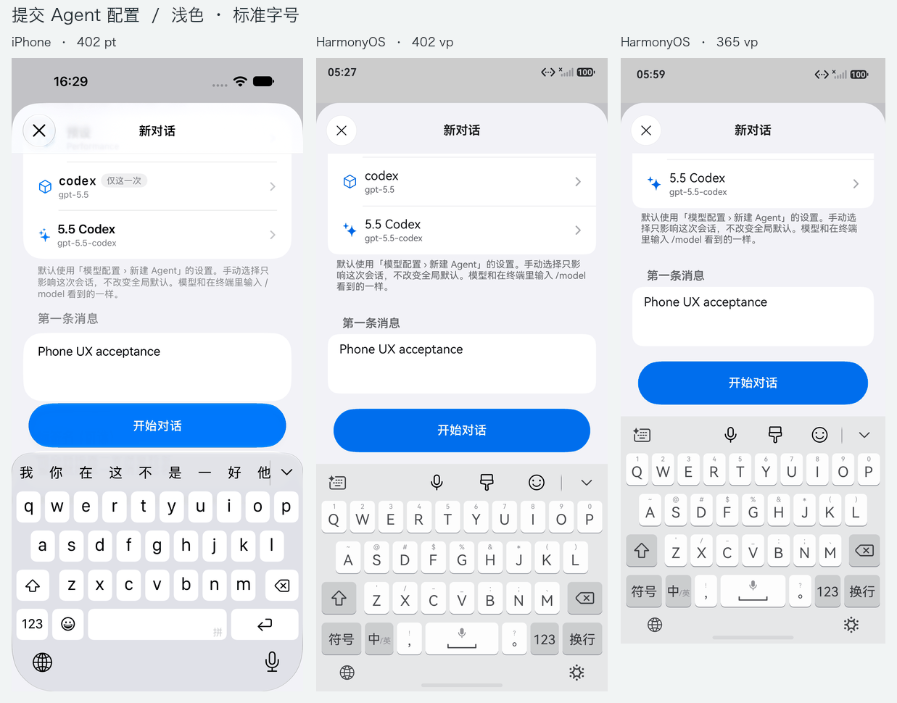
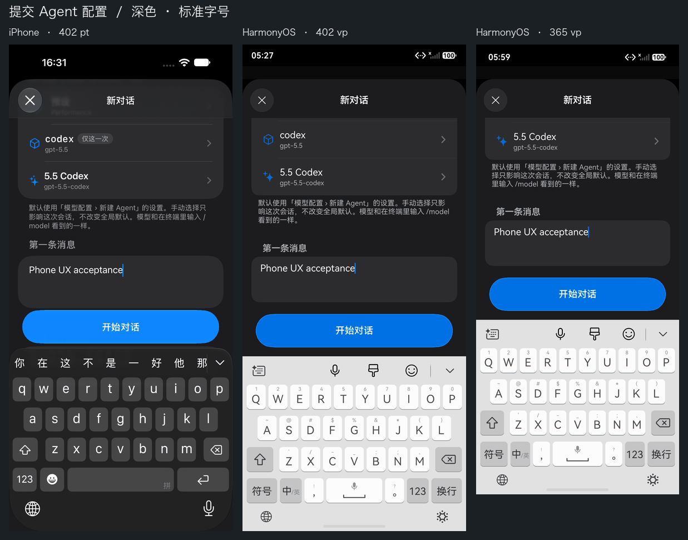
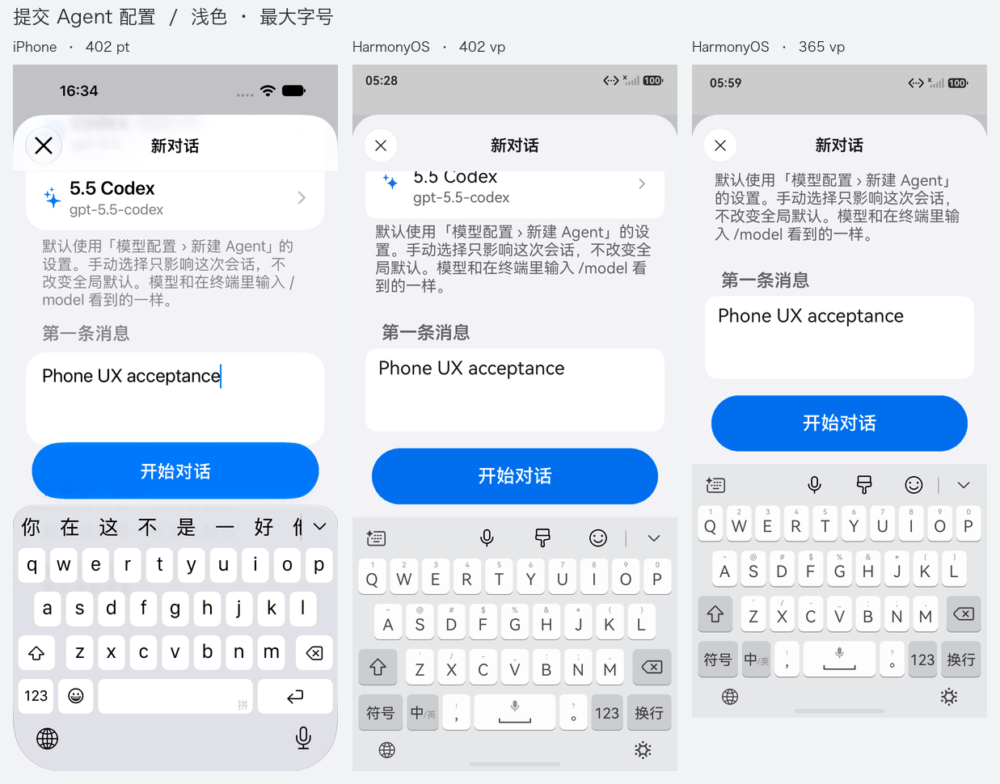

# 提交 Agent 配置 · Agent ready to start

[返回全部页面 · All pages](../README.md)

核对工作目录、启动器、模型和首条提示。
Enter the first message and inspect the start action above the keyboard.

Three independent native captures, left to right: iPhone 402 pt, HarmonyOS 402 vp, HarmonyOS 365 vp. The complete screen, including system bars, is visible.

[Download all original screenshots and accessibility trees for this page](../originals/start-ready.zip?raw=1) · [Source and capture method](../SOURCES.md)

Original archive SHA-256: d84cf5c521a5916686eacb6486a4bfd37d76dcde312eff3769547f2d338969c8

## 浅色 · 标准字号

| Device | Pixels | Captured at | PNG digest | Hierarchy digest |
| --- | --- | --- | --- | --- |
| iPhone 402 pt | 1206 × 2622 | 2026-11-23T08:29:19.191+00:00 | 02a288972652f19f | 7c01a5c1f72bdc5e |
| HarmonyOS 402 vp | 1206 × 2622 | 2026-11-23T17:27:34+08:00 | 1691ab9bb1c0b811 | eccc860271c14b44 |
| HarmonyOS 365 vp | 1280 × 2832 | 2026-11-23T17:59:27+08:00 | 5408cd0d0696fff7 | b4456f6a66b2a502 |

## 深色 · 标准字号

| Device | Pixels | Captured at | PNG digest | Hierarchy digest |
| --- | --- | --- | --- | --- |
| iPhone 402 pt | 1206 × 2622 | 2026-11-23T08:31:47.962+00:00 | 598d3657a64fbfd8 | c678b96904a410c0 |
| HarmonyOS 402 vp | 1206 × 2622 | 2026-11-23T17:27:50+08:00 | f66824cfc4de8e0f | d5facad534fc7803 |
| HarmonyOS 365 vp | 1280 × 2832 | 2026-11-23T17:59:42+08:00 | 778c62885bf974ef | 4fc79444cbed373b |

## 浅色 · 最大字号

| Device | Pixels | Captured at | PNG digest | Hierarchy digest |
| --- | --- | --- | --- | --- |
| iPhone 402 pt | 1206 × 2622 | 2026-11-23T08:34:27.128+00:00 | d6a23f680f289b72 | ba706f6a69bd31af |
| HarmonyOS 402 vp | 1206 × 2622 | 2026-11-23T17:28:06+08:00 | d6a7d31ed66ed325 | 5f672a4cb5d49dfd |
| HarmonyOS 365 vp | 1280 × 2832 | 2026-11-23T17:59:57+08:00 | 2f4bb110a431bd3c | 6e06acfb41ec15ec |

Full 64-character digests and ZIP entry paths are under this page in the [manifest](../manifest.json).

[← 选择模型](models.md)
[Agents 列表 →](agents.md)
