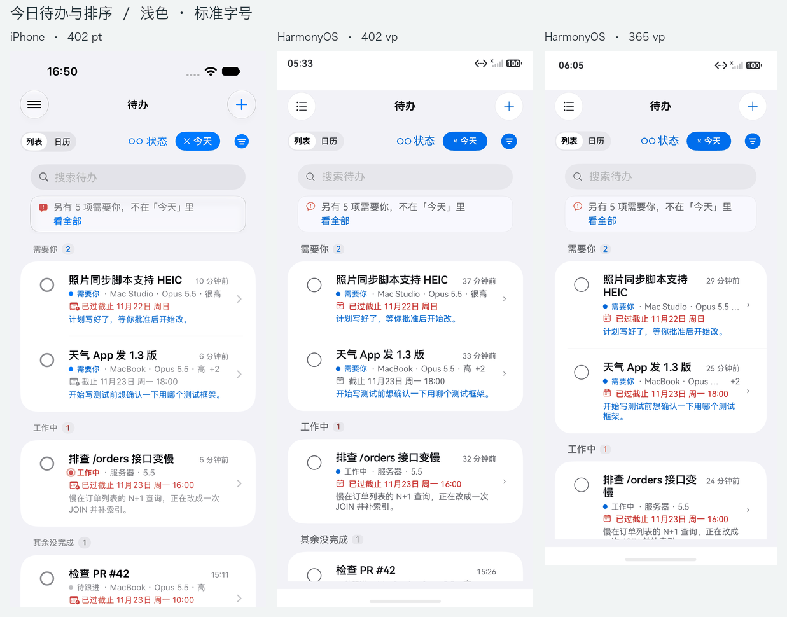
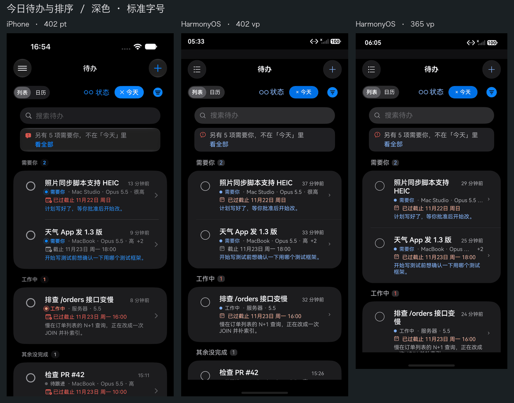
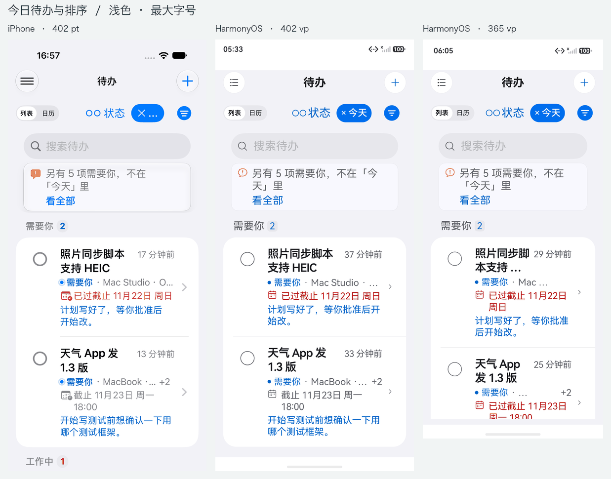

# 今日待办与排序 · Due today and priority

[返回全部页面 · All pages](../README.md)

筛选今天的待办，并查看优先级排序。

Three independent native captures, left to right: iPhone 402 pt, HarmonyOS 402 vp, HarmonyOS 365 vp. The complete screen, including system bars, is visible.

[Download all original screenshots and accessibility trees for this page](../originals/todo-due.zip?raw=1) · [Source and capture method](../SOURCES.md)

Original archive SHA-256: bdd60ece7448979777e87134ce3b2e50ea2d94037583479abb0d26a401d46d84

## 浅色 · 标准字号

| Device | Pixels | Captured at | PNG digest | Hierarchy digest |
| --- | --- | --- | --- | --- |
| iPhone 402 pt | 1206 × 2622 | 2026-11-23T08:50:17.945+00:00 | d00a5b62035655fd | 60eae15827915000 |
| HarmonyOS 402 vp | 1206 × 2622 | 2026-11-23T17:33:35+08:00 | cb551d6cf94c3274 | d6f2f9fd9ab760a2 |
| HarmonyOS 365 vp | 1280 × 2832 | 2026-11-23T18:05:46+08:00 | 5f2ab2f3921fdfce | 4c38d4cb1db606dc |

## 深色 · 标准字号

| Device | Pixels | Captured at | PNG digest | Hierarchy digest |
| --- | --- | --- | --- | --- |
| iPhone 402 pt | 1206 × 2622 | 2026-11-23T08:54:02.526+00:00 | e548eb510222c729 | 3ee42edcca328cb9 |
| HarmonyOS 402 vp | 1206 × 2622 | 2026-11-23T17:33:39+08:00 | faed3ff69e7526d8 | f9e985854f7808db |
| HarmonyOS 365 vp | 1280 × 2832 | 2026-11-23T18:05:50+08:00 | 4eed4904b5bb2902 | 5e74a2d275ba61f9 |

## 浅色 · 最大字号

| Device | Pixels | Captured at | PNG digest | Hierarchy digest |
| --- | --- | --- | --- | --- |
| iPhone 402 pt | 1206 × 2622 | 2026-11-23T08:57:50.450+00:00 | 6354340216738f8d | cfe3f1869a53477e |
| HarmonyOS 402 vp | 1206 × 2622 | 2026-11-23T17:33:43+08:00 | 04ce5e02209352a6 | 9e17a8a0eb8ceb58 |
| HarmonyOS 365 vp | 1280 × 2832 | 2026-11-23T18:05:55+08:00 | 1ce0272322a626c0 | d4126bd671994cfb |

Full 64-character digests and ZIP entry paths are under this page in the [manifest](../manifest.json).

[← 待办](todo.md)
[知识库 →](knowledge.md)
