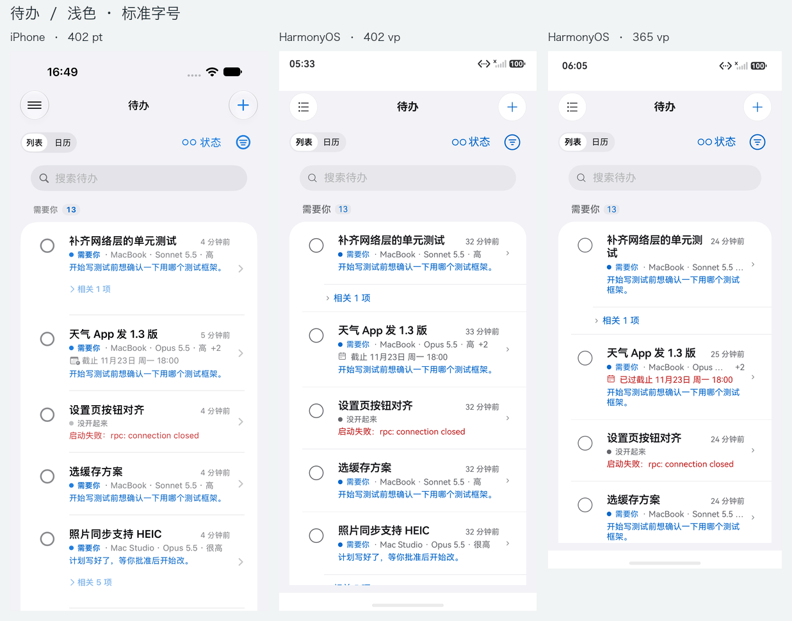
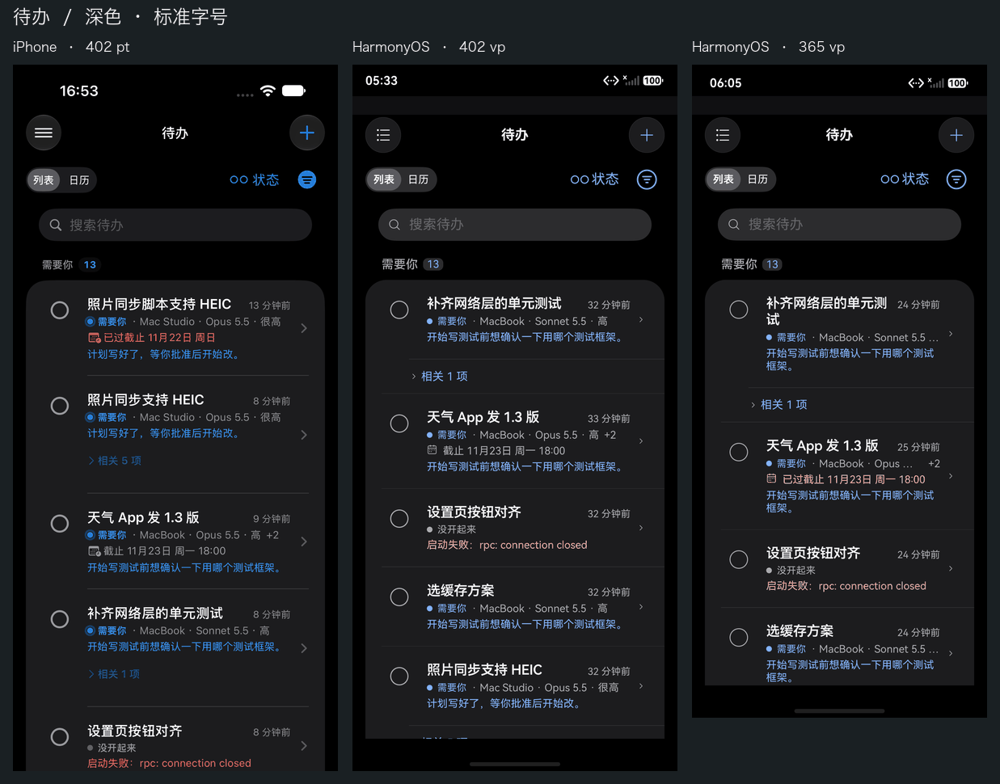
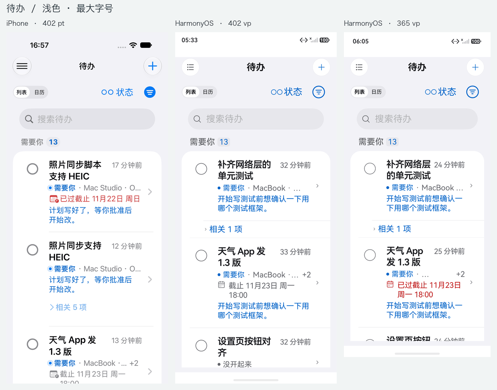

# 待办 · To-dos

[返回全部页面 · All pages](../README.md)

浏览待办清单及其状态。

Three independent native captures, left to right: iPhone 402 pt, HarmonyOS 402 vp, HarmonyOS 365 vp. The complete screen, including system bars, is visible.

[Download all original screenshots and accessibility trees for this page](../originals/todo.zip?raw=1) · [Source and capture method](../SOURCES.md)

Original archive SHA-256: d38b2a4e697a931863a60da68b9487874a17de7ddef006952a533ffb25c72ef1

## 浅色 · 标准字号

| Device | Pixels | Captured at | PNG digest | Hierarchy digest |
| --- | --- | --- | --- | --- |
| iPhone 402 pt | 1206 × 2622 | 2026-11-23T08:49:57.010+00:00 | 0dfc7e2f5fad20c6 | a9b1b8ba3040508e |
| HarmonyOS 402 vp | 1206 × 2622 | 2026-11-23T17:33:15+08:00 | 2cecd41f5d6dee6d | 1f1f921763982313 |
| HarmonyOS 365 vp | 1280 × 2832 | 2026-11-23T18:05:25+08:00 | 5b8d039a992c6ce3 | bac788ee1e537c42 |

## 深色 · 标准字号

| Device | Pixels | Captured at | PNG digest | Hierarchy digest |
| --- | --- | --- | --- | --- |
| iPhone 402 pt | 1206 × 2622 | 2026-11-23T08:53:42.357+00:00 | f7e07ac85339c948 | 04b8d4827cd00c54 |
| HarmonyOS 402 vp | 1206 × 2622 | 2026-11-23T17:33:18+08:00 | 32b902e7e903a1cd | 92b65f9da714856e |
| HarmonyOS 365 vp | 1280 × 2832 | 2026-11-23T18:05:29+08:00 | 74900090c89ec722 | 5ae5413ec096ca1a |

## 浅色 · 最大字号

| Device | Pixels | Captured at | PNG digest | Hierarchy digest |
| --- | --- | --- | --- | --- |
| iPhone 402 pt | 1206 × 2622 | 2026-11-23T08:57:30.489+00:00 | 43acdb067bb04c95 | 472d53025cfa4abc |
| HarmonyOS 402 vp | 1206 × 2622 | 2026-11-23T17:33:23+08:00 | 39e4bed243a2b947 | e85ee100cb3143bf |
| HarmonyOS 365 vp | 1280 × 2832 | 2026-11-23T18:05:35+08:00 | b207db9e5ab4494c | 8941ebd7dde617b8 |

Full 64-character digests and ZIP entry paths are under this page in the [manifest](../manifest.json).

[← 收件箱](inbox.md)
[今日待办与排序 →](todo-due.md)
