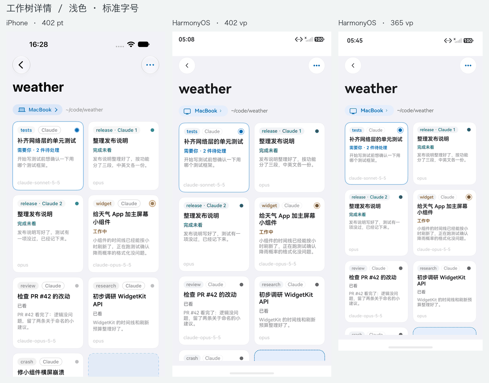
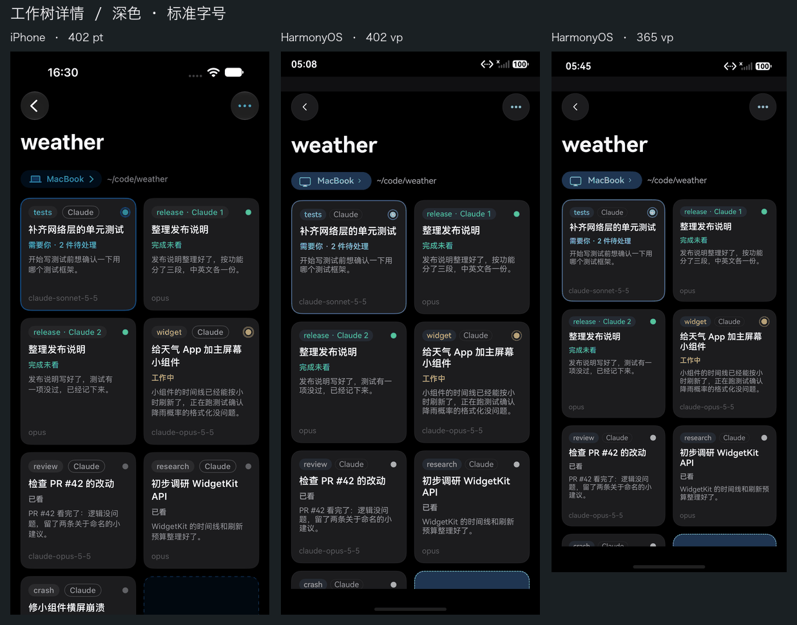
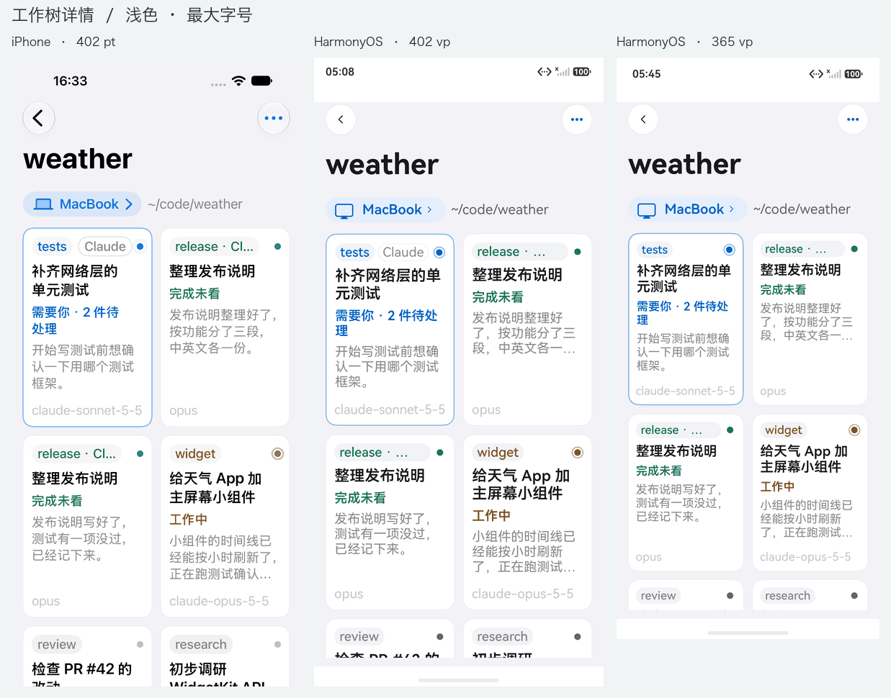

# 工作树详情 · Worktree details

[返回全部页面 · All pages](../README.md)

在选中的开发目录下查看会话和所属机器。
Open the weather terminal space and browse its agents across Git checkouts.

Three independent native captures, left to right: iPhone 402 pt, HarmonyOS 402 vp, HarmonyOS 365 vp. The complete screen, including system bars, is visible.

[Download all original screenshots and accessibility trees for this page](../originals/worktree.zip?raw=1) · [Source and capture method](../SOURCES.md)

Original archive SHA-256: 9a54356cc89a0861c948732c09e0d09e3618ef7aaa8afe8187b27bf843117937

## 浅色 · 标准字号

| Device | Pixels | Captured at | PNG digest | Hierarchy digest |
| --- | --- | --- | --- | --- |
| iPhone 402 pt | 1206 × 2622 | 2026-11-23T08:28:29.153+00:00 | 2cfa89dd6240e074 | 02902ca5b6c501e8 |
| HarmonyOS 402 vp | 1206 × 2622 | 2026-11-23T17:08:45+08:00 | a635a19aafaba9e7 | 259672f854de3496 |
| HarmonyOS 365 vp | 1280 × 2832 | 2026-11-23T17:45:12+08:00 | 3a7045e281aeacab | fd77cda18cf2a8e8 |

## 深色 · 标准字号

| Device | Pixels | Captured at | PNG digest | Hierarchy digest |
| --- | --- | --- | --- | --- |
| iPhone 402 pt | 1206 × 2622 | 2026-11-23T08:30:57.322+00:00 | 5eddecb003217a67 | c42c431fcf385874 |
| HarmonyOS 402 vp | 1206 × 2622 | 2026-11-23T17:08:50+08:00 | 6ed1186ecc02ce84 | 7ebe678c86d6a8e1 |
| HarmonyOS 365 vp | 1280 × 2832 | 2026-11-23T17:45:16+08:00 | ac8927d6223f6037 | a066c82377fd74eb |

## 浅色 · 最大字号

| Device | Pixels | Captured at | PNG digest | Hierarchy digest |
| --- | --- | --- | --- | --- |
| iPhone 402 pt | 1206 × 2622 | 2026-11-23T08:33:33.720+00:00 | e29d657768cfa6bf | f447b69aeb389dd1 |
| HarmonyOS 402 vp | 1206 × 2622 | 2026-11-23T17:08:55+08:00 | 79fc1a68481072ae | e45536cc01d5693f |
| HarmonyOS 365 vp | 1280 × 2832 | 2026-11-23T17:45:20+08:00 | 2aa444df4000965e | cdffce05e2400bd1 |

Full 64-character digests and ZIP entry paths are under this page in the [manifest](../manifest.json).

[← 仓库详情](project.md)
[新建 Agent →](new-agent.md)
