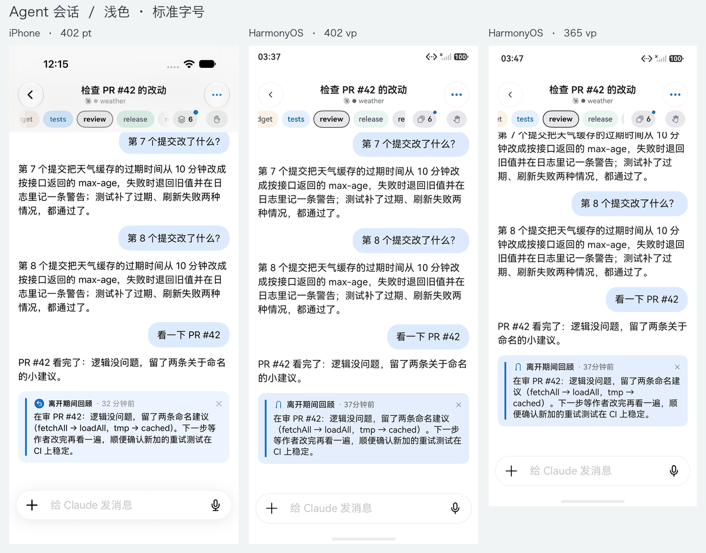
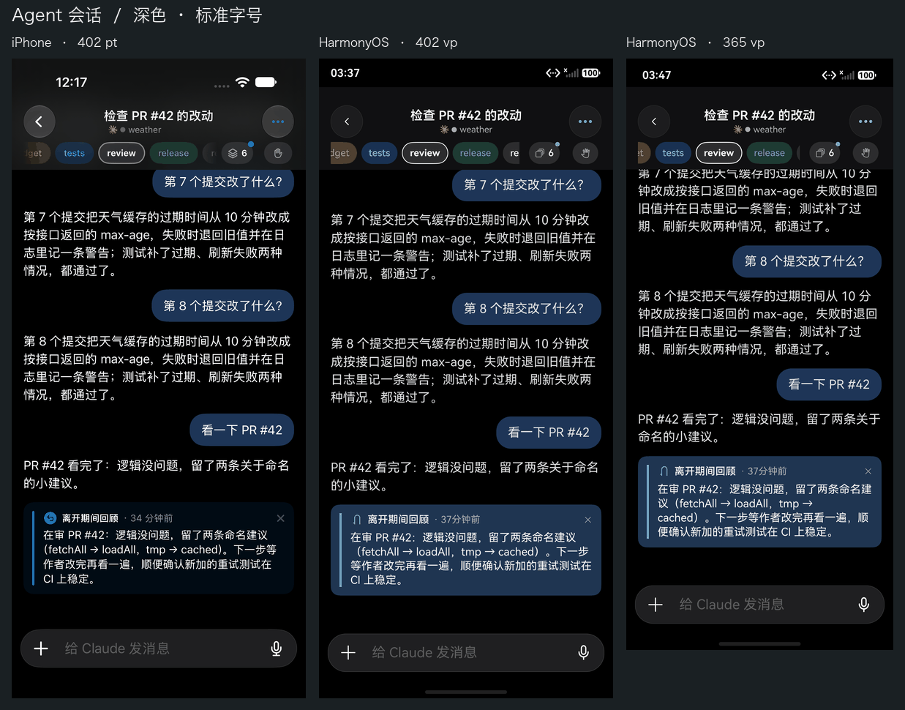
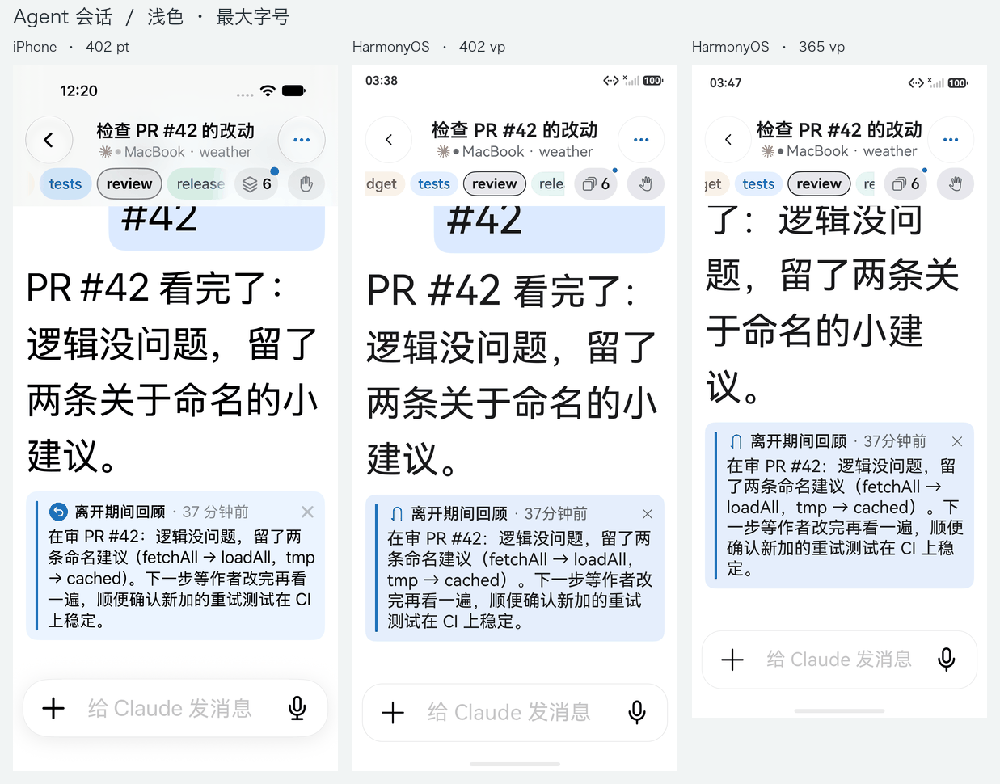

# Agent 会话 · Agent conversation

[返回全部页面 · All pages](../README.md)

打开 weather 的 PR #42 会话，核对用户消息、回复与回顾。
Open the PR #42 conversation with the seeded review history.

Three independent native captures, left to right: iPhone 402 pt, HarmonyOS 402 vp, HarmonyOS 365 vp. The complete screen, including system bars, is visible.

[Download all original screenshots and accessibility trees for this page](../originals/agent-chat.zip?raw=1) · [Source and capture method](../SOURCES.md)

Original archive SHA-256: aa7a75beb5afcc1659e8eff18049d9c88eb6162e2f21eb5dc0cdbda7a4412aeb

## 浅色 · 标准字号

| Device | Pixels | Captured at | PNG digest | Hierarchy digest |
| --- | --- | --- | --- | --- |
| iPhone 402 pt | 1206 × 2622 | 2026-11-23T04:15:14.838+00:00 | bdb84262e2ab081e | ce4ae0e6d0b944e4 |
| HarmonyOS 402 vp | 1206 × 2622 | 2026-11-23T15:37:55+08:00 | 71975259baa83fde | 98e9cd01b40ec0d1 |
| HarmonyOS 365 vp | 1280 × 2832 | 2026-11-23T15:47:16+08:00 | 515b5f15d9f795ea | afcb072a69f2ccb6 |

## 深色 · 标准字号

| Device | Pixels | Captured at | PNG digest | Hierarchy digest |
| --- | --- | --- | --- | --- |
| iPhone 402 pt | 1206 × 2622 | 2026-11-23T04:17:35.199+00:00 | f0bdbbca55c5c57b | 29420290cd3e636a |
| HarmonyOS 402 vp | 1206 × 2622 | 2026-11-23T15:37:58+08:00 | 2796890f0300f492 | 5cc915b638504525 |
| HarmonyOS 365 vp | 1280 × 2832 | 2026-11-23T15:47:20+08:00 | cbc5c6d2c7cba51a | 7f0d7612c72b95a5 |

## 浅色 · 最大字号

| Device | Pixels | Captured at | PNG digest | Hierarchy digest |
| --- | --- | --- | --- | --- |
| iPhone 402 pt | 1206 × 2622 | 2026-11-23T04:20:11.655+00:00 | 03307a2c285f2897 | 0d94f885e7a8d706 |
| HarmonyOS 402 vp | 1206 × 2622 | 2026-11-23T15:38:03+08:00 | a3609d81b5569a51 | 9549a99d70f95de9 |
| HarmonyOS 365 vp | 1280 × 2832 | 2026-11-23T15:47:24+08:00 | 7dac35dd39224e6e | 51a91389b94a5300 |

Full 64-character digests and ZIP entry paths are under this page in the [manifest](../manifest.json).

[← Agents 列表](agents.md)
[会话小结详情 →](recap-detail.md)
