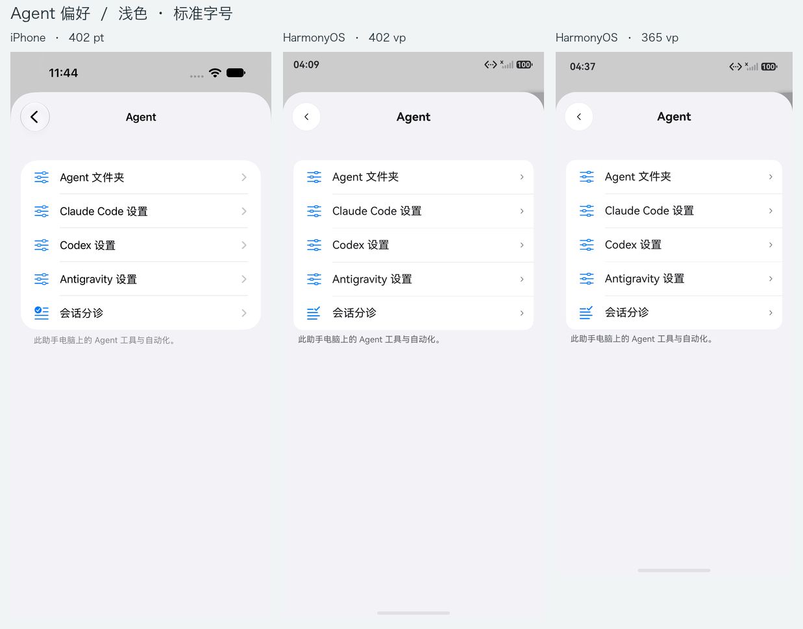
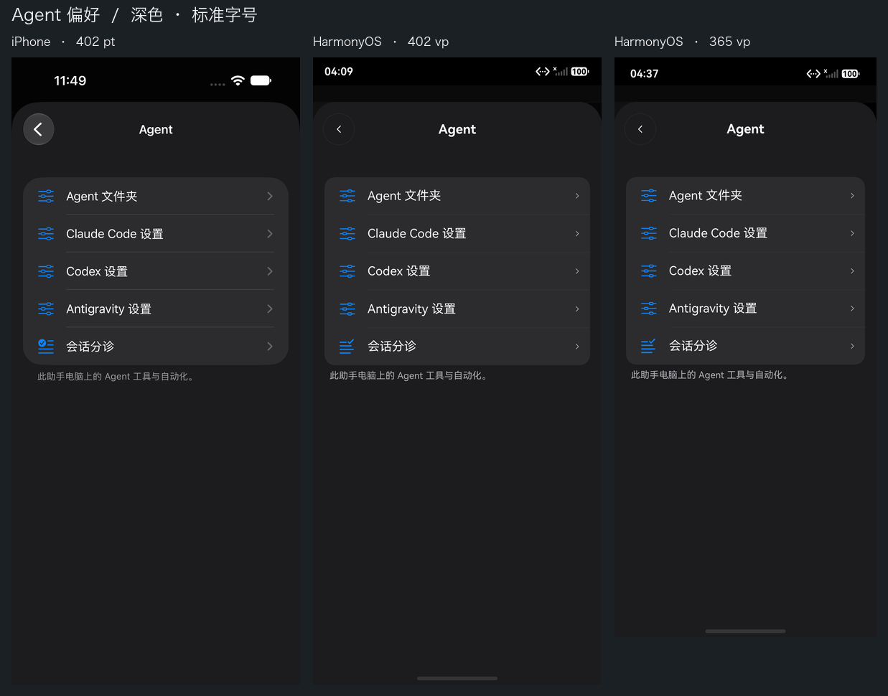
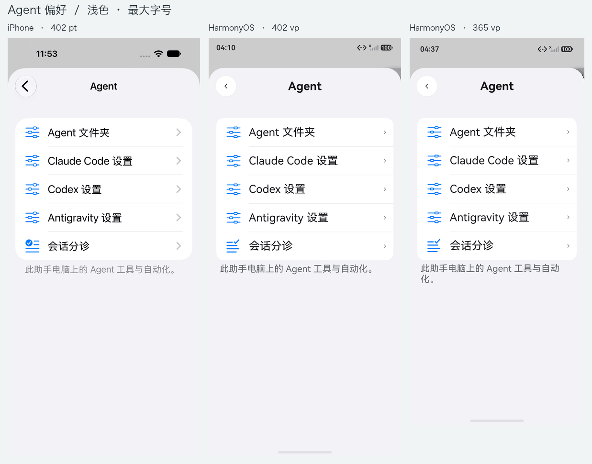

# Agent 偏好 · Agent preferences

[返回全部页面 · All pages](../README.md)

从设置进入 Agent 选项。
Open Agent preferences from Settings search and return to the same query.

Three independent native captures, left to right: iPhone 402 pt, HarmonyOS 402 vp, HarmonyOS 365 vp. The complete screen, including system bars, is visible.

[Download all original screenshots and accessibility trees for this page](../originals/agent-preferences.zip?raw=1) · [Source and capture method](../SOURCES.md)

Original archive SHA-256: 0c7a4a2a0606937e95c77f7e52517c8f94f568d69e34a87e3264ad15cac48ebc

## 浅色 · 标准字号

| Device | Pixels | Captured at | PNG digest | Hierarchy digest |
| --- | --- | --- | --- | --- |
| iPhone 402 pt | 1206 × 2622 | 2026-11-23T03:44:49.291+00:00 | f8554286d96fff85 | 224931192c25a414 |
| HarmonyOS 402 vp | 1206 × 2622 | 2026-11-23T16:09:52+08:00 | a88e38f470673906 | 4d35e83699887c84 |
| HarmonyOS 365 vp | 1280 × 2832 | 2026-11-23T16:37:23+08:00 | b916f881d4b900db | 1cf32a96fbe32741 |

## 深色 · 标准字号

| Device | Pixels | Captured at | PNG digest | Hierarchy digest |
| --- | --- | --- | --- | --- |
| iPhone 402 pt | 1206 × 2622 | 2026-11-23T03:49:29.583+00:00 | 44f11d3e00aff040 | 1c63083c1b1a15ba |
| HarmonyOS 402 vp | 1206 × 2622 | 2026-11-23T16:09:56+08:00 | 9cce93b2fe023ec8 | f8bc7f6ba7ddd9e4 |
| HarmonyOS 365 vp | 1280 × 2832 | 2026-11-23T16:37:27+08:00 | 4e38c14e28e8e556 | bc2cdc0186182b9a |

## 浅色 · 最大字号

| Device | Pixels | Captured at | PNG digest | Hierarchy digest |
| --- | --- | --- | --- | --- |
| iPhone 402 pt | 1206 × 2622 | 2026-11-23T03:53:47.910+00:00 | 685aae4e5e0613d4 | 3498dc1d3bde22b2 |
| HarmonyOS 402 vp | 1206 × 2622 | 2026-11-23T16:10:01+08:00 | 5b0ceebf9e2de7c7 | 6c076d242eeeec5f |
| HarmonyOS 365 vp | 1280 × 2832 | 2026-11-23T16:37:31+08:00 | 9c74f3af7703668c | 5716a3484977a691 |

Full 64-character digests and ZIP entry paths are under this page in the [manifest](../manifest.json).

[← 语言](language.md)
[搜索会话内容 →](search.md)
