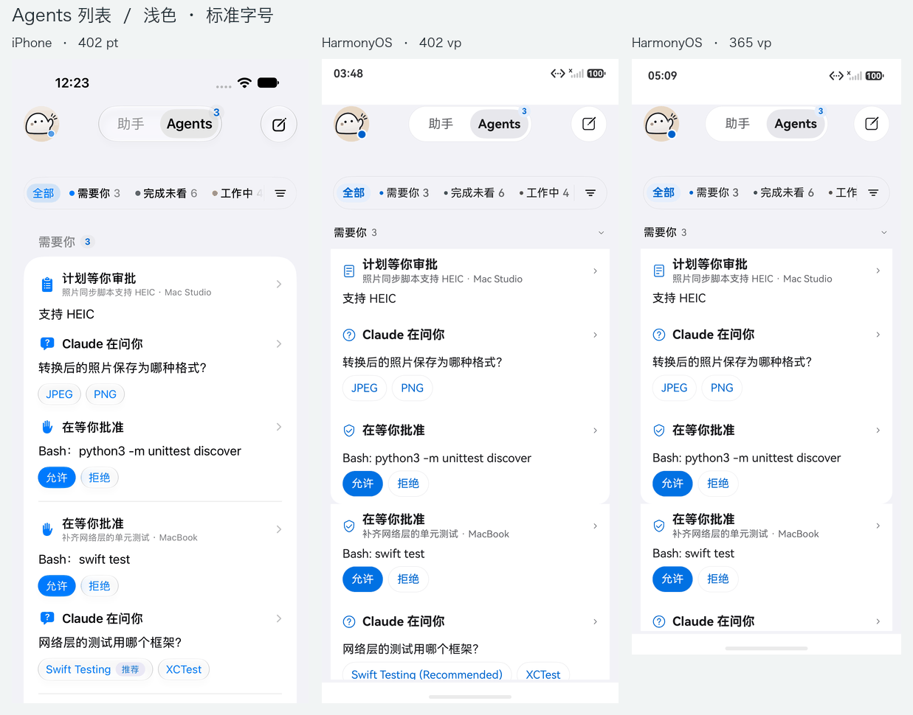
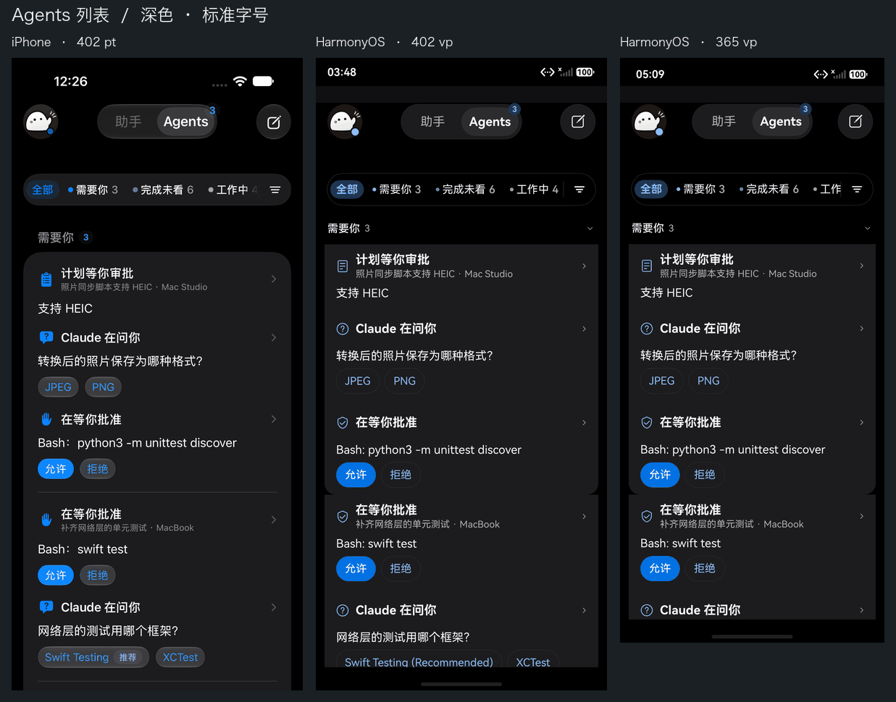
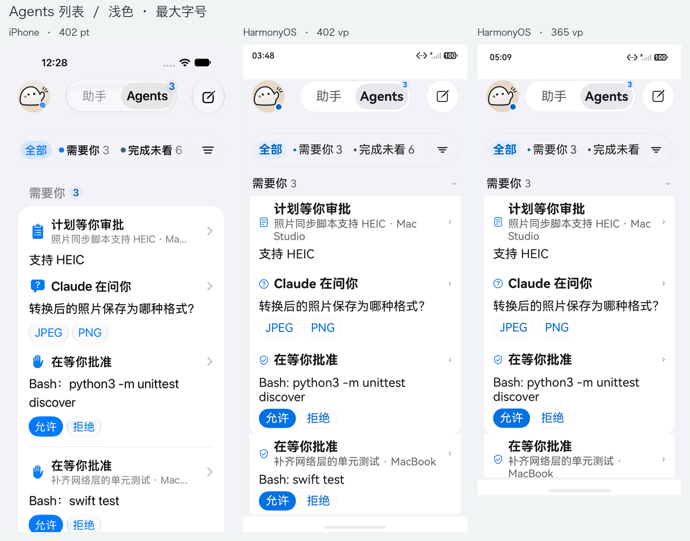

# Agents 列表 · Agent list

[返回全部页面 · All pages](../README.md)

按状态浏览 Agents，区分需要处理和正在工作的会话。

Three independent native captures, left to right: iPhone 402 pt, HarmonyOS 402 vp, HarmonyOS 365 vp. The complete screen, including system bars, is visible.

[Download all original screenshots and accessibility trees for this page](../originals/agents.zip?raw=1) · [Source and capture method](../SOURCES.md)

Original archive SHA-256: 5d142ae098e9c2d61e159f5f0d677763c2accaef51c411c4f26e702d0dd2a4a8

## 浅色 · 标准字号

| Device | Pixels | Captured at | PNG digest | Hierarchy digest |
| --- | --- | --- | --- | --- |
| iPhone 402 pt | 1206 × 2622 | 2026-11-23T04:23:39.981+00:00 | 64267b766236325d | dddbd6b41d63ac4f |
| HarmonyOS 402 vp | 1206 × 2622 | 2026-11-23T15:48:06+08:00 | 280aaf97b827c52a | 9a7dd0862dac4b1b |
| HarmonyOS 365 vp | 1280 × 2832 | 2026-11-23T17:09:44+08:00 | 96bb1f82376ae5d8 | 36557a0172250cad |

## 深色 · 标准字号

| Device | Pixels | Captured at | PNG digest | Hierarchy digest |
| --- | --- | --- | --- | --- |
| iPhone 402 pt | 1206 × 2622 | 2026-11-23T04:26:10.203+00:00 | ba323079ff920db8 | 2e0e8f3c5826bd37 |
| HarmonyOS 402 vp | 1206 × 2622 | 2026-11-23T15:48:10+08:00 | c9d23e39888a6884 | a0906bee508867a4 |
| HarmonyOS 365 vp | 1280 × 2832 | 2026-11-23T17:09:48+08:00 | 7b3cdcec07621e8d | 4ac3989d91c362ab |

## 浅色 · 最大字号

| Device | Pixels | Captured at | PNG digest | Hierarchy digest |
| --- | --- | --- | --- | --- |
| iPhone 402 pt | 1206 × 2622 | 2026-11-23T04:28:39.445+00:00 | 0f8b83ce8f970c13 | caf727465f70d7bd |
| HarmonyOS 402 vp | 1206 × 2622 | 2026-11-23T15:48:14+08:00 | 8661ab61dbbe6374 | 7196fcd4e205b325 |
| HarmonyOS 365 vp | 1280 × 2832 | 2026-11-23T17:09:52+08:00 | 3e472389b83fb525 | 6e6f5fa61562aabc |

Full 64-character digests and ZIP entry paths are under this page in the [manifest](../manifest.json).

[← 提交 Agent 配置](start-ready.md)
[Agent 会话 →](agent-chat.md)
