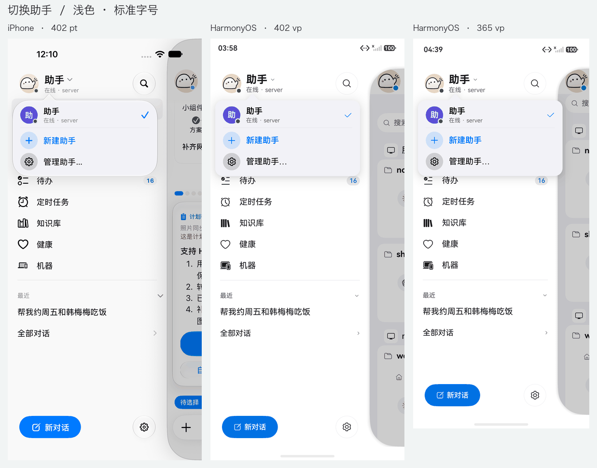
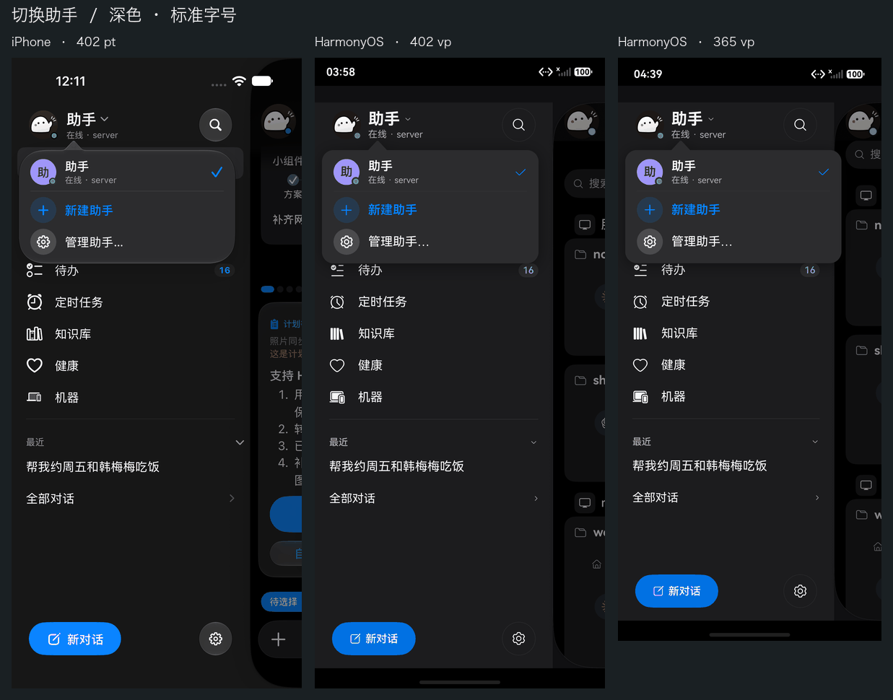
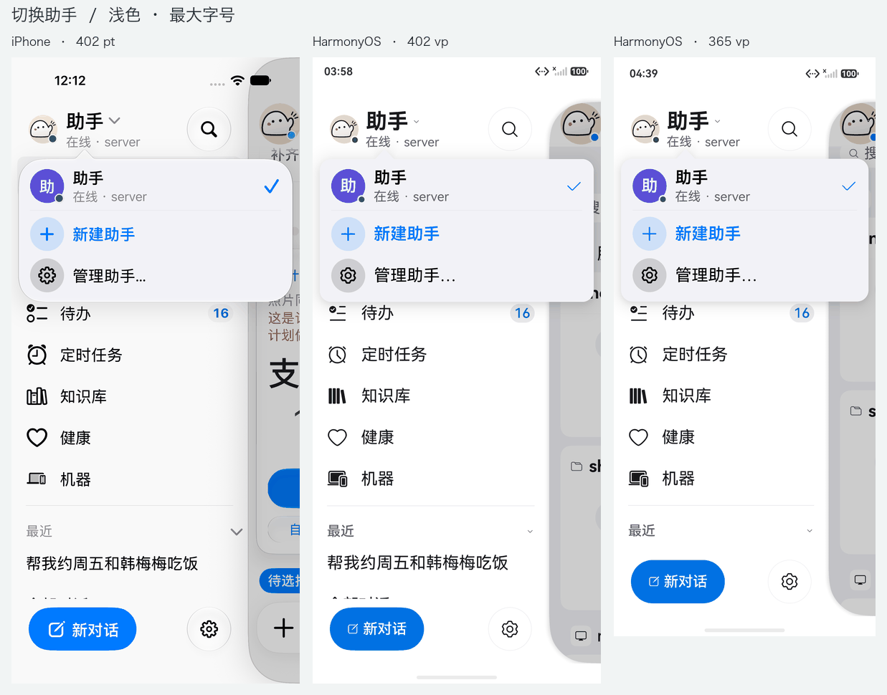

# 切换助手 · Switch assistants

[返回全部页面 · All pages](../README.md)

从当前助手打开助手切换菜单。

Three independent native captures, left to right: iPhone 402 pt, HarmonyOS 402 vp, HarmonyOS 365 vp. The complete screen, including system bars, is visible.

[Download all original screenshots and accessibility trees for this page](../originals/assistant-menu.zip?raw=1) · [Source and capture method](../SOURCES.md)

Original archive SHA-256: 4e5954db00a897120db6efdc2e73db6fa3d4650ad7b993ca731e0b7c2cd446de

## 浅色 · 标准字号

| Device | Pixels | Captured at | PNG digest | Hierarchy digest |
| --- | --- | --- | --- | --- |
| iPhone 402 pt | 1206 × 2622 | 2026-11-23T04:10:21.131+00:00 | 6228f17ec6b1a711 | 17f8619c260b7d01 |
| HarmonyOS 402 vp | 1206 × 2622 | 2026-11-23T15:58:29+08:00 | 7269863df61fe1a6 | 5be0934ef288e9ec |
| HarmonyOS 365 vp | 1280 × 2832 | 2026-11-23T16:39:31+08:00 | 80bdd39f4d87bd65 | ec07cd8530189889 |

## 深色 · 标准字号

| Device | Pixels | Captured at | PNG digest | Hierarchy digest |
| --- | --- | --- | --- | --- |
| iPhone 402 pt | 1206 × 2622 | 2026-11-23T04:11:09.917+00:00 | 009df4c3496f03b0 | 4aa69ca13a1bd2a2 |
| HarmonyOS 402 vp | 1206 × 2622 | 2026-11-23T15:58:35+08:00 | 52c6f3ac66d91219 | bc9f1e42d7f93f96 |
| HarmonyOS 365 vp | 1280 × 2832 | 2026-11-23T16:39:38+08:00 | 9a9df1e709f70aa9 | 816935477a41ff79 |

## 浅色 · 最大字号

| Device | Pixels | Captured at | PNG digest | Hierarchy digest |
| --- | --- | --- | --- | --- |
| iPhone 402 pt | 1206 × 2622 | 2026-11-23T04:12:11.740+00:00 | 9771400b01f357d6 | 040cda1812ad792b |
| HarmonyOS 402 vp | 1206 × 2622 | 2026-11-23T15:58:40+08:00 | 2f7cf371ec9721d0 | 968784028c2eac0f |
| HarmonyOS 365 vp | 1280 × 2832 | 2026-11-23T16:39:45+08:00 | 843391370e68e86c | 067f2e88404afbe1 |

Full 64-character digests and ZIP entry paths are under this page in the [manifest](../manifest.json).

[← 侧栏](drawer.md)
[设置 →](settings.md)
