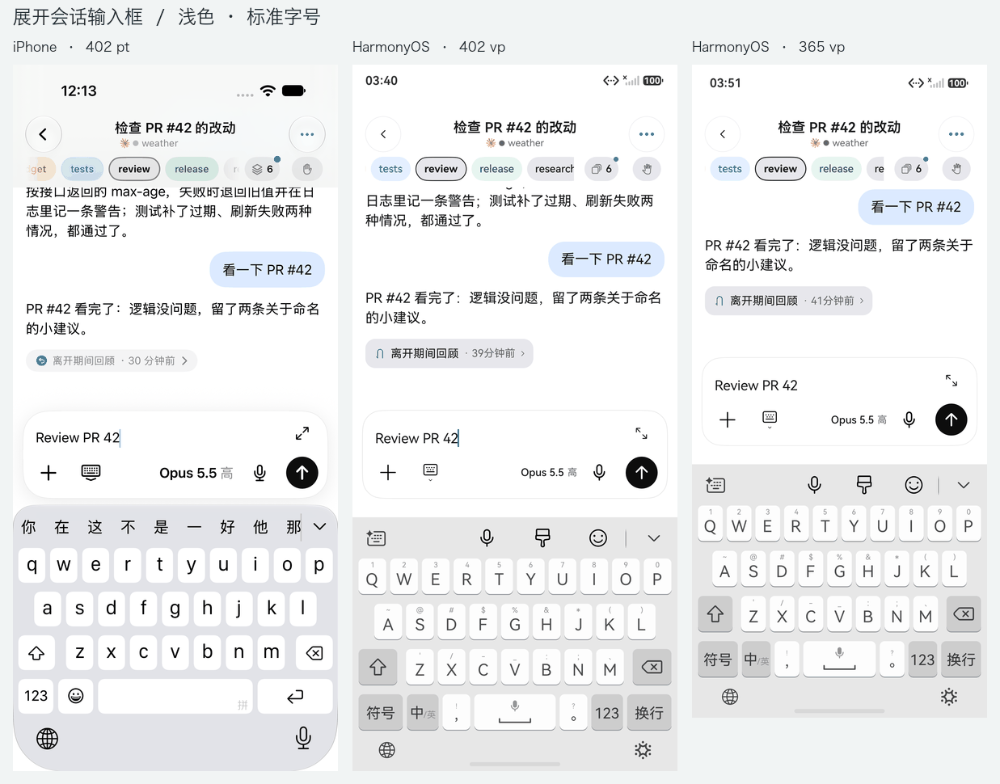
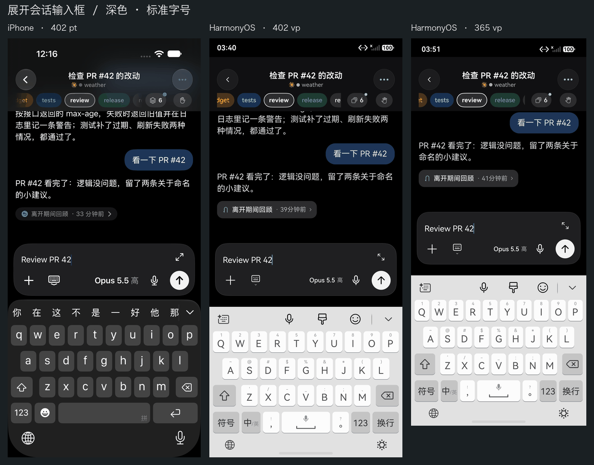
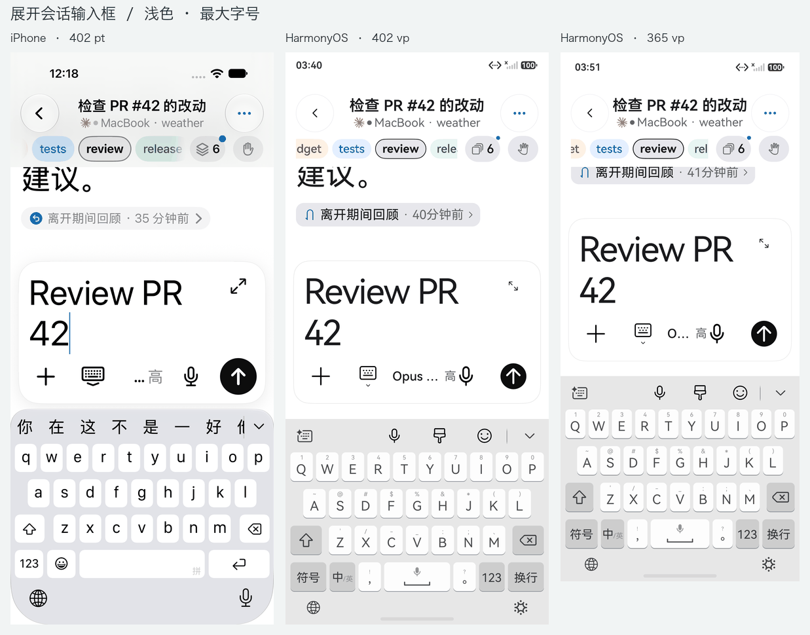

# 展开会话输入框 · Focused composer

[返回全部页面 · All pages](../README.md)

聚焦 PR #42 的输入框，核对草稿、键盘和发送控件的位置。
Focus the PR #42 composer and return from its full-screen editor to the same draft.

Three independent native captures, left to right: iPhone 402 pt, HarmonyOS 402 vp, HarmonyOS 365 vp. The complete screen, including system bars, is visible.

[Download all original screenshots and accessibility trees for this page](../originals/composer.zip?raw=1) · [Source and capture method](../SOURCES.md)

Original archive SHA-256: 448ff9092b58925e67c09a9b4252450baa7db44db409259d29a93c33568b0412

## 浅色 · 标准字号

| Device | Pixels | Captured at | PNG digest | Hierarchy digest |
| --- | --- | --- | --- | --- |
| iPhone 402 pt | 1206 × 2622 | 2026-11-23T04:13:42.916+00:00 | c83196b5c7b221ea | 310947d108f0df1f |
| HarmonyOS 402 vp | 1206 × 2622 | 2026-11-23T15:40:45+08:00 | a5f11f352ce2df94 | 40c060e63e3ef152 |
| HarmonyOS 365 vp | 1280 × 2832 | 2026-11-23T15:51:46+08:00 | 2d2601abeaf24088 | 1ef4ee79e2c38c72 |

## 深色 · 标准字号

| Device | Pixels | Captured at | PNG digest | Hierarchy digest |
| --- | --- | --- | --- | --- |
| iPhone 402 pt | 1206 × 2622 | 2026-11-23T04:16:01.683+00:00 | 07a12fec1b0c6a4e | ed1c4484a1704a96 |
| HarmonyOS 402 vp | 1206 × 2622 | 2026-11-23T15:40:49+08:00 | a176d3fa68dc9aeb | 13a6db59ca758ffb |
| HarmonyOS 365 vp | 1280 × 2832 | 2026-11-23T15:51:50+08:00 | 911ba43b98a05514 | 0fd2563a400963e4 |

## 浅色 · 最大字号

| Device | Pixels | Captured at | PNG digest | Hierarchy digest |
| --- | --- | --- | --- | --- |
| iPhone 402 pt | 1206 × 2622 | 2026-11-23T04:18:22.858+00:00 | e3d8ae1bc2767cea | 1fb350e4ea05ff55 |
| HarmonyOS 402 vp | 1206 × 2622 | 2026-11-23T15:40:53+08:00 | 78f6ac7d70e30385 | 3d1b3c772bd29a7d |
| HarmonyOS 365 vp | 1280 × 2832 | 2026-11-23T15:51:54+08:00 | bc02e619b691602f | cd14475503a661b0 |

Full 64-character digests and ZIP entry paths are under this page in the [manifest](../manifest.json).

[← Persona 主对话](persona.md)
[回看会话记录 →](reading-history.md)
