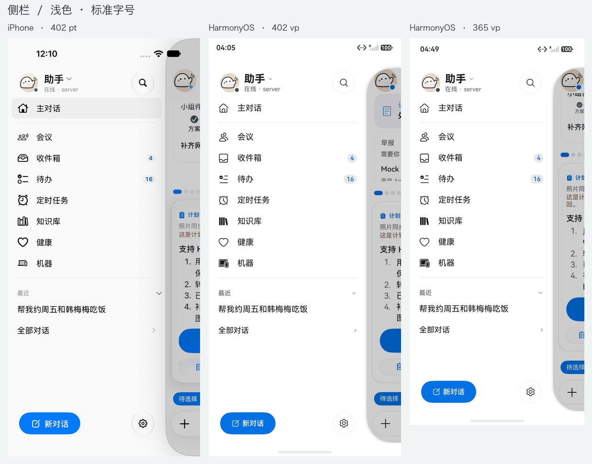
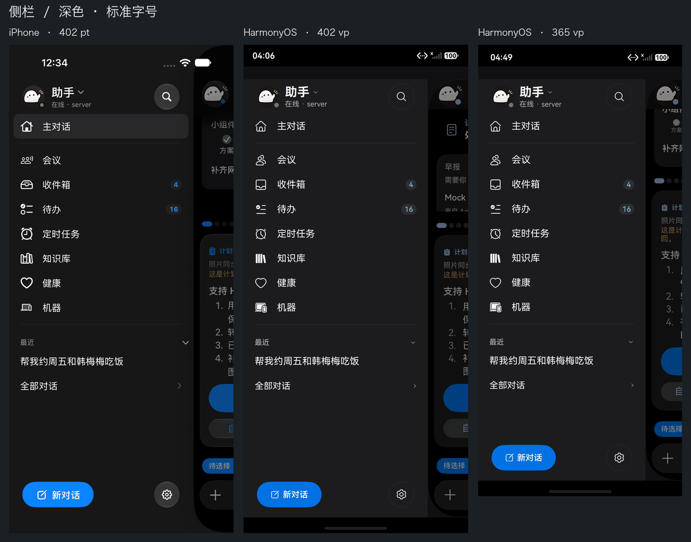
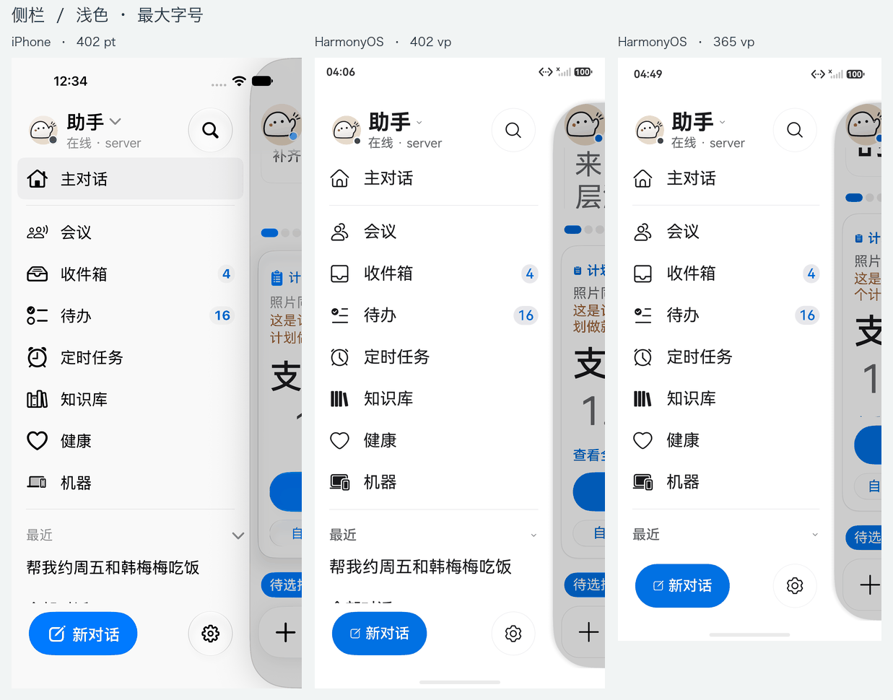

# 侧栏 · Navigation drawer

[返回全部页面 · All pages](../README.md)

在侧栏查找主对话、工作空间和设置入口。

Three independent native captures, left to right: iPhone 402 pt, HarmonyOS 402 vp, HarmonyOS 365 vp. The complete screen, including system bars, is visible.

[Download all original screenshots and accessibility trees for this page](../originals/drawer.zip?raw=1) · [Source and capture method](../SOURCES.md)

Original archive SHA-256: b68c9acf7544d338308d48f8ba9c6843275e98ce9d0b4e4cd3f52c0b87a40c71

## 浅色 · 标准字号

| Device | Pixels | Captured at | PNG digest | Hierarchy digest |
| --- | --- | --- | --- | --- |
| iPhone 402 pt | 1206 × 2622 | 2026-11-23T04:10:47.812+00:00 | ce3893d4f80ea3ef | b698869812e8a467 |
| HarmonyOS 402 vp | 1206 × 2622 | 2026-11-23T16:05:58+08:00 | 17ab81135cea56dc | b148be5d1c5441cf |
| HarmonyOS 365 vp | 1280 × 2832 | 2026-11-23T16:49:25+08:00 | b1dc95822e9cb371 | 9c7364771c6ac28d |

## 深色 · 标准字号

| Device | Pixels | Captured at | PNG digest | Hierarchy digest |
| --- | --- | --- | --- | --- |
| iPhone 402 pt | 1206 × 2622 | 2026-11-23T04:34:14.617+00:00 | ed105bb76319bbdf | 83d2a07dc327e6dd |
| HarmonyOS 402 vp | 1206 × 2622 | 2026-11-23T16:06:04+08:00 | 1ca2e046e7115fce | f1dd99c4f2bba1f1 |
| HarmonyOS 365 vp | 1280 × 2832 | 2026-11-23T16:49:30+08:00 | a7ed504ee8a93bdd | 924480f86bd2b5cd |

## 浅色 · 最大字号

| Device | Pixels | Captured at | PNG digest | Hierarchy digest |
| --- | --- | --- | --- | --- |
| iPhone 402 pt | 1206 × 2622 | 2026-11-23T04:34:34.057+00:00 | e4d7a3f89bce4337 | e3e131ab16ded319 |
| HarmonyOS 402 vp | 1206 × 2622 | 2026-11-23T16:06:09+08:00 | bdd0a5ccdec5ae44 | 5921a697a81149f4 |
| HarmonyOS 365 vp | 1280 × 2832 | 2026-11-23T16:49:36+08:00 | 35a807301866787f | b6d6d7f935a75b77 |

Full 64-character digests and ZIP entry paths are under this page in the [manifest](../manifest.json).

[← 机器监控读数](machine-monitor.md)
[切换助手 →](assistant-menu.md)
