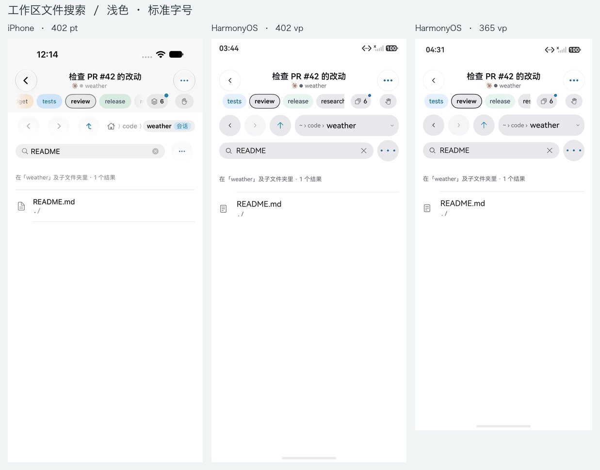
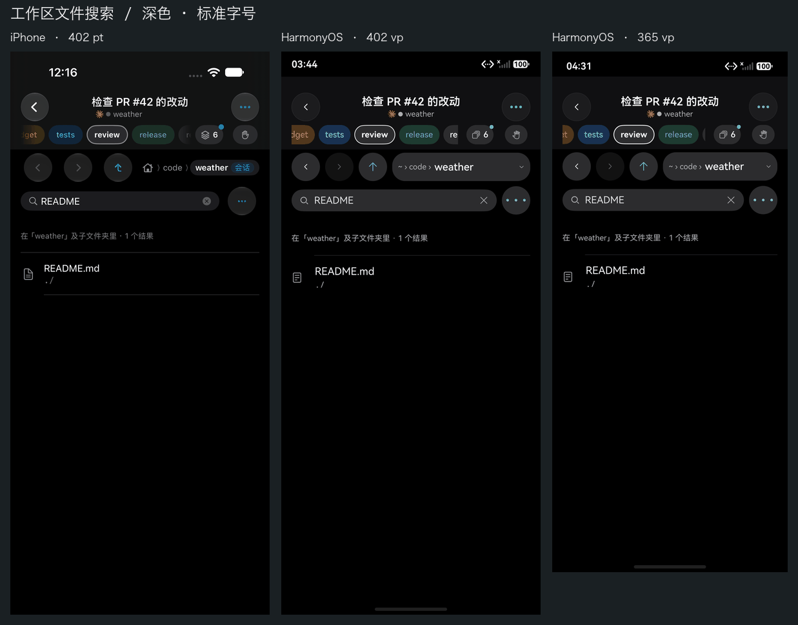
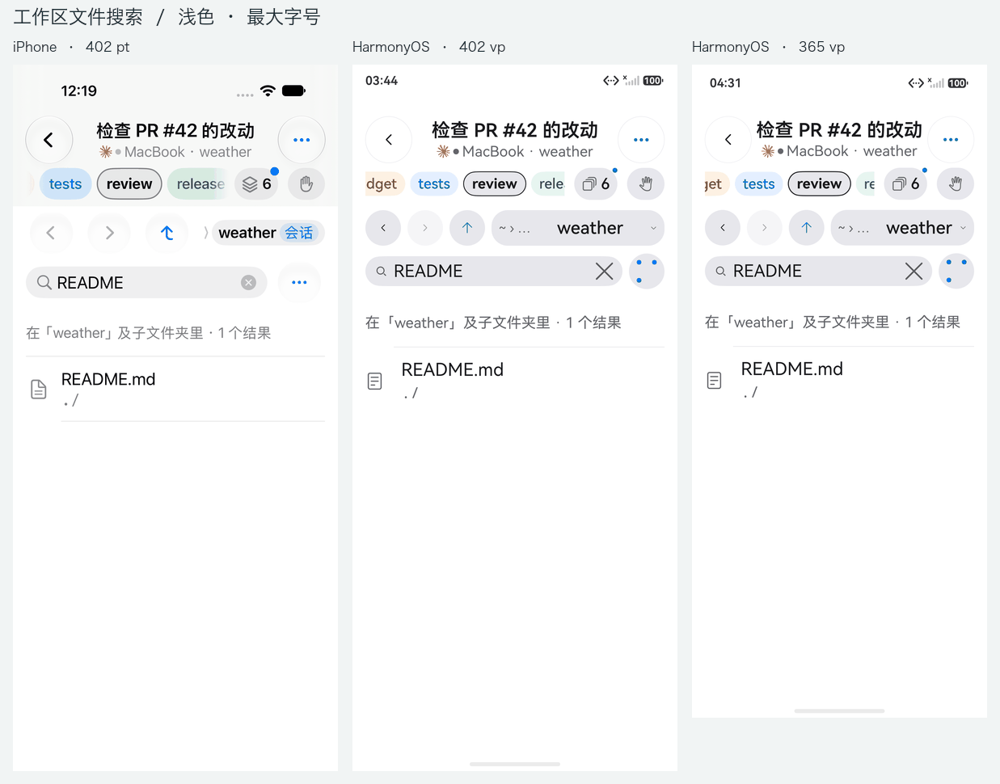

# 工作区文件搜索 · Find a file

[返回全部页面 · All pages](../README.md)

在当前工作目录及子目录搜索 README。

Three independent native captures, left to right: iPhone 402 pt, HarmonyOS 402 vp, HarmonyOS 365 vp. The complete screen, including system bars, is visible.

[Download all original screenshots and accessibility trees for this page](../originals/file-search.zip?raw=1) · [Source and capture method](../SOURCES.md)

Original archive SHA-256: 4b97b770d33fb9874e24dd7aa49314414d6f0473aaefe08c0a073d9898d64fd8

## 浅色 · 标准字号

| Device | Pixels | Captured at | PNG digest | Hierarchy digest |
| --- | --- | --- | --- | --- |
| iPhone 402 pt | 1206 × 2622 | 2026-11-23T04:14:22.146+00:00 | 6815fbbf2e1c7616 | 8731e6576d38b531 |
| HarmonyOS 402 vp | 1206 × 2622 | 2026-11-23T15:44:28+08:00 | 836d96d095613fb1 | c75765d4b6abf51c |
| HarmonyOS 365 vp | 1280 × 2832 | 2026-11-23T16:31:22+08:00 | f9a9702258581d23 | da2d0961852d4252 |

## 深色 · 标准字号

| Device | Pixels | Captured at | PNG digest | Hierarchy digest |
| --- | --- | --- | --- | --- |
| iPhone 402 pt | 1206 × 2622 | 2026-11-23T04:16:42.088+00:00 | 625e79e63b78a815 | c12a9ed477431baa |
| HarmonyOS 402 vp | 1206 × 2622 | 2026-11-23T15:44:32+08:00 | ed52c461828e53eb | d958d89db9a0c741 |
| HarmonyOS 365 vp | 1280 × 2832 | 2026-11-23T16:31:26+08:00 | b58735105ac5a467 | 6cb6af8e1036750a |

## 浅色 · 最大字号

| Device | Pixels | Captured at | PNG digest | Hierarchy digest |
| --- | --- | --- | --- | --- |
| iPhone 402 pt | 1206 × 2622 | 2026-11-23T04:19:19.150+00:00 | dbbd1541d4f6a1d2 | 196b98f71fddba8c |
| HarmonyOS 402 vp | 1206 × 2622 | 2026-11-23T15:44:36+08:00 | 02be663629e0b7ba | 96faee35d410c660 |
| HarmonyOS 365 vp | 1280 × 2832 | 2026-11-23T16:31:30+08:00 | 6db93ef7ac320bbb | 4f6336823ddbce6c |

Full 64-character digests and ZIP entry paths are under this page in the [manifest](../manifest.json).

[← 文件](files.md)
[Git 工作区 →](git.md)
