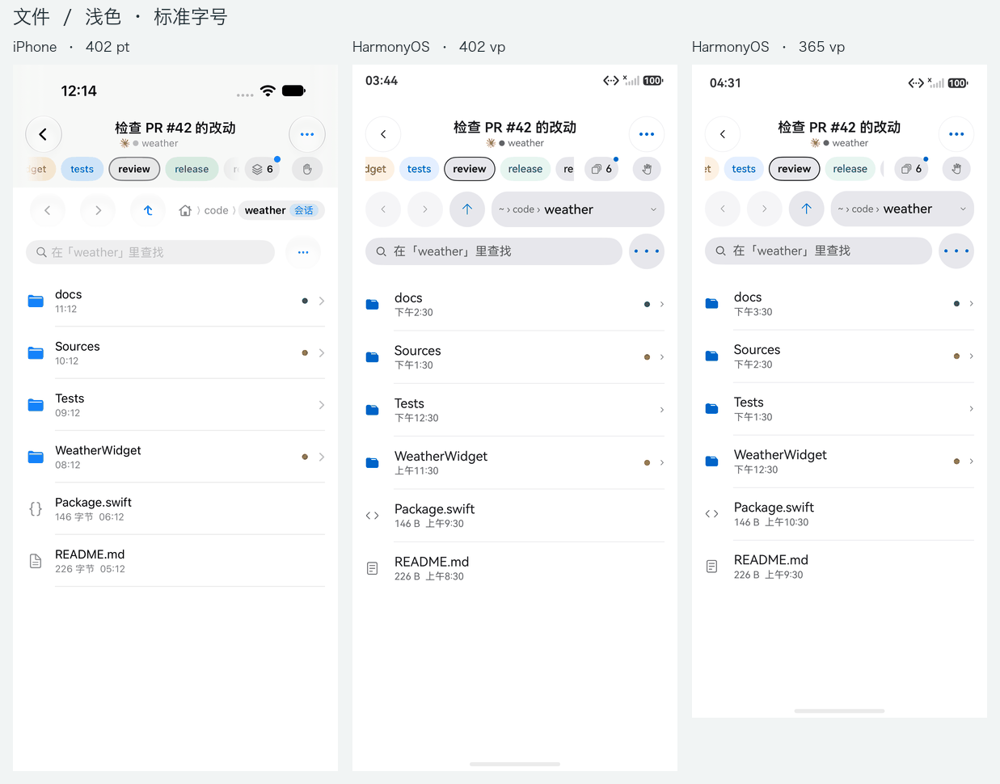
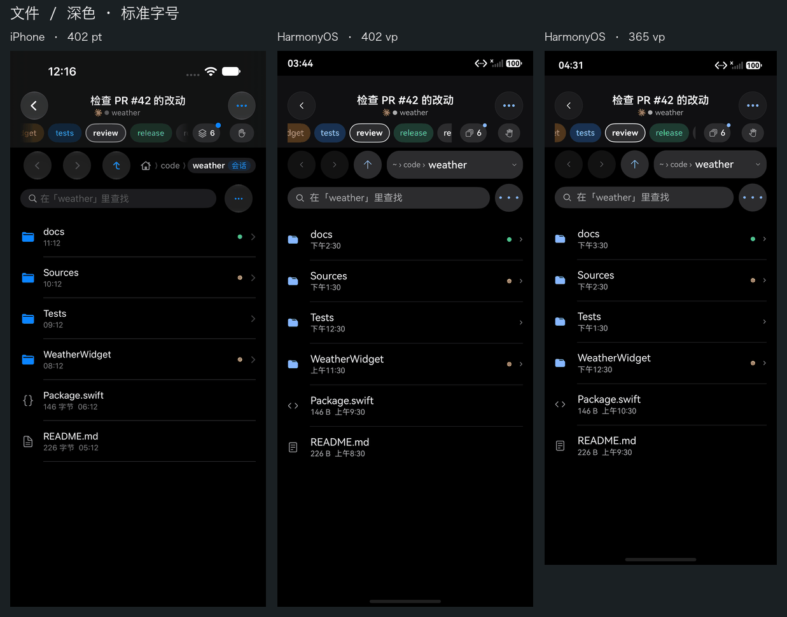
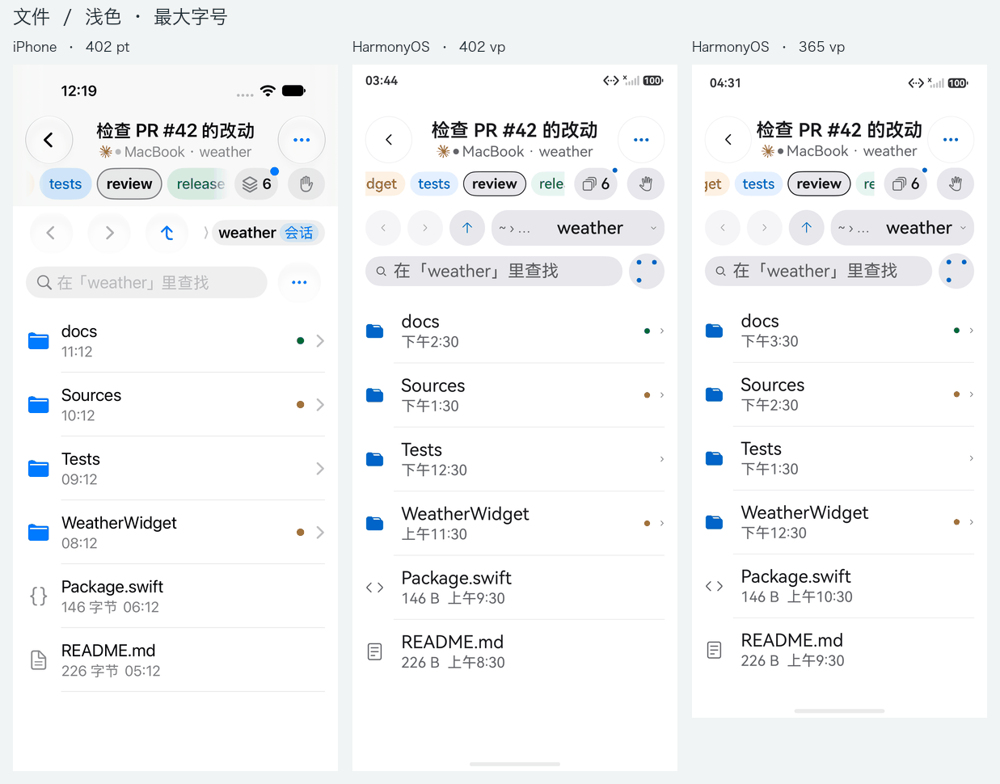

# 文件 · Workspace files

[返回全部页面 · All pages](../README.md)

浏览 weather 目录的文件与文件夹。
Open Files from the More menu of the PR #42 conversation. Its title, space and sibling tabs stay visible.

Three independent native captures, left to right: iPhone 402 pt, HarmonyOS 402 vp, HarmonyOS 365 vp. The complete screen, including system bars, is visible.

[Download all original screenshots and accessibility trees for this page](../originals/files.zip?raw=1) · [Source and capture method](../SOURCES.md)

Original archive SHA-256: df6e722ead6594ff416944d1087b8cb0f4f5052b3214d525ffb805fb14bc09c6

## 浅色 · 标准字号

| Device | Pixels | Captured at | PNG digest | Hierarchy digest |
| --- | --- | --- | --- | --- |
| iPhone 402 pt | 1206 × 2622 | 2026-11-23T04:14:13.776+00:00 | 739507b9dfe63ca8 | 9123c7565f3c7b55 |
| HarmonyOS 402 vp | 1206 × 2622 | 2026-11-23T15:44:10+08:00 | 9283b25ac1024398 | 907cc34ff8dec50e |
| HarmonyOS 365 vp | 1280 × 2832 | 2026-11-23T16:31:03+08:00 | f76d27b7876cfdbf | a36323762e30d394 |

## 深色 · 标准字号

| Device | Pixels | Captured at | PNG digest | Hierarchy digest |
| --- | --- | --- | --- | --- |
| iPhone 402 pt | 1206 × 2622 | 2026-11-23T04:16:33.840+00:00 | 37523a326742a79a | 4e3a7e27f55a7c3a |
| HarmonyOS 402 vp | 1206 × 2622 | 2026-11-23T15:44:14+08:00 | 802125c6396e38d9 | 08bd16b31842a972 |
| HarmonyOS 365 vp | 1280 × 2832 | 2026-11-23T16:31:07+08:00 | 8830d8885c734b9c | e7f2ad4bd133a442 |

## 浅色 · 最大字号

| Device | Pixels | Captured at | PNG digest | Hierarchy digest |
| --- | --- | --- | --- | --- |
| iPhone 402 pt | 1206 × 2622 | 2026-11-23T04:19:10.806+00:00 | a845e0ed41ab1637 | 25d4bdbcb8b76099 |
| HarmonyOS 402 vp | 1206 × 2622 | 2026-11-23T15:44:18+08:00 | 96e81b601eec8469 | e945ebb74d5e3215 |
| HarmonyOS 365 vp | 1280 × 2832 | 2026-11-23T16:31:11+08:00 | 043c425a047aefc6 | 4f65aa3869bbe74f |

Full 64-character digests and ZIP entry paths are under this page in the [manifest](../manifest.json).

[← 回看会话记录](reading-history.md)
[工作区文件搜索 →](file-search.md)
