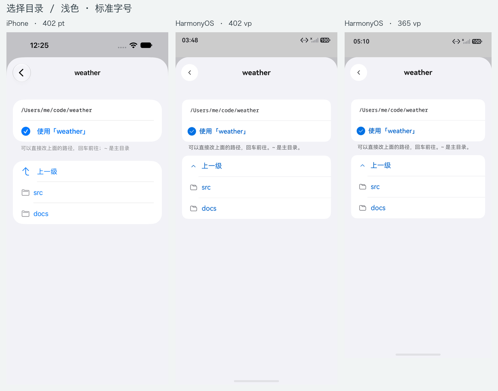
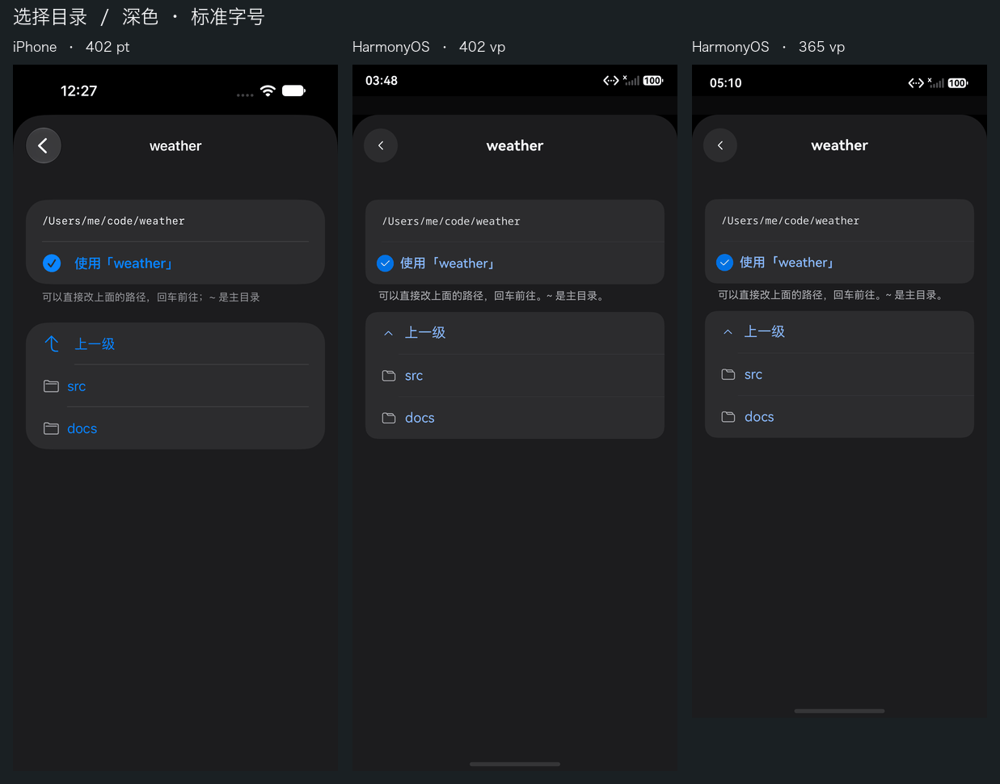
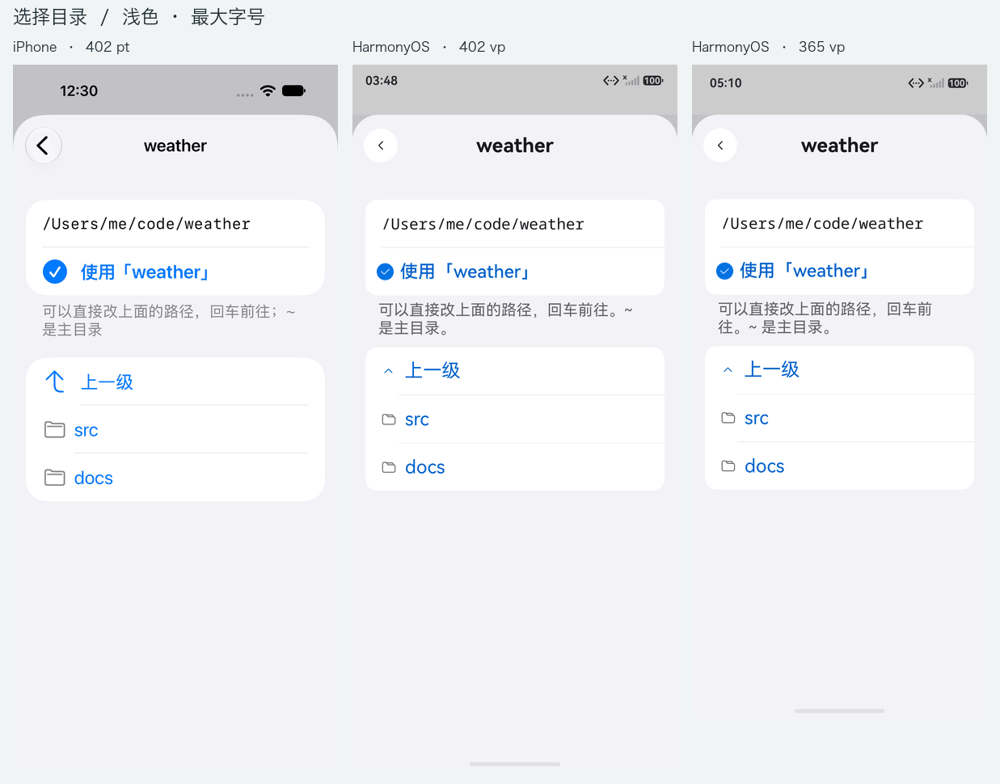

# 选择目录 · Choose a working directory

[返回全部页面 · All pages](../README.md)

浏览目录，并将所选目录交给新会话。
Open the weather directory picker and compare the parent, children and the action to use that directory.

Three independent native captures, left to right: iPhone 402 pt, HarmonyOS 402 vp, HarmonyOS 365 vp. The complete screen, including system bars, is visible.

[Download all original screenshots and accessibility trees for this page](../originals/folder-browser.zip?raw=1) · [Source and capture method](../SOURCES.md)

Original archive SHA-256: c82aafaa2e2d53e745786bb2553d9e946102a64ae880801145156350edcb827f

## 浅色 · 标准字号

| Device | Pixels | Captured at | PNG digest | Hierarchy digest |
| --- | --- | --- | --- | --- |
| iPhone 402 pt | 1206 × 2622 | 2026-11-23T04:25:13.383+00:00 | aa0b662dcdf406b2 | 8d7106fb8a0599c2 |
| HarmonyOS 402 vp | 1206 × 2622 | 2026-11-23T15:48:38+08:00 | 74b434927a1c535e | 698c359682aa0af2 |
| HarmonyOS 365 vp | 1280 × 2832 | 2026-11-23T17:10:22+08:00 | 3254c4119edb5207 | 2d5a34818c714863 |

## 深色 · 标准字号

| Device | Pixels | Captured at | PNG digest | Hierarchy digest |
| --- | --- | --- | --- | --- |
| iPhone 402 pt | 1206 × 2622 | 2026-11-23T04:27:43.026+00:00 | 2c3c90bb7a654510 | 45228fe374371d41 |
| HarmonyOS 402 vp | 1206 × 2622 | 2026-11-23T15:48:42+08:00 | 0ea4273c08557f7e | 4153a1af2f2ee8da |
| HarmonyOS 365 vp | 1280 × 2832 | 2026-11-23T17:10:26+08:00 | ad7e8965a5716a45 | 8b21eb9441b5c319 |

## 浅色 · 最大字号

| Device | Pixels | Captured at | PNG digest | Hierarchy digest |
| --- | --- | --- | --- | --- |
| iPhone 402 pt | 1206 × 2622 | 2026-11-23T04:30:16.339+00:00 | cc4b9b6a7f4e81b8 | d5ed7373d90186ab |
| HarmonyOS 402 vp | 1206 × 2622 | 2026-11-23T15:48:46+08:00 | c5b19d211fc11aec | a24ab30da0ada488 |
| HarmonyOS 365 vp | 1280 × 2832 | 2026-11-23T17:10:30+08:00 | 8af4390b5dca1dd6 | 4439276afe7be999 |

Full 64-character digests and ZIP entry paths are under this page in the [manifest](../manifest.json).

[← 新建 Agent](new-agent.md)
[选择模型 →](models.md)
