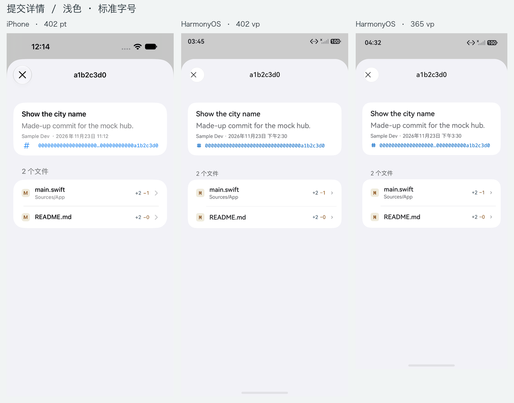
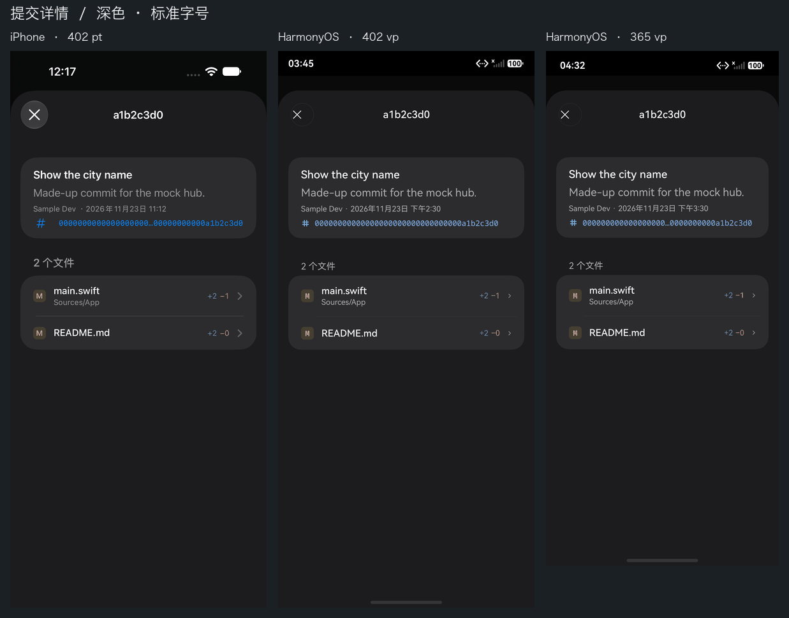
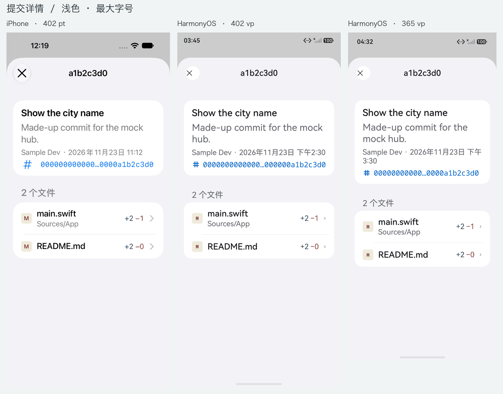

# 提交详情 · Commit details

[返回全部页面 · All pages](../README.md)

查看 Show the city name 提交、作者、短哈希和改动文件。

Three independent native captures, left to right: iPhone 402 pt, HarmonyOS 402 vp, HarmonyOS 365 vp. The complete screen, including system bars, is visible.

[Download all original screenshots and accessibility trees for this page](../originals/git-commit.zip?raw=1) · [Source and capture method](../SOURCES.md)

Original archive SHA-256: effa0c63b3abffca2863bfe10f1b67c5ede5eb6943d607b2475d60a024b300d8

## 浅色 · 标准字号

| Device | Pixels | Captured at | PNG digest | Hierarchy digest |
| --- | --- | --- | --- | --- |
| iPhone 402 pt | 1206 × 2622 | 2026-11-23T04:14:51.048+00:00 | 47687b41ebb766b8 | 4b37707e1736ebcd |
| HarmonyOS 402 vp | 1206 × 2622 | 2026-11-23T15:45:39+08:00 | 4e091169b3178c9a | 16e7eb127143f470 |
| HarmonyOS 365 vp | 1280 × 2832 | 2026-11-23T16:32:35+08:00 | 17482a2cc0532719 | 3cef9f9e6acbd9a3 |

## 深色 · 标准字号

| Device | Pixels | Captured at | PNG digest | Hierarchy digest |
| --- | --- | --- | --- | --- |
| iPhone 402 pt | 1206 × 2622 | 2026-11-23T04:17:10.909+00:00 | aa79dc4ca5d006e5 | 72a7fc6d06f88d4e |
| HarmonyOS 402 vp | 1206 × 2622 | 2026-11-23T15:45:43+08:00 | 6ed894be80c46792 | 5a0eb170bd6e3733 |
| HarmonyOS 365 vp | 1280 × 2832 | 2026-11-23T16:32:39+08:00 | e5356c902118c383 | 386194eb5ebc8b9a |

## 浅色 · 最大字号

| Device | Pixels | Captured at | PNG digest | Hierarchy digest |
| --- | --- | --- | --- | --- |
| iPhone 402 pt | 1206 × 2622 | 2026-11-23T04:19:48.199+00:00 | 20da10ce3361c3da | 892a9e5d391964f3 |
| HarmonyOS 402 vp | 1206 × 2622 | 2026-11-23T15:45:47+08:00 | c4f97d3ab0232e0c | 85d947a7977f37fc |
| HarmonyOS 365 vp | 1280 × 2832 | 2026-11-23T16:32:43+08:00 | e32a7c9d3d9a1958 | 2b7634739a7d7f0d |

Full 64-character digests and ZIP entry paths are under this page in the [manifest](../manifest.json).

[← Git 工作区](git.md)
[Git 差异 →](git-diff.md)
