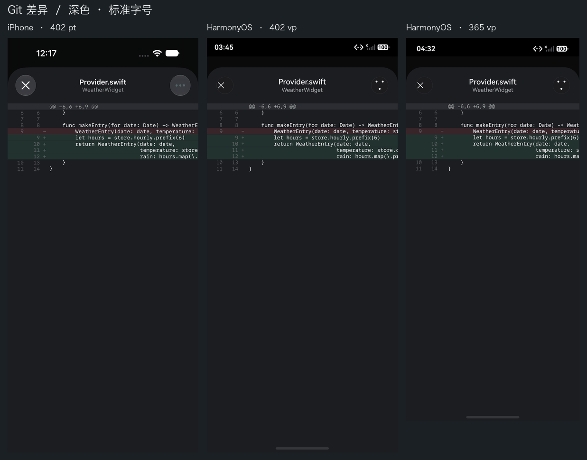
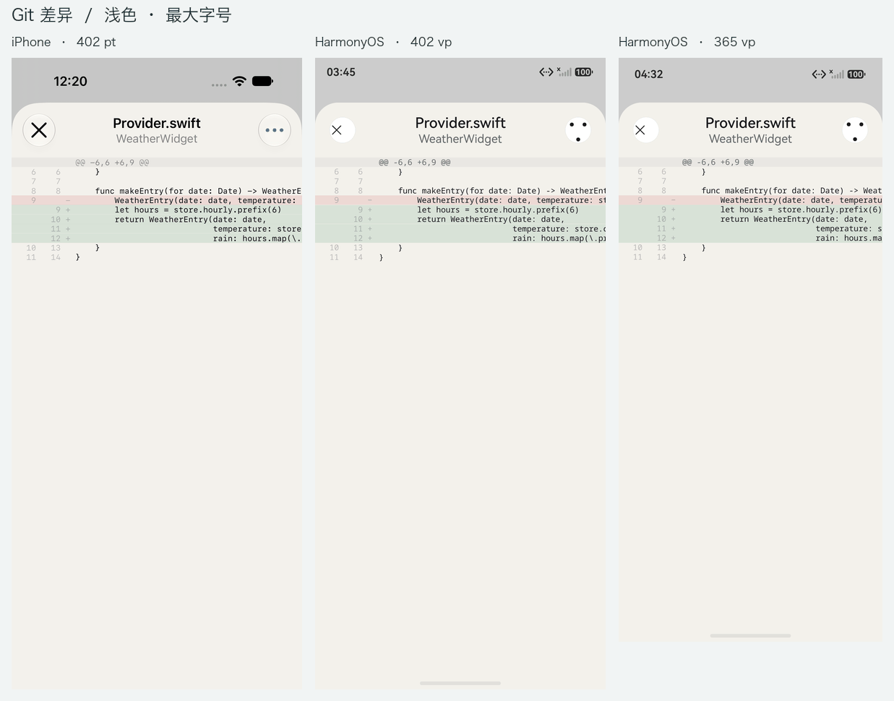

# Git 差异 · File diff

[返回全部页面 · All pages](../README.md)

读取 Provider.swift 的逐行差异。

Three independent native captures, left to right: iPhone 402 pt, HarmonyOS 402 vp, HarmonyOS 365 vp. The complete screen, including system bars, is visible.

[Download all original screenshots and accessibility trees for this page](../originals/git-diff.zip?raw=1) · [Source and capture method](../SOURCES.md)

Original archive SHA-256: 3dfcf2a806635dfb7939ba4e0908a1e52cf404cf25dbf89697316b1a445a6c62

## 浅色 · 标准字号

| Device | Pixels | Captured at | PNG digest | Hierarchy digest |
| --- | --- | --- | --- | --- |
| iPhone 402 pt | 1206 × 2622 | 2026-11-23T04:15:05.287+00:00 | d73c455418f0354c | 6cd4151a16d67384 |
| HarmonyOS 402 vp | 1206 × 2622 | 2026-11-23T15:45:16+08:00 | 5124555de0808509 | a0b148d532e64d05 |
| HarmonyOS 365 vp | 1280 × 2832 | 2026-11-23T16:32:12+08:00 | 505503bf2abbb5ef | a4c98e7f12dc24d6 |

## 深色 · 标准字号

| Device | Pixels | Captured at | PNG digest | Hierarchy digest |
| --- | --- | --- | --- | --- |
| iPhone 402 pt | 1206 × 2622 | 2026-11-23T04:17:25.361+00:00 | c6acbe9fef073fcf | ac6b3fa5b1c07b11 |
| HarmonyOS 402 vp | 1206 × 2622 | 2026-11-23T15:45:20+08:00 | b7d45f36ee8aac98 | 5d8a0e997033d135 |
| HarmonyOS 365 vp | 1280 × 2832 | 2026-11-23T16:32:16+08:00 | f212ca517a06f1d9 | 0c46b4b10fabab46 |

## 浅色 · 最大字号

| Device | Pixels | Captured at | PNG digest | Hierarchy digest |
| --- | --- | --- | --- | --- |
| iPhone 402 pt | 1206 × 2622 | 2026-11-23T04:20:02.259+00:00 | 02b3cde66e7fcd3e | 07a7527ea5157e6e |
| HarmonyOS 402 vp | 1206 × 2622 | 2026-11-23T15:45:25+08:00 | ca4056071035dd5b | 099ece1380fcd359 |
| HarmonyOS 365 vp | 1280 × 2832 | 2026-11-23T16:32:20+08:00 | 1895e1d85c9ee48e | 5af8ea4e155f6a5e |

Full 64-character digests and ZIP entry paths are under this page in the [manifest](../manifest.json).

[← 提交详情](git-commit.md)
[机器总览 →](machines.md)
