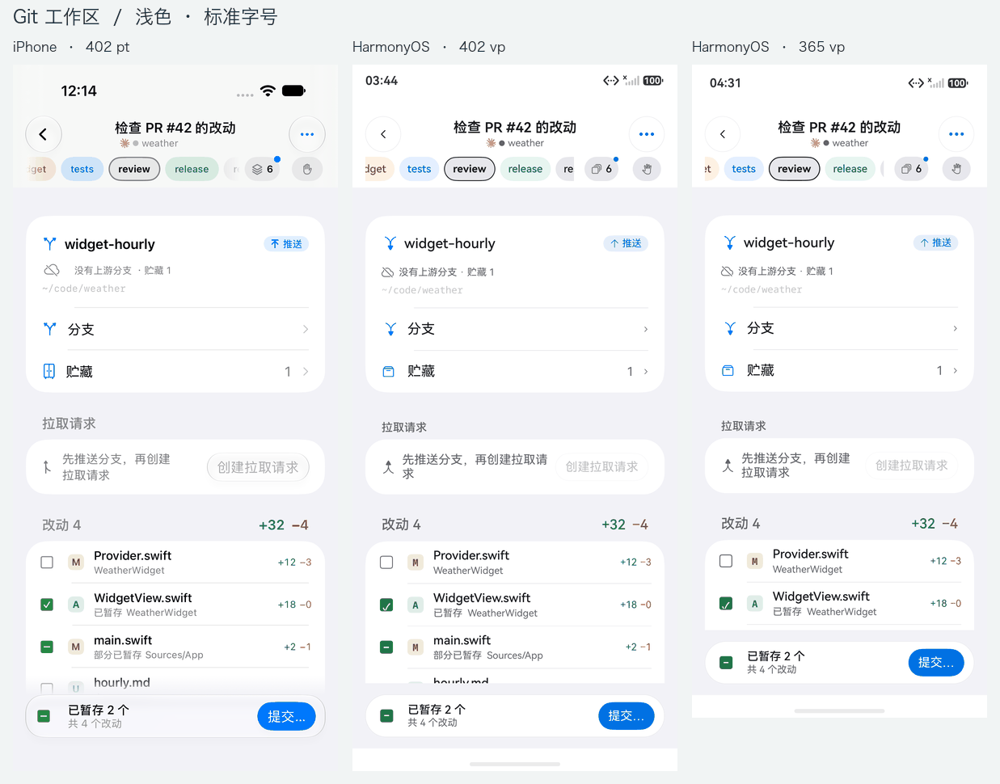
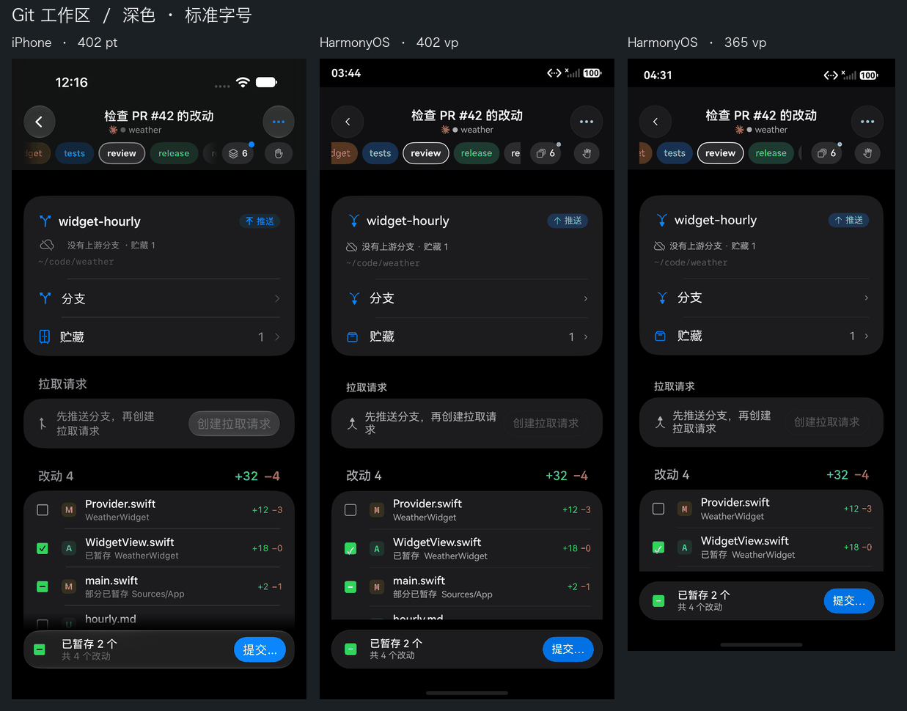
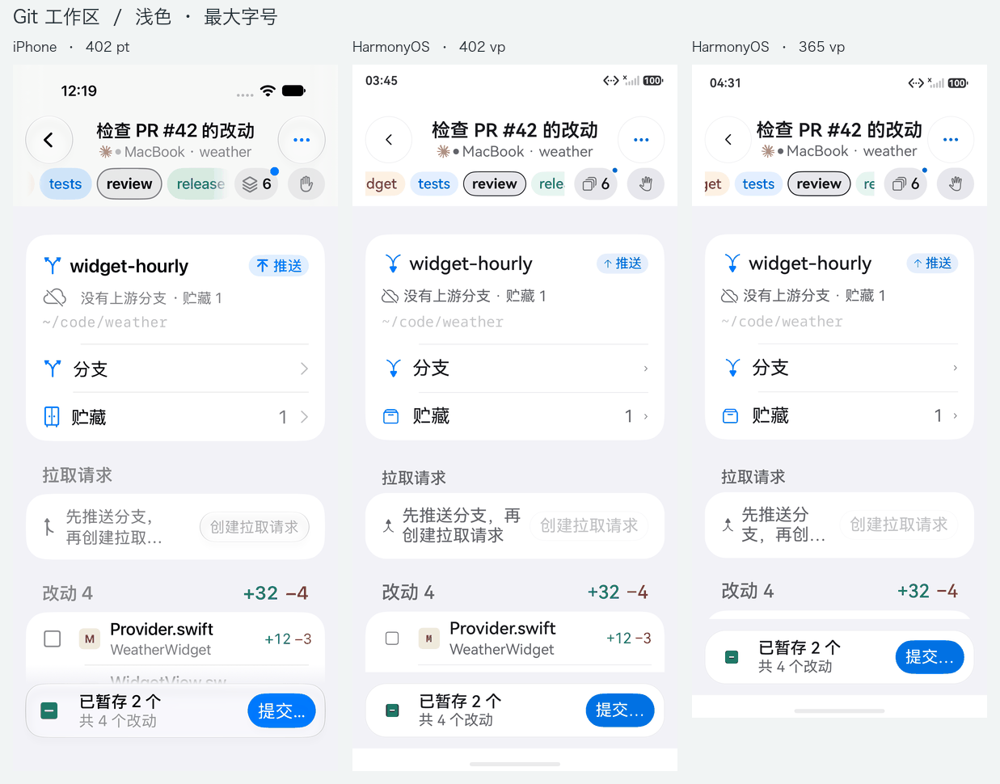

# Git 工作区 · Git workspace

[返回全部页面 · All pages](../README.md)

查看分支、改动文件及暂存状态。
Open Git from the PR #42 conversation menu and inspect its branch, stash, pull request and changes.

Three independent native captures, left to right: iPhone 402 pt, HarmonyOS 402 vp, HarmonyOS 365 vp. The complete screen, including system bars, is visible.

[Download all original screenshots and accessibility trees for this page](../originals/git.zip?raw=1) · [Source and capture method](../SOURCES.md)

Original archive SHA-256: b236125fe56b4e85a8f9d2ef4043d8604002d246784e862ed75945c72027ca90

## 浅色 · 标准字号

| Device | Pixels | Captured at | PNG digest | Hierarchy digest |
| --- | --- | --- | --- | --- |
| iPhone 402 pt | 1206 × 2622 | 2026-11-23T04:14:32.201+00:00 | af8e823cccb0f7c8 | 187ea9dfc3cc11d4 |
| HarmonyOS 402 vp | 1206 × 2622 | 2026-11-23T15:44:52+08:00 | ab91b34d623a17a3 | 4be0ac0efd9f2a5b |
| HarmonyOS 365 vp | 1280 × 2832 | 2026-11-23T16:31:46+08:00 | a5c33c815fd4c907 | 171985fa21a3313a |

## 深色 · 标准字号

| Device | Pixels | Captured at | PNG digest | Hierarchy digest |
| --- | --- | --- | --- | --- |
| iPhone 402 pt | 1206 × 2622 | 2026-11-23T04:16:51.860+00:00 | 75321068a98b50df | 1c195062cc8ce1bc |
| HarmonyOS 402 vp | 1206 × 2622 | 2026-11-23T15:44:56+08:00 | 2e53c97a64833825 | 160df4489ece3e3e |
| HarmonyOS 365 vp | 1280 × 2832 | 2026-11-23T16:31:50+08:00 | fb5c749119475ae8 | f853db896efae062 |

## 浅色 · 最大字号

| Device | Pixels | Captured at | PNG digest | Hierarchy digest |
| --- | --- | --- | --- | --- |
| iPhone 402 pt | 1206 × 2622 | 2026-11-23T04:19:29.110+00:00 | 702348332dbf6bd9 | 0914e5f537c21299 |
| HarmonyOS 402 vp | 1206 × 2622 | 2026-11-23T15:45:00+08:00 | 514615d4d8d1a561 | 039d4d5aa9b5bc41 |
| HarmonyOS 365 vp | 1280 × 2832 | 2026-11-23T16:31:55+08:00 | 551400896df60cee | a808d9ac48e0a467 |

Full 64-character digests and ZIP entry paths are under this page in the [manifest](../manifest.json).

[← 工作区文件搜索](file-search.md)
[提交详情 →](git-commit.md)
