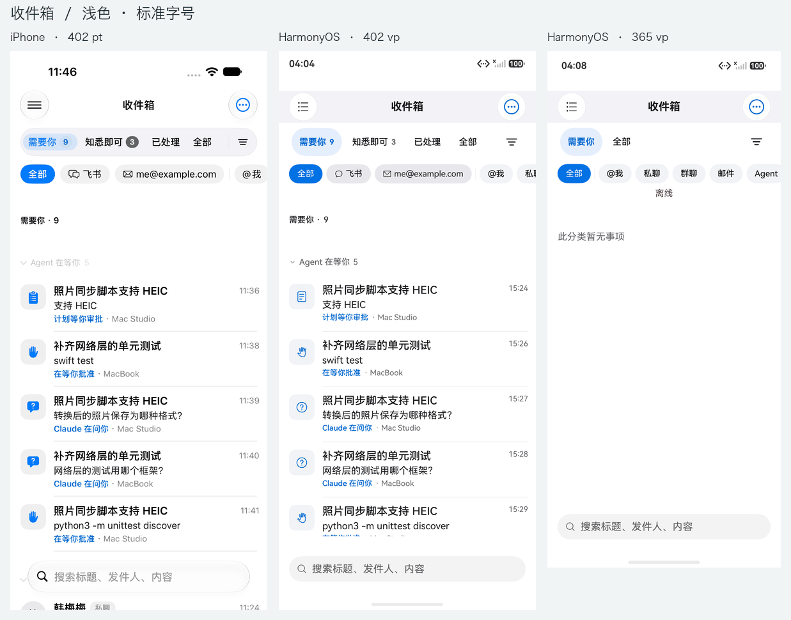
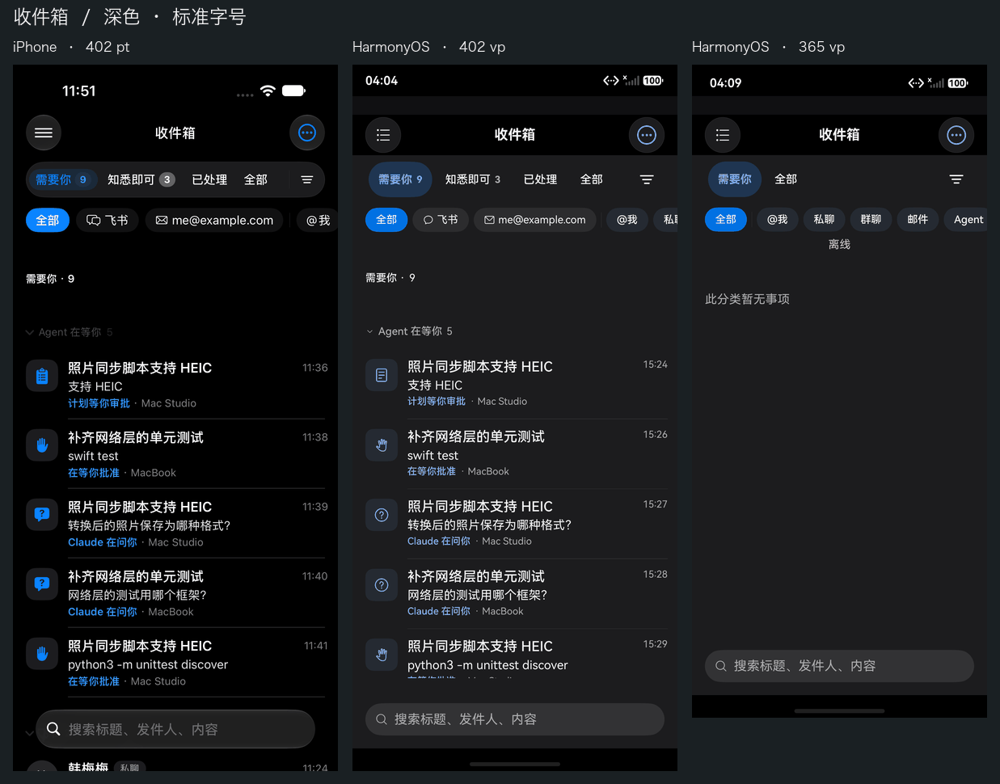
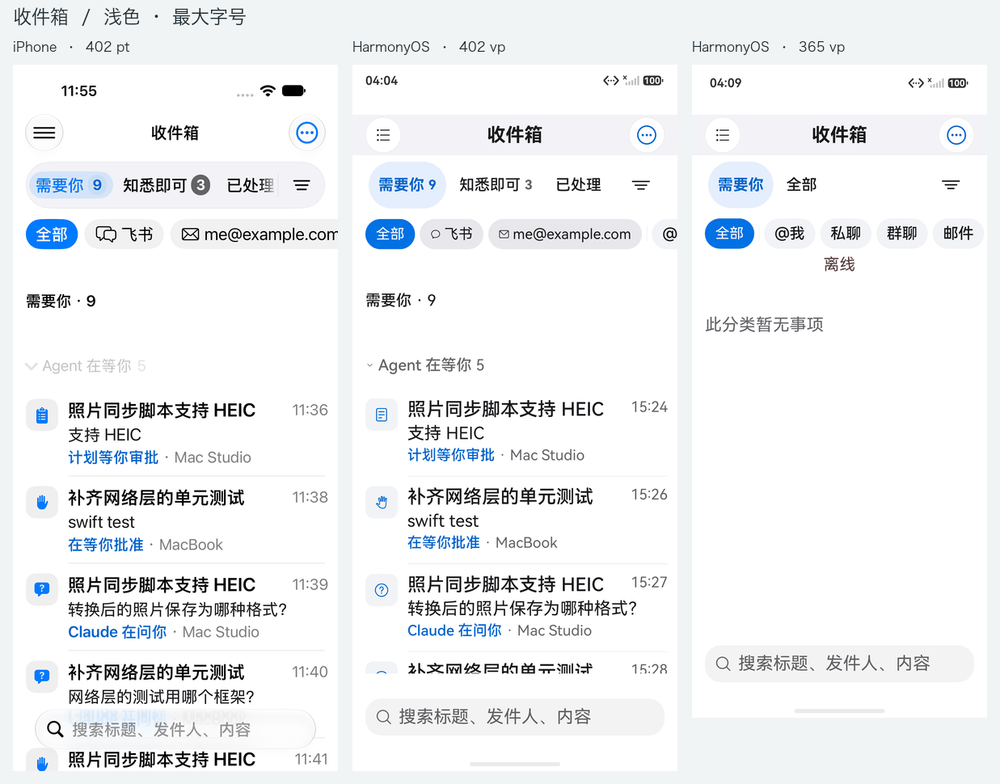

# 收件箱 · Inbox

[返回全部页面 · All pages](../README.md)

查看收件箱的分类、筛选和待处理事项。

Three independent native captures, left to right: iPhone 402 pt, HarmonyOS 402 vp, HarmonyOS 365 vp. The complete screen, including system bars, is visible.

[Download all original screenshots and accessibility trees for this page](../originals/inbox.zip?raw=1) · [Source and capture method](../SOURCES.md)

Original archive SHA-256: 5896521d2d95945c8ba8afe6073400fa7d1c2c6127d4b6b00a8643ed5c146e01

## 浅色 · 标准字号

| Device | Pixels | Captured at | PNG digest | Hierarchy digest |
| --- | --- | --- | --- | --- |
| iPhone 402 pt | 1206 × 2622 | 2026-11-23T03:46:52.984+00:00 | f17fd80e7cb103bc | f7226f4745f246c8 |
| HarmonyOS 402 vp | 1206 × 2622 | 2026-11-23T16:04:32+08:00 | 3325661a0af71d0c | e06caea1ee1621e8 |
| HarmonyOS 365 vp | 1280 × 2832 | 2026-11-23T16:08:37+08:00 | 82cbed61f9b39c41 | 20c88fe7eed48e29 |

## 深色 · 标准字号

| Device | Pixels | Captured at | PNG digest | Hierarchy digest |
| --- | --- | --- | --- | --- |
| iPhone 402 pt | 1206 × 2622 | 2026-11-23T03:51:23.244+00:00 | 286534499fb26ae2 | 3e1e79ef8b4f04d1 |
| HarmonyOS 402 vp | 1206 × 2622 | 2026-11-23T16:04:36+08:00 | 1d51b65514b006aa | 6944bb6f5785c992 |
| HarmonyOS 365 vp | 1280 × 2832 | 2026-11-23T16:09:01+08:00 | 2c2af50646f59eba | 75a2b2797349e6c8 |

## 浅色 · 最大字号

| Device | Pixels | Captured at | PNG digest | Hierarchy digest |
| --- | --- | --- | --- | --- |
| iPhone 402 pt | 1206 × 2622 | 2026-11-23T03:55:27.213+00:00 | 6502343ca847e070 | f72a46527f39f8c4 |
| HarmonyOS 402 vp | 1206 × 2622 | 2026-11-23T16:04:40+08:00 | d9fe2954f9a0e2d9 | 0bd0dfcbfb3070f7 |
| HarmonyOS 365 vp | 1280 × 2832 | 2026-11-23T16:09:19+08:00 | 77fb5d4f9d74e03d | 8ab367867fe98db5 |

Full 64-character digests and ZIP entry paths are under this page in the [manifest](../manifest.json).

[← 搜索会话内容](search.md)
[待办 →](todo.md)
