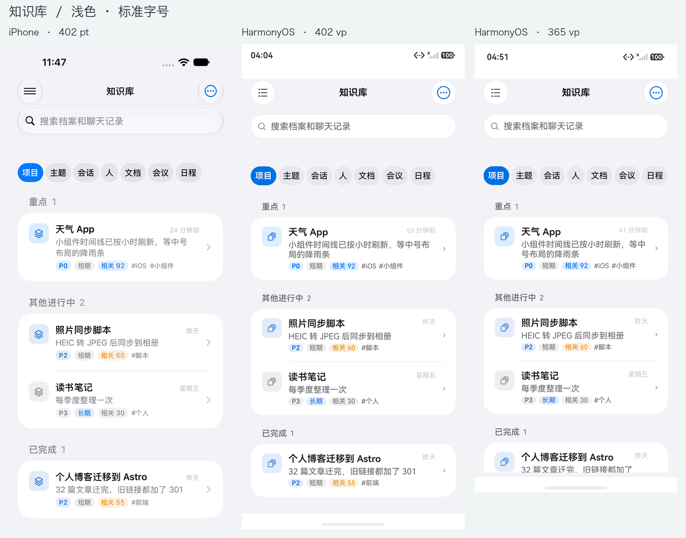
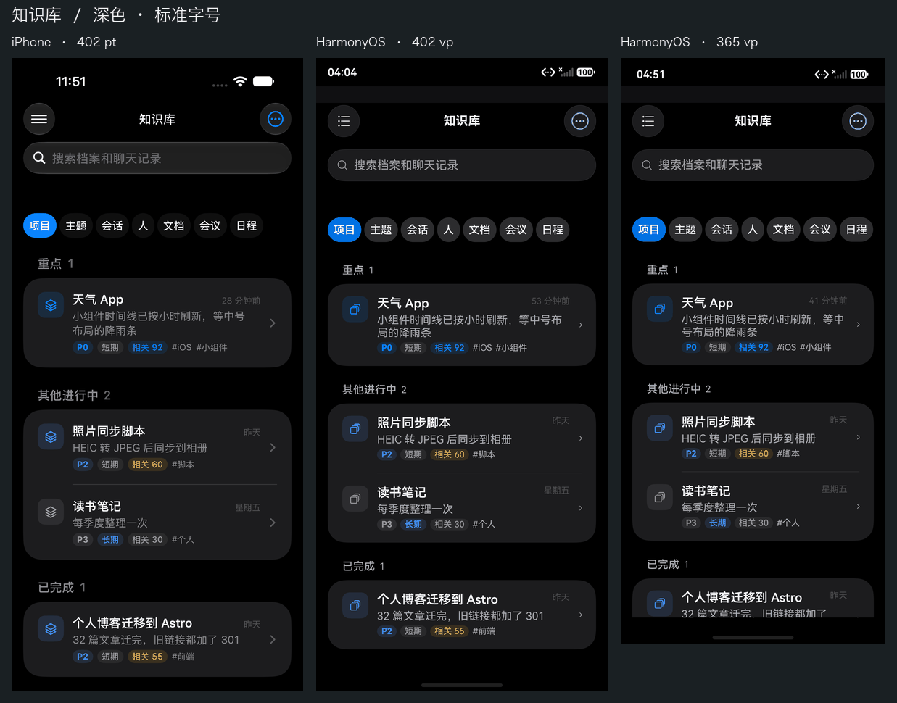
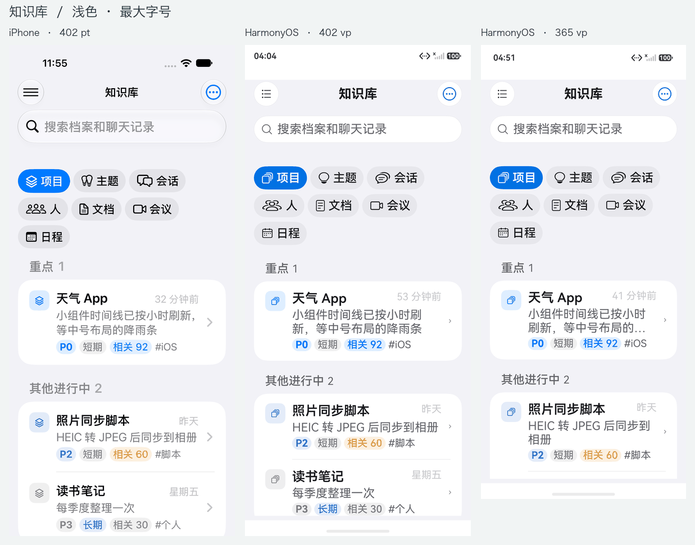

# 知识库 · Knowledge

[返回全部页面 · All pages](../README.md)

浏览知识库的分类和条目。
Compare the same projects across Focus, Other Active and Completed, including priority and state.

Three independent native captures, left to right: iPhone 402 pt, HarmonyOS 402 vp, HarmonyOS 365 vp. The complete screen, including system bars, is visible.

[Download all original screenshots and accessibility trees for this page](../originals/knowledge.zip?raw=1) · [Source and capture method](../SOURCES.md)

Original archive SHA-256: 315ab633029ccbe800e5126b0682d941836f79a028c74f3ef579508088a18f7f

## 浅色 · 标准字号

| Device | Pixels | Captured at | PNG digest | Hierarchy digest |
| --- | --- | --- | --- | --- |
| iPhone 402 pt | 1206 × 2622 | 2026-11-23T03:47:04.955+00:00 | adf1c593557eda56 | 11617a745b08deae |
| HarmonyOS 402 vp | 1206 × 2622 | 2026-11-23T16:04:01+08:00 | 26fa18042159843c | 20778e708ecd4a1b |
| HarmonyOS 365 vp | 1280 × 2832 | 2026-11-23T16:51:41+08:00 | 141a7678ac2c4da9 | 0a839feb2f3e7d5d |

## 深色 · 标准字号

| Device | Pixels | Captured at | PNG digest | Hierarchy digest |
| --- | --- | --- | --- | --- |
| iPhone 402 pt | 1206 × 2622 | 2026-11-23T03:51:34.509+00:00 | b26965c385855c79 | dc82327574abafce |
| HarmonyOS 402 vp | 1206 × 2622 | 2026-11-23T16:04:04+08:00 | bfa0f724465c6cbc | 722fc4d339effad9 |
| HarmonyOS 365 vp | 1280 × 2832 | 2026-11-23T16:51:45+08:00 | 76bed53f33114612 | 47683edc3145490e |

## 浅色 · 最大字号

| Device | Pixels | Captured at | PNG digest | Hierarchy digest |
| --- | --- | --- | --- | --- |
| iPhone 402 pt | 1206 × 2622 | 2026-11-23T03:55:37.604+00:00 | 2d48f1f2f6b2e534 | d2624df61339ed59 |
| HarmonyOS 402 vp | 1206 × 2622 | 2026-11-23T16:04:09+08:00 | dd81f8d4b04e9a57 | 7dc3695dfc379a45 |
| HarmonyOS 365 vp | 1280 × 2832 | 2026-11-23T16:51:49+08:00 | 449bd6c9efd8a363 | 50cdfdd05f62fcc8 |

Full 64-character digests and ZIP entry paths are under this page in the [manifest](../manifest.json).

[← 今日待办与排序](todo-due.md)
[会议 →](meetings.md)
