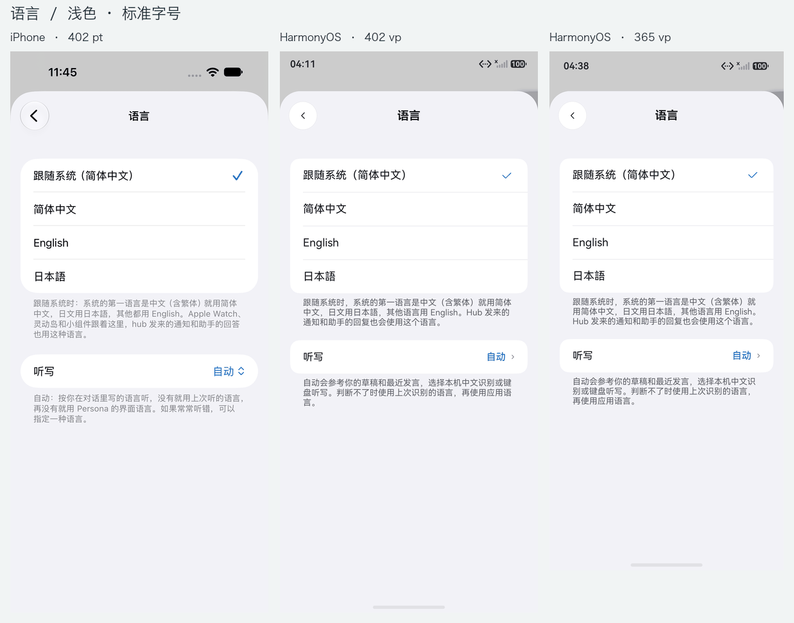
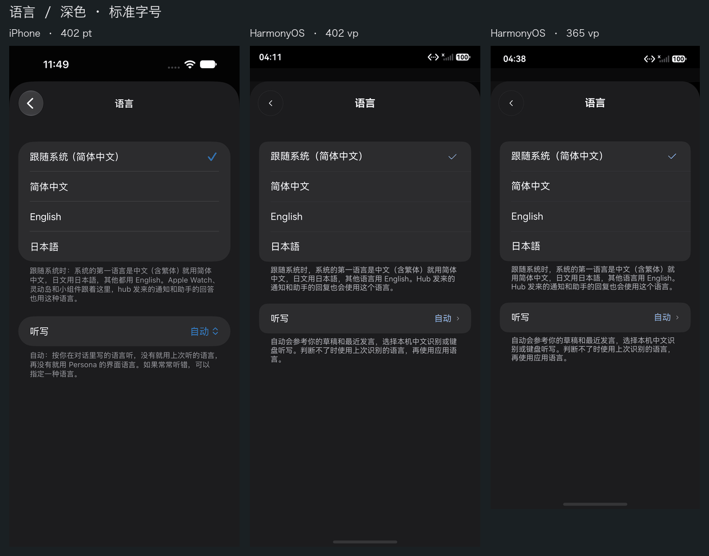
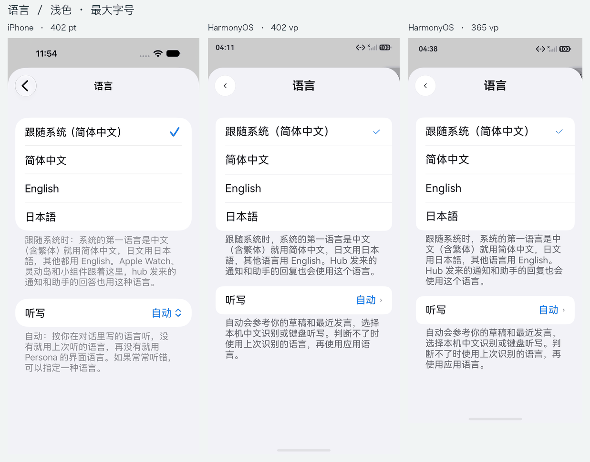

# 语言 · Language settings

[返回全部页面 · All pages](../README.md)

查看可选应用语言和当前语言设置。
Open Language in Settings. Automatic dictation follows the conversation language and the device’s available input methods.

Three independent native captures, left to right: iPhone 402 pt, HarmonyOS 402 vp, HarmonyOS 365 vp. The complete screen, including system bars, is visible.

[Download all original screenshots and accessibility trees for this page](../originals/language.zip?raw=1) · [Source and capture method](../SOURCES.md)

Original archive SHA-256: 8d30ff04fc261c2a10bcb42bc9b7ad952fb0df92f24f53c807b52463a02601ff

## 浅色 · 标准字号

| Device | Pixels | Captured at | PNG digest | Hierarchy digest |
| --- | --- | --- | --- | --- |
| iPhone 402 pt | 1206 × 2622 | 2026-11-23T03:45:10.768+00:00 | fe2b97a653f7f473 | 01bb55439167b5e6 |
| HarmonyOS 402 vp | 1206 × 2622 | 2026-11-23T16:11:21+08:00 | fb58e94f4b970d43 | f68b6158f4c48a9e |
| HarmonyOS 365 vp | 1280 × 2832 | 2026-11-23T16:38:39+08:00 | 7445051aabf060f5 | 5842fc82b9301123 |

## 深色 · 标准字号

| Device | Pixels | Captured at | PNG digest | Hierarchy digest |
| --- | --- | --- | --- | --- |
| iPhone 402 pt | 1206 × 2622 | 2026-11-23T03:49:49.380+00:00 | 7970e0c0c894c9f9 | bed21ca367bc8af4 |
| HarmonyOS 402 vp | 1206 × 2622 | 2026-11-23T16:11:25+08:00 | 5e3e0983f879ce80 | e16956f6611b89a4 |
| HarmonyOS 365 vp | 1280 × 2832 | 2026-11-23T16:38:43+08:00 | d3796468d0d66440 | 7433c6551f64230a |

## 浅色 · 最大字号

| Device | Pixels | Captured at | PNG digest | Hierarchy digest |
| --- | --- | --- | --- | --- |
| iPhone 402 pt | 1206 × 2622 | 2026-11-23T03:54:06.279+00:00 | e3aa1b7f7093ffa2 | 3b67b25ee0685736 |
| HarmonyOS 402 vp | 1206 × 2622 | 2026-11-23T16:11:29+08:00 | 0c22f77cc1a467f6 | 9ec6f9c8a472a62a |
| HarmonyOS 365 vp | 1280 × 2832 | 2026-11-23T16:38:47+08:00 | 75cb95ace8138c33 | 30443f178766e30d |

Full 64-character digests and ZIP entry paths are under this page in the [manifest](../manifest.json).

[← 返回设置搜索结果](settings-search-restored.md)
[Agent 偏好 →](agent-preferences.md)
