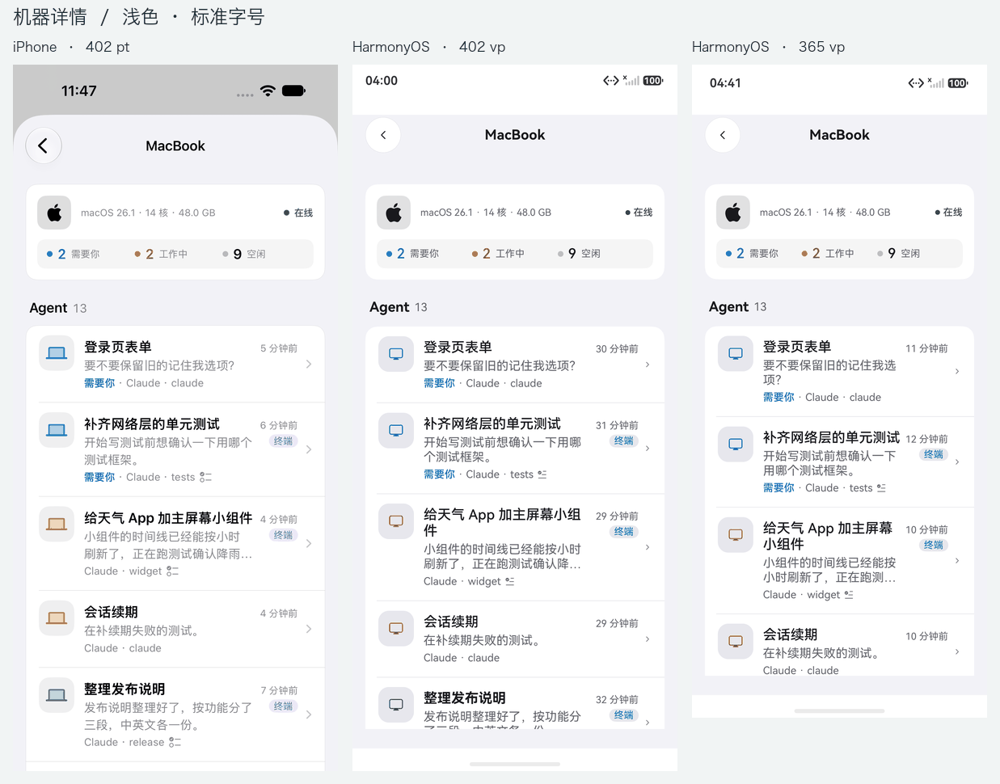
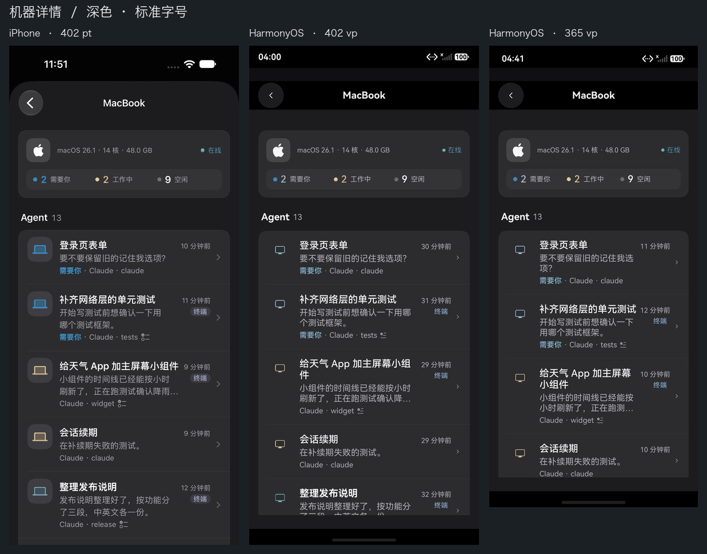
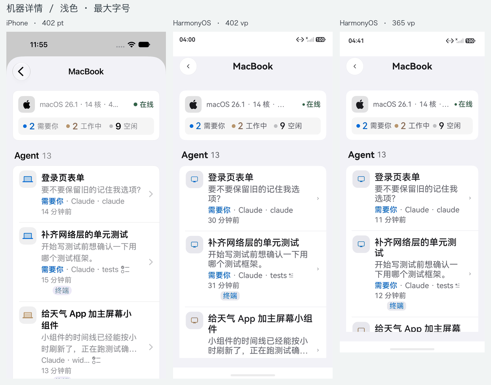

# 机器详情 · Machine details

[返回全部页面 · All pages](../README.md)

进入同一台测试 MacBook 的详情。
Open the fixture MacBook from the machine directory and inspect its agents.

Three independent native captures, left to right: iPhone 402 pt, HarmonyOS 402 vp, HarmonyOS 365 vp. The complete screen, including system bars, is visible.

[Download all original screenshots and accessibility trees for this page](../originals/machine-detail.zip?raw=1) · [Source and capture method](../SOURCES.md)

Original archive SHA-256: 7ea4994b7a1f7557a920cff624972a96609467f97336ae2d47750001f6da6dcf

## 浅色 · 标准字号

| Device | Pixels | Captured at | PNG digest | Hierarchy digest |
| --- | --- | --- | --- | --- |
| iPhone 402 pt | 1206 × 2622 | 2026-11-23T03:47:18.644+00:00 | ded5c81ec82181c6 | 1ea8a946317302e6 |
| HarmonyOS 402 vp | 1206 × 2622 | 2026-11-23T16:00:38+08:00 | 2ea5d41b52e05371 | f6bb7a971552aeaf |
| HarmonyOS 365 vp | 1280 × 2832 | 2026-11-23T16:41:05+08:00 | a5ea06b89bbe9372 | 9eed8b84abe66cfb |

## 深色 · 标准字号

| Device | Pixels | Captured at | PNG digest | Hierarchy digest |
| --- | --- | --- | --- | --- |
| iPhone 402 pt | 1206 × 2622 | 2026-11-23T03:51:47.599+00:00 | 462155be5ba66055 | 28fef38f21418b2b |
| HarmonyOS 402 vp | 1206 × 2622 | 2026-11-23T16:00:41+08:00 | 04b175011a15799c | a1ff27100a0746ff |
| HarmonyOS 365 vp | 1280 × 2832 | 2026-11-23T16:41:09+08:00 | c895da3cfd80e2ba | 0ca432b0360d47ff |

## 浅色 · 最大字号

| Device | Pixels | Captured at | PNG digest | Hierarchy digest |
| --- | --- | --- | --- | --- |
| iPhone 402 pt | 1206 × 2622 | 2026-11-23T03:55:48.707+00:00 | 22be2d412bd91dea | 68f103e140bf53c6 |
| HarmonyOS 402 vp | 1206 × 2622 | 2026-11-23T16:00:46+08:00 | 5e1ba209d19e9038 | 03b1de77a029eb61 |
| HarmonyOS 365 vp | 1280 × 2832 | 2026-11-23T16:41:13+08:00 | 8ed6d400d496a12a | 9489713120f3ee94 |

Full 64-character digests and ZIP entry paths are under this page in the [manifest](../manifest.json).

[← 机器总览](machines.md)
[机器监控读数 →](machine-monitor.md)
