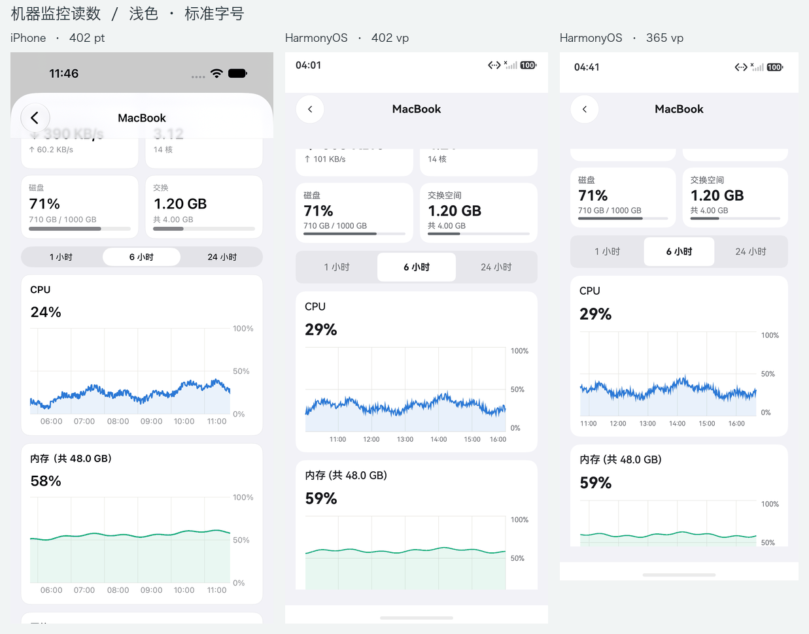
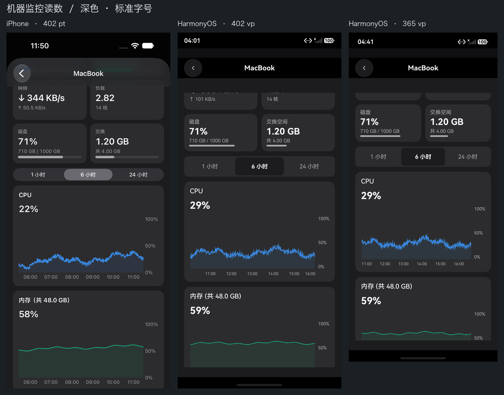
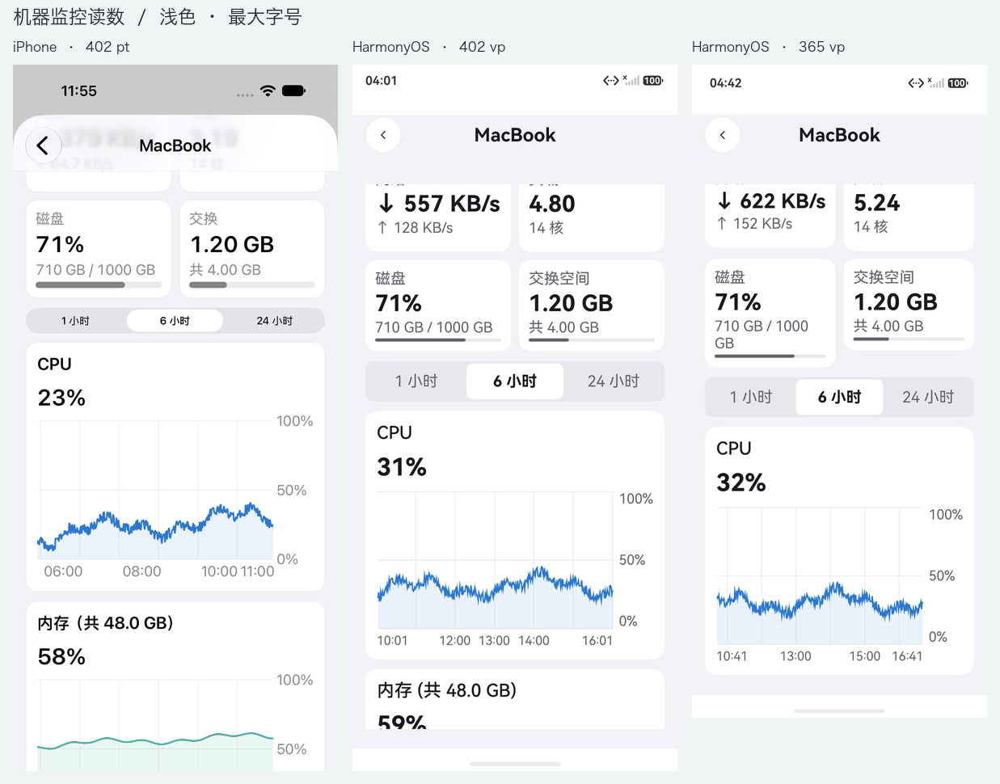

# 机器监控读数 · Machine metrics

[返回全部页面 · All pages](../README.md)

查看 MacBook 的 CPU 历史曲线及所选时间范围。
Inspect six hours of CPU history on the fixture MacBook. Each local Hub has its own sampling time and values.

Three independent native captures, left to right: iPhone 402 pt, HarmonyOS 402 vp, HarmonyOS 365 vp. The complete screen, including system bars, is visible.

[Download all original screenshots and accessibility trees for this page](../originals/machine-monitor.zip?raw=1) · [Source and capture method](../SOURCES.md)

Original archive SHA-256: 8294bd2d4b0da491d5f3afaa6a5718f04ee3b039a1201843e6fb0b284f352f14

## 浅色 · 标准字号

| Device | Pixels | Captured at | PNG digest | Hierarchy digest |
| --- | --- | --- | --- | --- |
| iPhone 402 pt | 1206 × 2622 | 2026-11-23T03:46:13.790+00:00 | 94d0f9de787a6d9e | 06863e946a1e9d71 |
| HarmonyOS 402 vp | 1206 × 2622 | 2026-11-23T16:01:09+08:00 | e585fc9b212ae012 | 9964b66870e78a86 |
| HarmonyOS 365 vp | 1280 × 2832 | 2026-11-23T16:41:40+08:00 | 48072ba1f5a8d0dc | 96a0c21a6c6aee57 |

## 深色 · 标准字号

| Device | Pixels | Captured at | PNG digest | Hierarchy digest |
| --- | --- | --- | --- | --- |
| iPhone 402 pt | 1206 × 2622 | 2026-11-23T03:50:47.259+00:00 | 03ca8d8cb6d0c6b9 | 5dee76907f08fb49 |
| HarmonyOS 402 vp | 1206 × 2622 | 2026-11-23T16:01:13+08:00 | b51e018077ac5d21 | dcdefe6519282367 |
| HarmonyOS 365 vp | 1280 × 2832 | 2026-11-23T16:41:45+08:00 | 626d5036da943fa5 | 5d0dd08588d9f46d |

## 浅色 · 最大字号

| Device | Pixels | Captured at | PNG digest | Hierarchy digest |
| --- | --- | --- | --- | --- |
| iPhone 402 pt | 1206 × 2622 | 2026-11-23T03:55:05.619+00:00 | b946da9726c8e08b | 5023d2be2713347d |
| HarmonyOS 402 vp | 1206 × 2622 | 2026-11-23T16:01:25+08:00 | 58f1cce32c517c08 | 9ec8cfbc9a4d155d |
| HarmonyOS 365 vp | 1280 × 2832 | 2026-11-23T16:42:01+08:00 | df443ec295416af4 | 0d6f347ca57514c5 |

Full 64-character digests and ZIP entry paths are under this page in the [manifest](../manifest.json).

[← 机器详情](machine-detail.md)
[侧栏 →](drawer.md)
