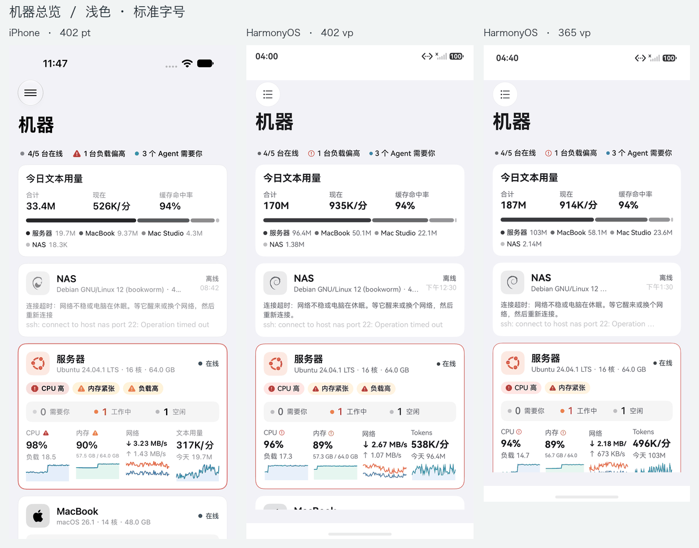
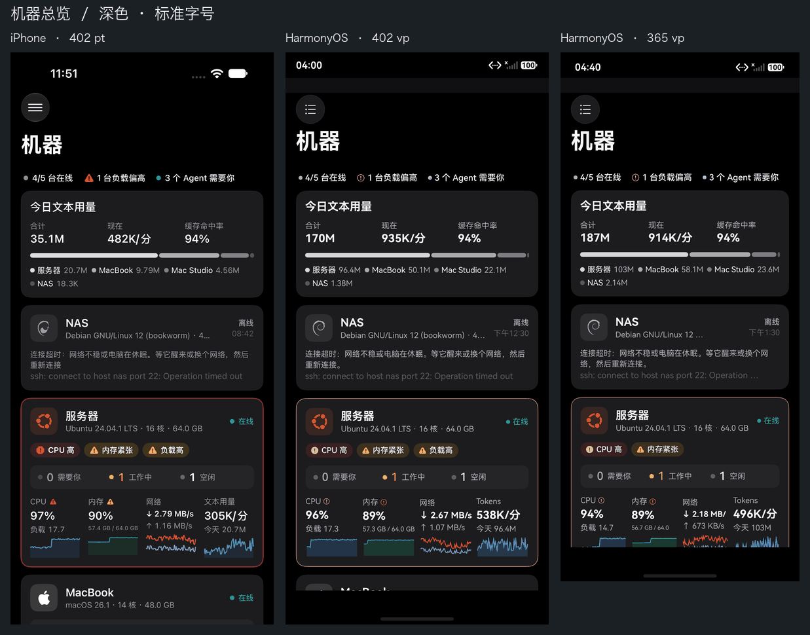
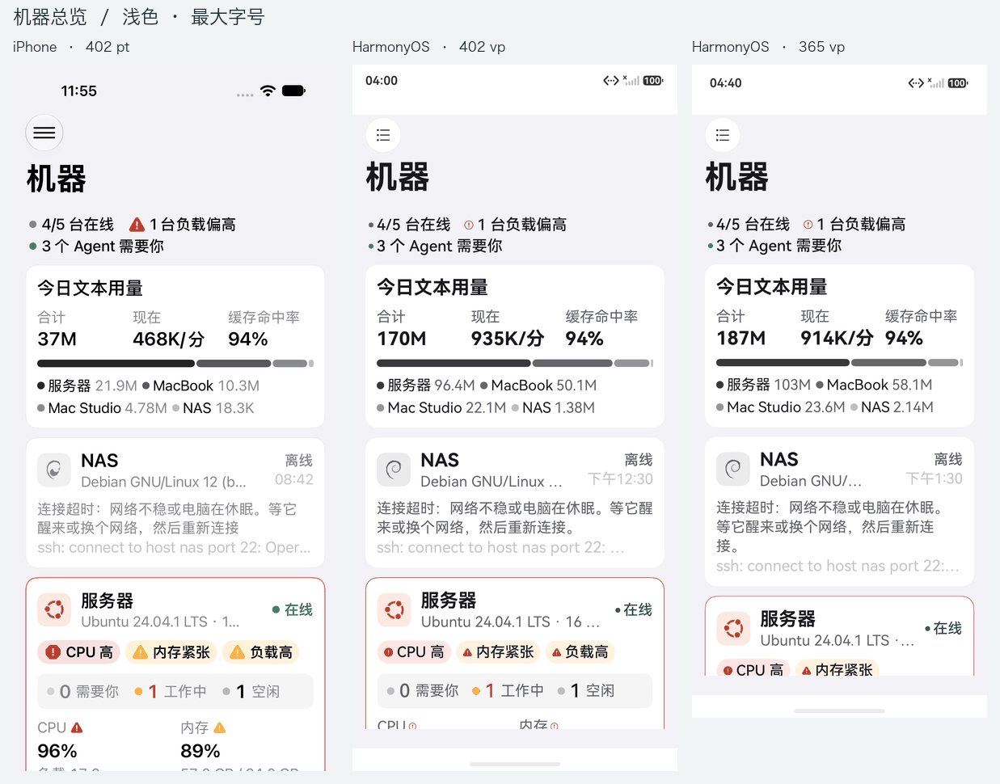

# 机器总览 · Machines

[返回全部页面 · All pages](../README.md)

比较机器的在线状态、负载与使用量。

Three independent native captures, left to right: iPhone 402 pt, HarmonyOS 402 vp, HarmonyOS 365 vp. The complete screen, including system bars, is visible.

[Download all original screenshots and accessibility trees for this page](../originals/machines.zip?raw=1) · [Source and capture method](../SOURCES.md)

Original archive SHA-256: 036aec62f5ccbb0f40940a1543bea221a241ce7ad20a0a5557c4d7251436b50e

## 浅色 · 标准字号

| Device | Pixels | Captured at | PNG digest | Hierarchy digest |
| --- | --- | --- | --- | --- |
| iPhone 402 pt | 1206 × 2622 | 2026-11-23T03:47:31.633+00:00 | 4a22ad4036597628 | c47ae7eb5612b306 |
| HarmonyOS 402 vp | 1206 × 2622 | 2026-11-23T16:00:24+08:00 | 543ab8d2c8b53db4 | b6637f2e8cc5eff3 |
| HarmonyOS 365 vp | 1280 × 2832 | 2026-11-23T16:40:46+08:00 | ccf5d7c4b6574db0 | 02f607a9cfbe51bf |

## 深色 · 标准字号

| Device | Pixels | Captured at | PNG digest | Hierarchy digest |
| --- | --- | --- | --- | --- |
| iPhone 402 pt | 1206 × 2622 | 2026-11-23T03:51:59.282+00:00 | 53384c30d517a64f | aad8f80389806184 |
| HarmonyOS 402 vp | 1206 × 2622 | 2026-11-23T16:00:28+08:00 | 9fc8306060c53bf7 | ce421f7b706311bc |
| HarmonyOS 365 vp | 1280 × 2832 | 2026-11-23T16:40:49+08:00 | eac8a16fb246fd11 | fab9165deb526e88 |

## 浅色 · 最大字号

| Device | Pixels | Captured at | PNG digest | Hierarchy digest |
| --- | --- | --- | --- | --- |
| iPhone 402 pt | 1206 × 2622 | 2026-11-23T03:55:59.611+00:00 | 78fc14144742a23e | aeddb58ded0e0bf9 |
| HarmonyOS 402 vp | 1206 × 2622 | 2026-11-23T16:00:32+08:00 | 4ae1b7729257652b | a472536ef433e78f |
| HarmonyOS 365 vp | 1280 × 2832 | 2026-11-23T16:40:54+08:00 | 01f532f5c2b8916b | 6b213b507fb31d7d |

Full 64-character digests and ZIP entry paths are under this page in the [manifest](../manifest.json).

[← Git 差异](git-diff.md)
[机器详情 →](machine-detail.md)
