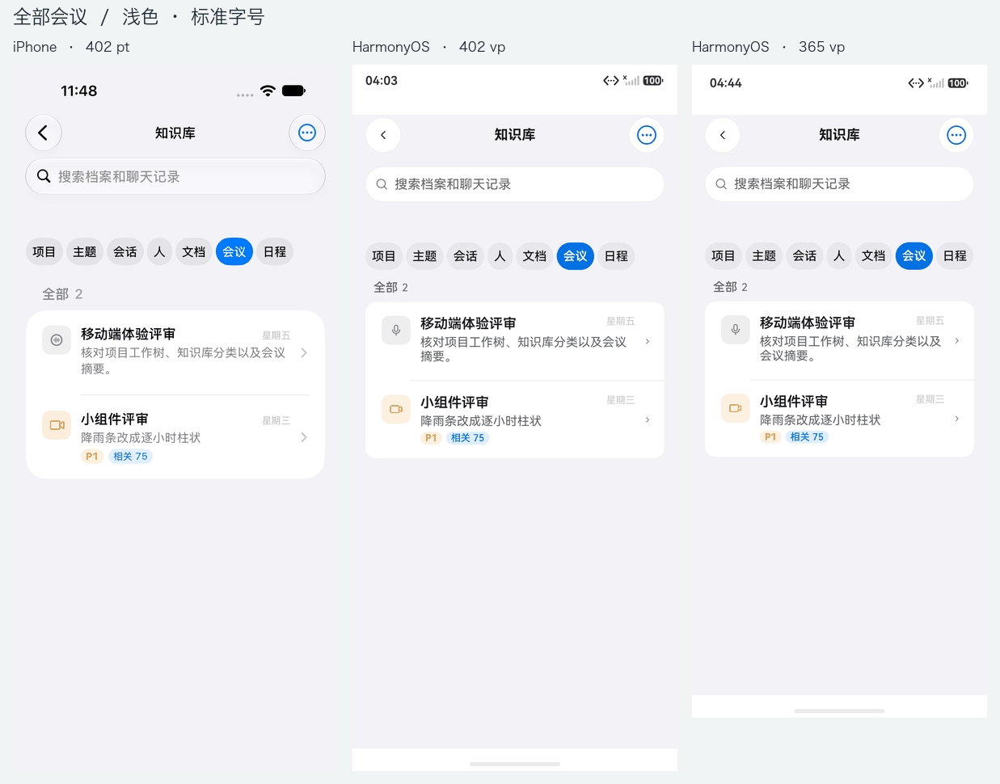
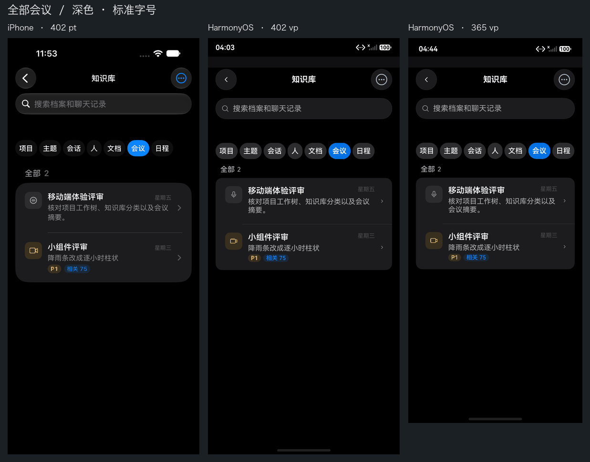
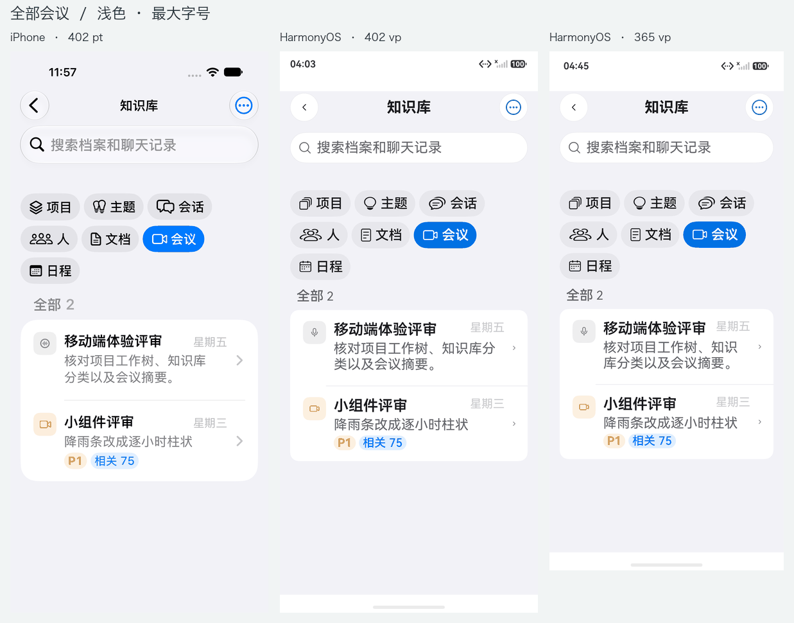

# 全部会议 · All meetings

[返回全部页面 · All pages](../README.md)

打开会议记录列表，找到移动端体验评审。

Three independent native captures, left to right: iPhone 402 pt, HarmonyOS 402 vp, HarmonyOS 365 vp. The complete screen, including system bars, is visible.

[Download all original screenshots and accessibility trees for this page](../originals/meeting-list.zip?raw=1) · [Source and capture method](../SOURCES.md)

Original archive SHA-256: 392aa5ba5bb2fae336d37f7e9239675882d3d397cd9bfa981cad2f5ba8c247af

## 浅色 · 标准字号

| Device | Pixels | Captured at | PNG digest | Hierarchy digest |
| --- | --- | --- | --- | --- |
| iPhone 402 pt | 1206 × 2622 | 2026-11-23T03:48:42.938+00:00 | 5f31ec054da05b06 | ed79b9ecb2a41fa3 |
| HarmonyOS 402 vp | 1206 × 2622 | 2026-11-23T16:03:05+08:00 | 6b428842b0508207 | a98e05fd0eaeac30 |
| HarmonyOS 365 vp | 1280 × 2832 | 2026-11-23T16:44:41+08:00 | cc618704712c454b | 7075dc906d8aeb95 |

## 深色 · 标准字号

| Device | Pixels | Captured at | PNG digest | Hierarchy digest |
| --- | --- | --- | --- | --- |
| iPhone 402 pt | 1206 × 2622 | 2026-11-23T03:53:06.011+00:00 | 7eb36882689a3901 | 63af27a19be6a647 |
| HarmonyOS 402 vp | 1206 × 2622 | 2026-11-23T16:03:09+08:00 | 0322af206444f887 | f9b6dbb7912d4668 |
| HarmonyOS 365 vp | 1280 × 2832 | 2026-11-23T16:44:44+08:00 | 0455580618d7505b | 456c41907fa35fdd |

## 浅色 · 最大字号

| Device | Pixels | Captured at | PNG digest | Hierarchy digest |
| --- | --- | --- | --- | --- |
| iPhone 402 pt | 1206 × 2622 | 2026-11-23T03:57:00.970+00:00 | 52b4cae6f63ec416 | c6a6e78a35b83e5a |
| HarmonyOS 402 vp | 1206 × 2622 | 2026-11-23T16:03:13+08:00 | 998927b58f9bf7d4 | e9f726bf372c75cf |
| HarmonyOS 365 vp | 1280 × 2832 | 2026-11-23T16:45:01+08:00 | c25fd8651ad3cc6b | 6c1ac91610ab19ef |

Full 64-character digests and ZIP entry paths are under this page in the [manifest](../manifest.json).

[← 会议](meetings.md)
[会议详情 →](meeting-detail.md)
