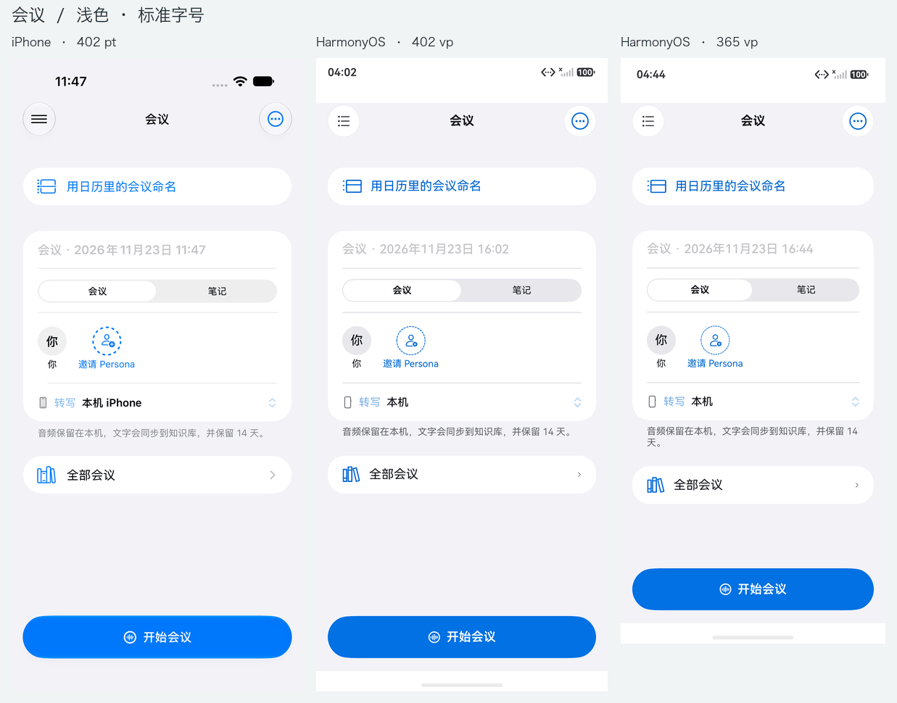
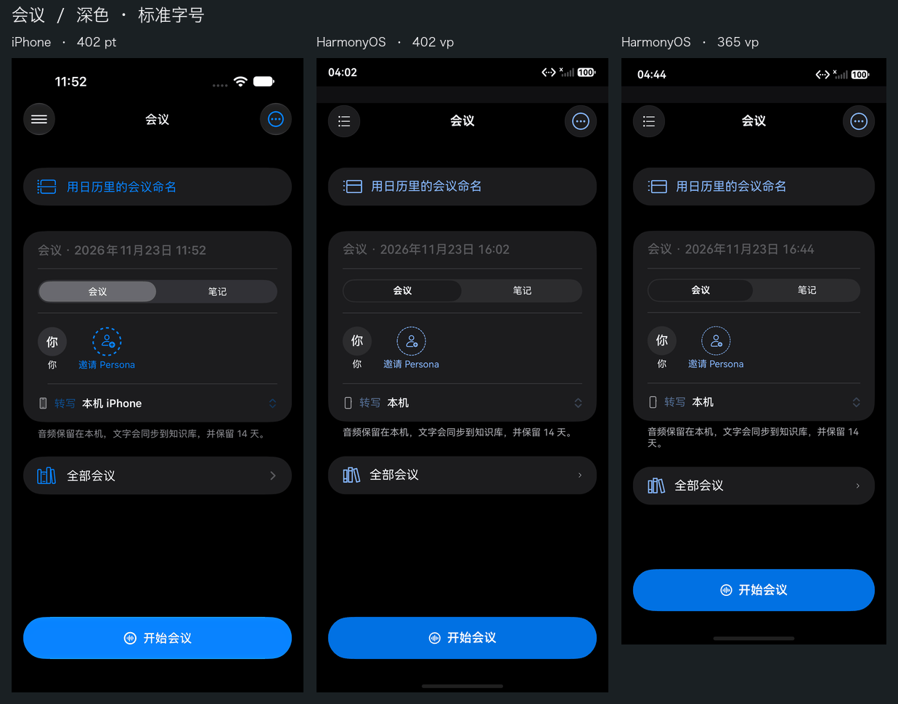
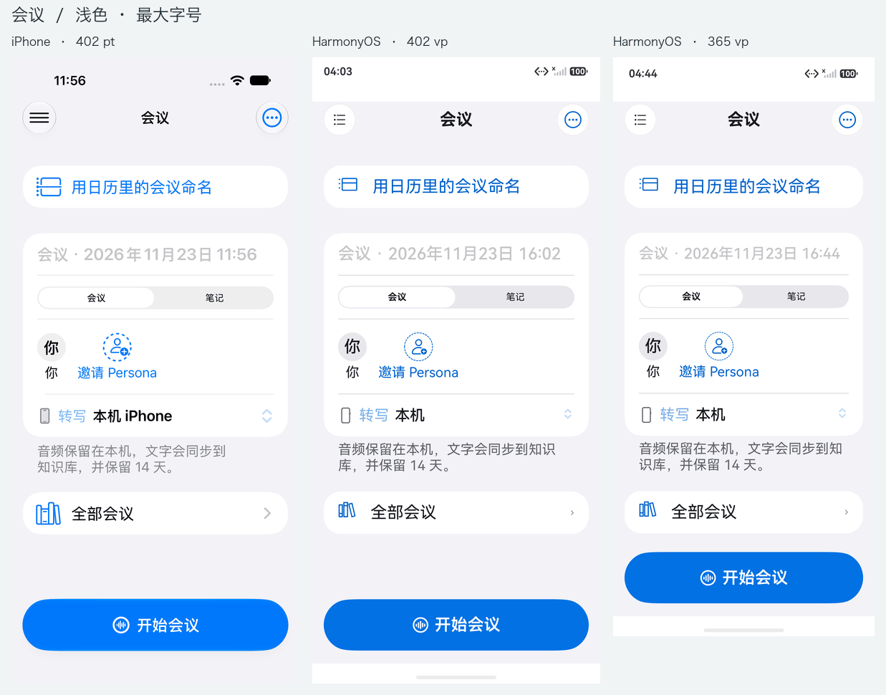

# 会议 · Meetings

[返回全部页面 · All pages](../README.md)

查看会议首页、录制入口及全部会议入口。
Compare the meeting and note setup, calendar naming, assistant invitation and start action.

Three independent native captures, left to right: iPhone 402 pt, HarmonyOS 402 vp, HarmonyOS 365 vp. The complete screen, including system bars, is visible.

[Download all original screenshots and accessibility trees for this page](../originals/meetings.zip?raw=1) · [Source and capture method](../SOURCES.md)

Original archive SHA-256: 8c49d1abf59483a71a64c6263643f08a2aa1ef4f81053d639fc458d0427e54de

## 浅色 · 标准字号

| Device | Pixels | Captured at | PNG digest | Hierarchy digest |
| --- | --- | --- | --- | --- |
| iPhone 402 pt | 1206 × 2622 | 2026-11-23T03:47:44.729+00:00 | edf55a50b3ade862 | 0b524bdaa1ef05fb |
| HarmonyOS 402 vp | 1206 × 2622 | 2026-11-23T16:02:53+08:00 | c56e5ed3541131ca | f420b950aadc2db9 |
| HarmonyOS 365 vp | 1280 × 2832 | 2026-11-23T16:44:20+08:00 | 788efc6714abc477 | d45c21bd72fac079 |

## 深色 · 标准字号

| Device | Pixels | Captured at | PNG digest | Hierarchy digest |
| --- | --- | --- | --- | --- |
| iPhone 402 pt | 1206 × 2622 | 2026-11-23T03:52:10.781+00:00 | b8f617b9b2a75217 | af0e1647605184c1 |
| HarmonyOS 402 vp | 1206 × 2622 | 2026-11-23T16:02:56+08:00 | d08f27a7e59e0dd9 | ddbd40a670d2ca57 |
| HarmonyOS 365 vp | 1280 × 2832 | 2026-11-23T16:44:24+08:00 | 7ab3523b69fc26a0 | 5a009bb7b187354a |

## 浅色 · 最大字号

| Device | Pixels | Captured at | PNG digest | Hierarchy digest |
| --- | --- | --- | --- | --- |
| iPhone 402 pt | 1206 × 2622 | 2026-11-23T03:56:10.049+00:00 | 5e01c5cd2fd629af | ff708b27af6a201e |
| HarmonyOS 402 vp | 1206 × 2622 | 2026-11-23T16:03:00+08:00 | 76e57e8f1a3a397e | 2b06add9de991b7d |
| HarmonyOS 365 vp | 1280 × 2832 | 2026-11-23T16:44:34+08:00 | 49362b452c522725 | d3eef794fd746257 |

Full 64-character digests and ZIP entry paths are under this page in the [manifest](../manifest.json).

[← 知识库](knowledge.md)
[全部会议 →](meeting-list.md)
