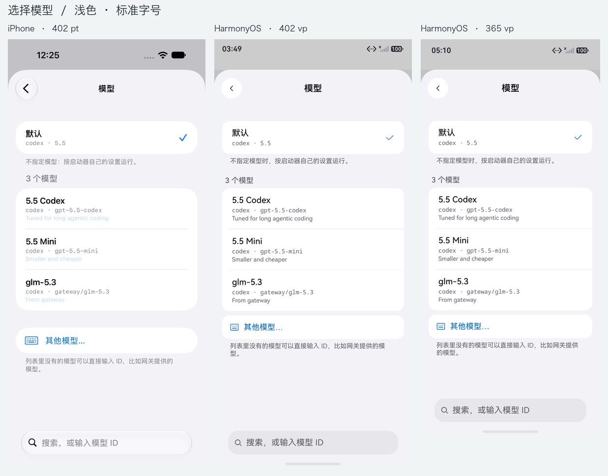
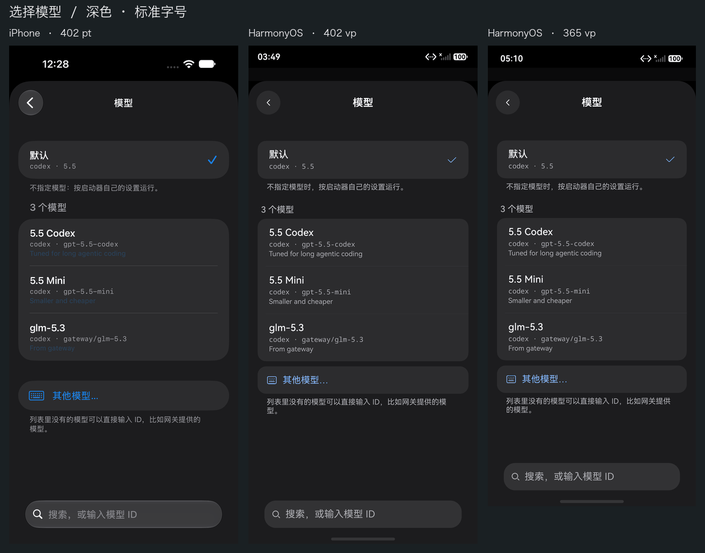
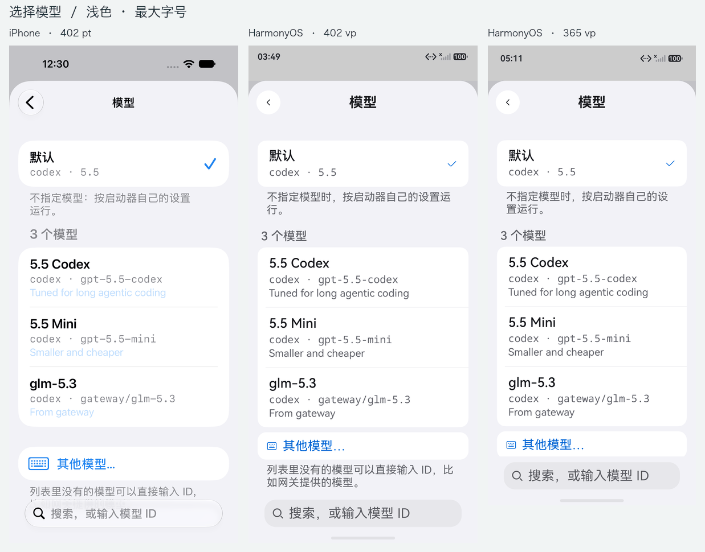

# 选择模型 · Choose a model

[返回全部页面 · All pages](../README.md)

打开所选启动器提供的模型列表。

Three independent native captures, left to right: iPhone 402 pt, HarmonyOS 402 vp, HarmonyOS 365 vp. The complete screen, including system bars, is visible.

[Download all original screenshots and accessibility trees for this page](../originals/models.zip?raw=1) · [Source and capture method](../SOURCES.md)

Original archive SHA-256: 5433f1727dc7716f67f5fcf966c28fef76d47bd98bbc85360fa5e872da16d38a

## 浅色 · 标准字号

| Device | Pixels | Captured at | PNG digest | Hierarchy digest |
| --- | --- | --- | --- | --- |
| iPhone 402 pt | 1206 × 2622 | 2026-11-23T04:25:34.535+00:00 | 99227d5ac11eec17 | 5fd31307e22251ec |
| HarmonyOS 402 vp | 1206 × 2622 | 2026-11-23T15:49:04+08:00 | e6ee26d3784899d1 | 9be607f9966cc3b9 |
| HarmonyOS 365 vp | 1280 × 2832 | 2026-11-23T17:10:52+08:00 | 7db4fe9a1e0f543c | 34df2c2f772c2b5e |

## 深色 · 标准字号

| Device | Pixels | Captured at | PNG digest | Hierarchy digest |
| --- | --- | --- | --- | --- |
| iPhone 402 pt | 1206 × 2622 | 2026-11-23T04:28:03.946+00:00 | 035096e790c295e1 | c89dbb6bd871bb8b |
| HarmonyOS 402 vp | 1206 × 2622 | 2026-11-23T15:49:08+08:00 | d6b903b65a4e76c8 | 8baaee891cc8e147 |
| HarmonyOS 365 vp | 1280 × 2832 | 2026-11-23T17:10:56+08:00 | c4adc1745df2f7c1 | c87b591486877127 |

## 浅色 · 最大字号

| Device | Pixels | Captured at | PNG digest | Hierarchy digest |
| --- | --- | --- | --- | --- |
| iPhone 402 pt | 1206 × 2622 | 2026-11-23T04:30:38.268+00:00 | f97284b38e930d5a | e789fd58bf206850 |
| HarmonyOS 402 vp | 1206 × 2622 | 2026-11-23T15:49:12+08:00 | cafd4ef34205e245 | 74b30f72bf042bde |
| HarmonyOS 365 vp | 1280 × 2832 | 2026-11-23T17:11:00+08:00 | 3f521c2bd6732ab4 | 2fa93a7cee39abe7 |

Full 64-character digests and ZIP entry paths are under this page in the [manifest](../manifest.json).

[← 选择目录](folder-browser.md)
[提交 Agent 配置 →](start-ready.md)
