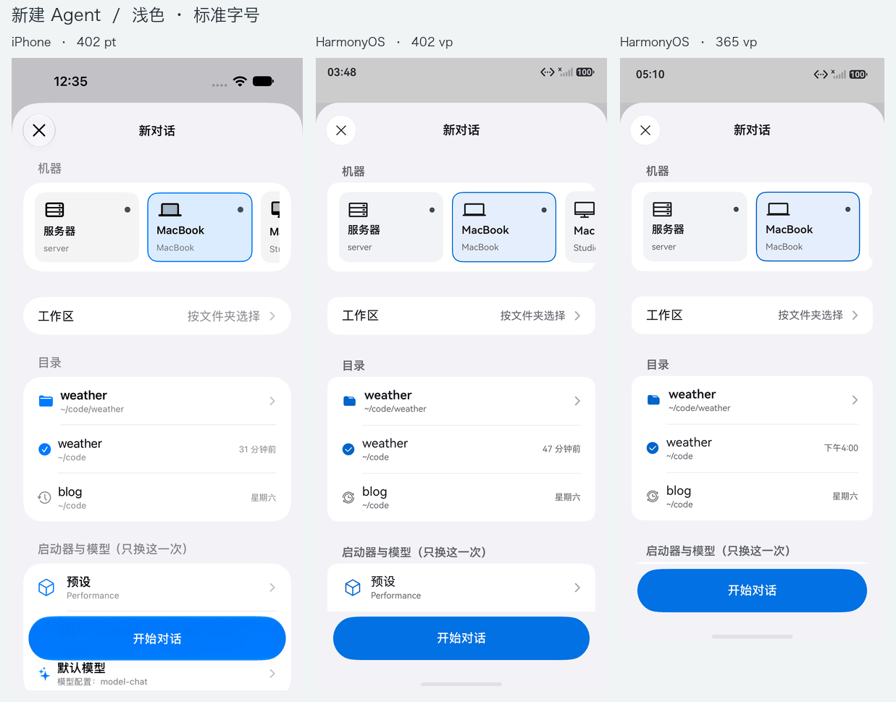
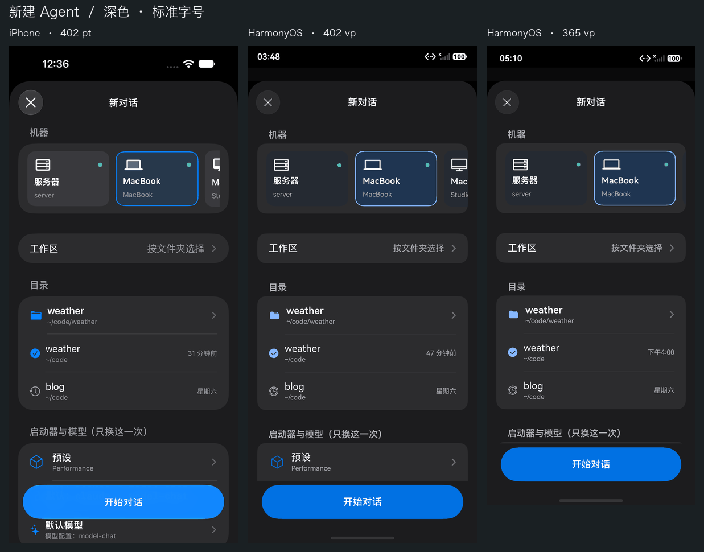
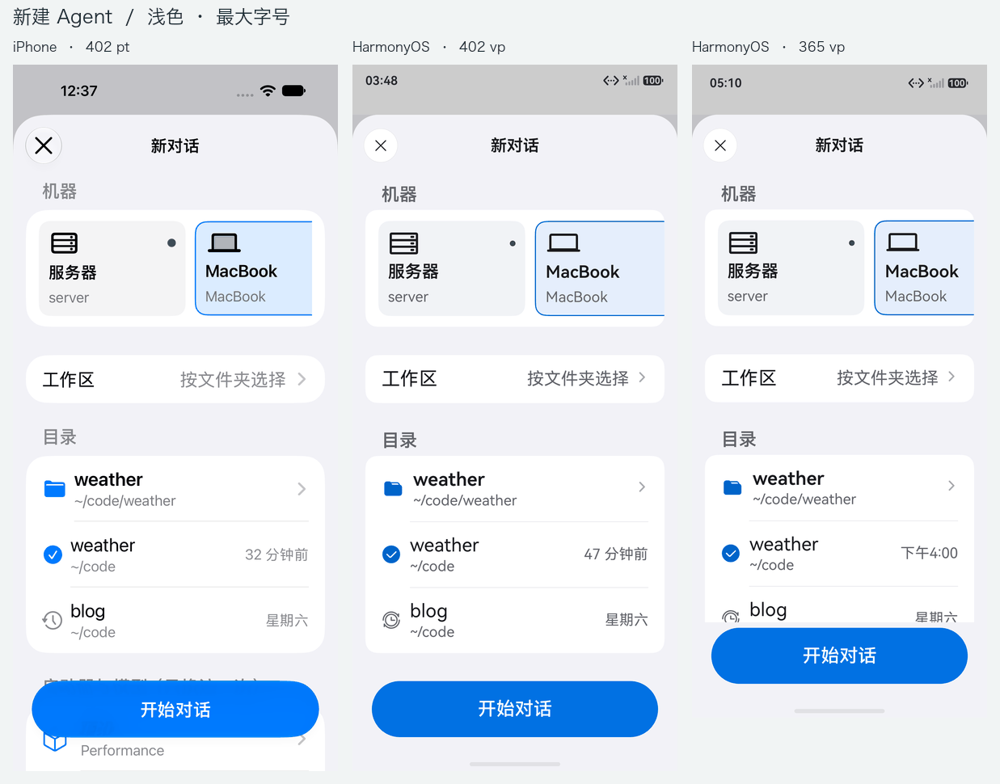

# 新建 Agent · New agent

[返回全部页面 · All pages](../README.md)

在启动表单选择机器、工作目录和启动器。
Compare the machine, directory, launcher and default model in the start form.

Three independent native captures, left to right: iPhone 402 pt, HarmonyOS 402 vp, HarmonyOS 365 vp. The complete screen, including system bars, is visible.

[Download all original screenshots and accessibility trees for this page](../originals/new-agent.zip?raw=1) · [Source and capture method](../SOURCES.md)

Original archive SHA-256: cc20bcc15076cd70eabefd19b7e9085245fcaac6c06aba8ad165d26697fd5606

## 浅色 · 标准字号

| Device | Pixels | Captured at | PNG digest | Hierarchy digest |
| --- | --- | --- | --- | --- |
| iPhone 402 pt | 1206 × 2622 | 2026-11-23T04:35:54.704+00:00 | 4385288e6abca5c3 | 259dbcd20a45a082 |
| HarmonyOS 402 vp | 1206 × 2622 | 2026-11-23T15:48:25+08:00 | f535edc7247d3341 | 49c6eb765ee7287d |
| HarmonyOS 365 vp | 1280 × 2832 | 2026-11-23T17:10:08+08:00 | a0021308c492ee3d | daab9f6f31756d47 |

## 深色 · 标准字号

| Device | Pixels | Captured at | PNG digest | Hierarchy digest |
| --- | --- | --- | --- | --- |
| iPhone 402 pt | 1206 × 2622 | 2026-11-23T04:36:44.729+00:00 | 1777779bf887b88c | fc654f1d1351c4e2 |
| HarmonyOS 402 vp | 1206 × 2622 | 2026-11-23T15:48:29+08:00 | 5d0e668cd9de053c | 294b643a6ca14697 |
| HarmonyOS 365 vp | 1280 × 2832 | 2026-11-23T17:10:12+08:00 | bef8ec9ed40e04b4 | be1d35167cba49b0 |

## 浅色 · 最大字号

| Device | Pixels | Captured at | PNG digest | Hierarchy digest |
| --- | --- | --- | --- | --- |
| iPhone 402 pt | 1206 × 2622 | 2026-11-23T04:37:35.720+00:00 | 22223fe0cc49abde | 322baf6d8cbe2a77 |
| HarmonyOS 402 vp | 1206 × 2622 | 2026-11-23T15:48:33+08:00 | d05b0ef59fa02630 | f78b5f2cdcda839f |
| HarmonyOS 365 vp | 1280 × 2832 | 2026-11-23T17:10:16+08:00 | bcdcb3e4a7353286 | 02d814988e7e0d42 |

Full 64-character digests and ZIP entry paths are under this page in the [manifest](../manifest.json).

[← 工作树详情](worktree.md)
[选择目录 →](folder-browser.md)
