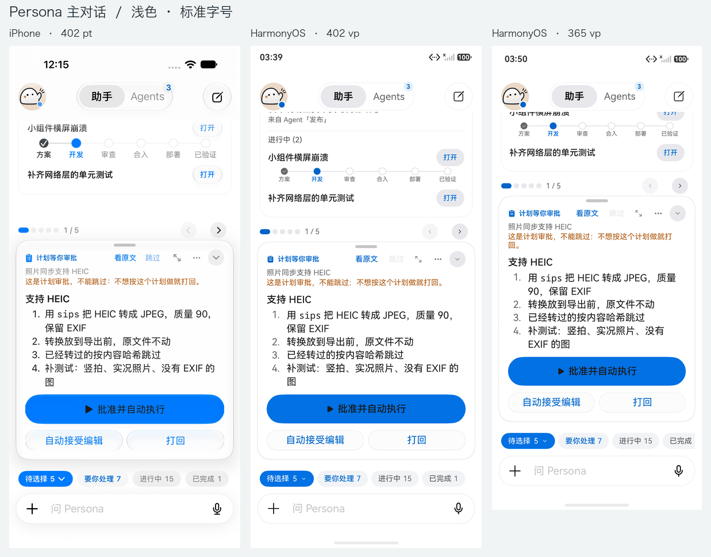
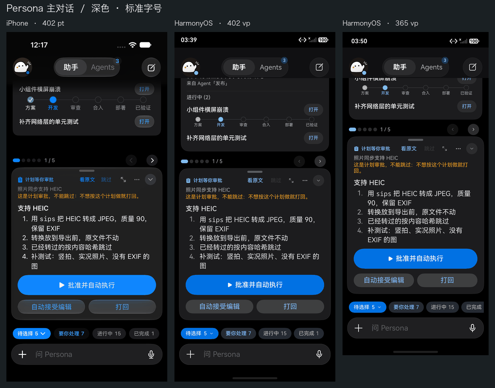
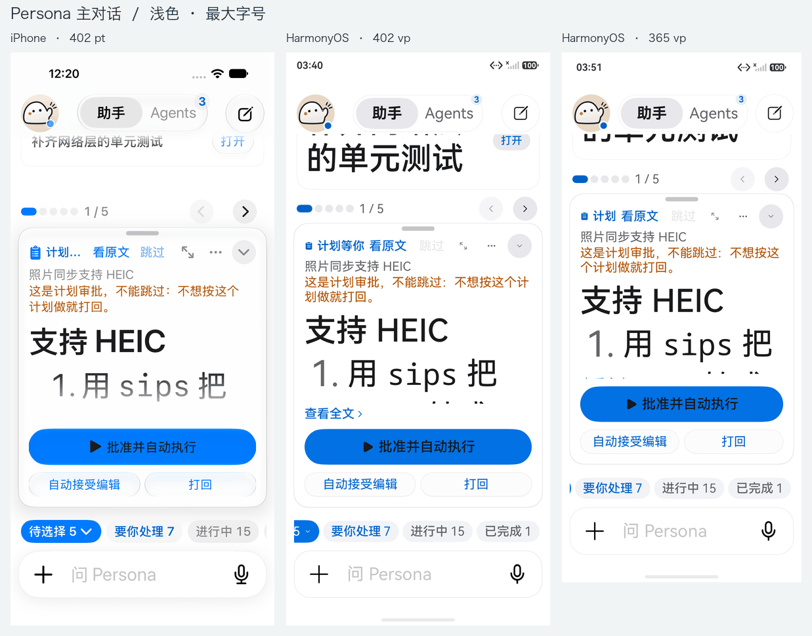

# Persona 主对话 · Main assistant conversation

[返回全部页面 · All pages](../README.md)

查看主助手的消息、任务卡和输入区。
Compare the assistant briefing, its progress links, the pending Agent plan and the composer.

Three independent native captures, left to right: iPhone 402 pt, HarmonyOS 402 vp, HarmonyOS 365 vp. The complete screen, including system bars, is visible.

[Download all original screenshots and accessibility trees for this page](../originals/persona.zip?raw=1) · [Source and capture method](../SOURCES.md)

Original archive SHA-256: 43abe651db4ae9b9e19c2d119e5b08188b5e585509ee110dc3667ed669dfbb9e

## 浅色 · 标准字号

| Device | Pixels | Captured at | PNG digest | Hierarchy digest |
| --- | --- | --- | --- | --- |
| iPhone 402 pt | 1206 × 2622 | 2026-11-23T04:15:28.731+00:00 | 31aca5948db426cb | 2ecf5e9c2d2c8272 |
| HarmonyOS 402 vp | 1206 × 2622 | 2026-11-23T15:39:33+08:00 | c98786a098dd0755 | 6d36cf8ffc9cf658 |
| HarmonyOS 365 vp | 1280 × 2832 | 2026-11-23T15:50:30+08:00 | 0f4bb85a9bc04c47 | ee3a2ce50307ee05 |

## 深色 · 标准字号

| Device | Pixels | Captured at | PNG digest | Hierarchy digest |
| --- | --- | --- | --- | --- |
| iPhone 402 pt | 1206 × 2622 | 2026-11-23T04:17:49.186+00:00 | f2b0e9b67bbffd05 | 615792d294cd700a |
| HarmonyOS 402 vp | 1206 × 2622 | 2026-11-23T15:39:37+08:00 | 8ab6a01daf8bc0d6 | ed6f6e974169e687 |
| HarmonyOS 365 vp | 1280 × 2832 | 2026-11-23T15:50:33+08:00 | 797b2a192b9f32d3 | 4be72710913f53a5 |

## 浅色 · 最大字号

| Device | Pixels | Captured at | PNG digest | Hierarchy digest |
| --- | --- | --- | --- | --- |
| iPhone 402 pt | 1206 × 2622 | 2026-11-23T04:20:26.036+00:00 | dc8872d7be255734 | c360c3ab8e91c588 |
| HarmonyOS 402 vp | 1206 × 2622 | 2026-11-23T15:40:01+08:00 | 506d9189d80e554a | e806f01d60956e00 |
| HarmonyOS 365 vp | 1280 × 2832 | 2026-11-23T15:51:04+08:00 | c7ba59fb7557efe8 | 5ff206d8320bb1e3 |

Full 64-character digests and ZIP entry paths are under this page in the [manifest](../manifest.json).

[← 会话小结详情](recap-detail.md)
[展开会话输入框 →](composer.md)
