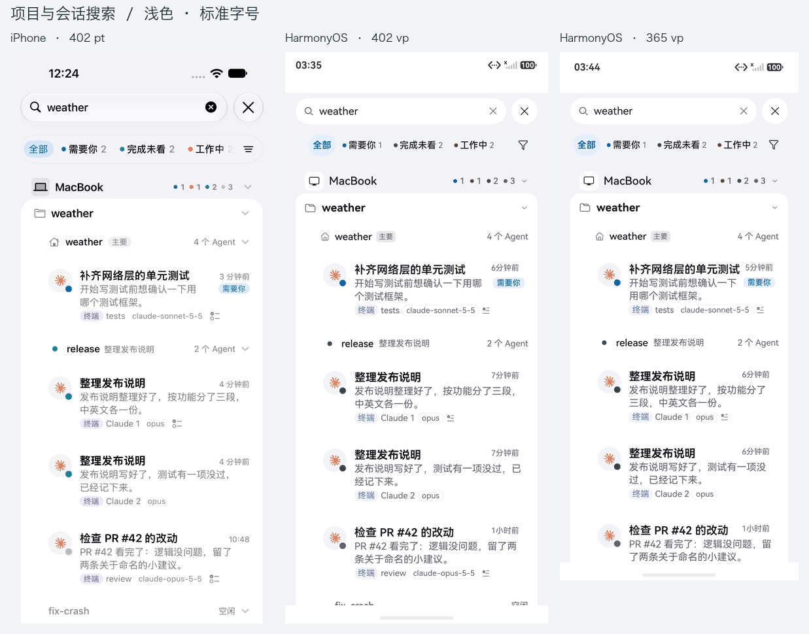
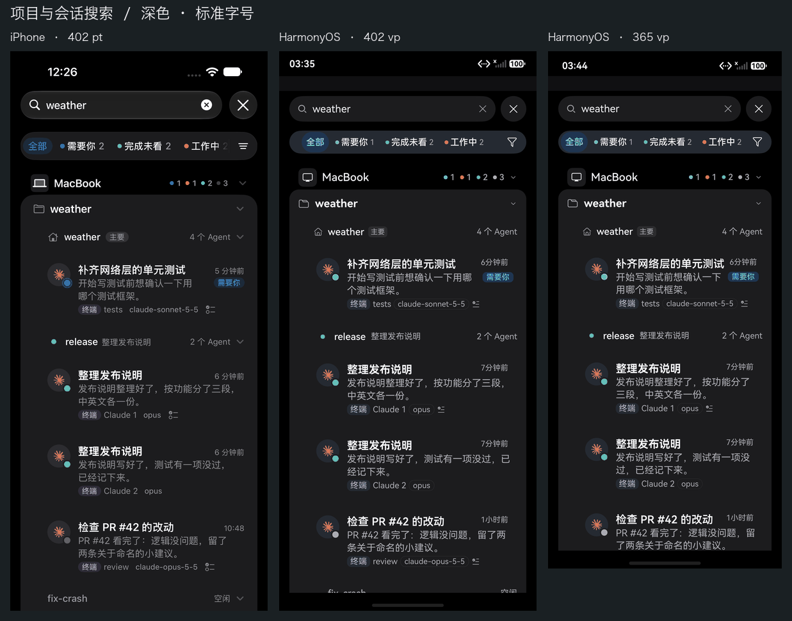
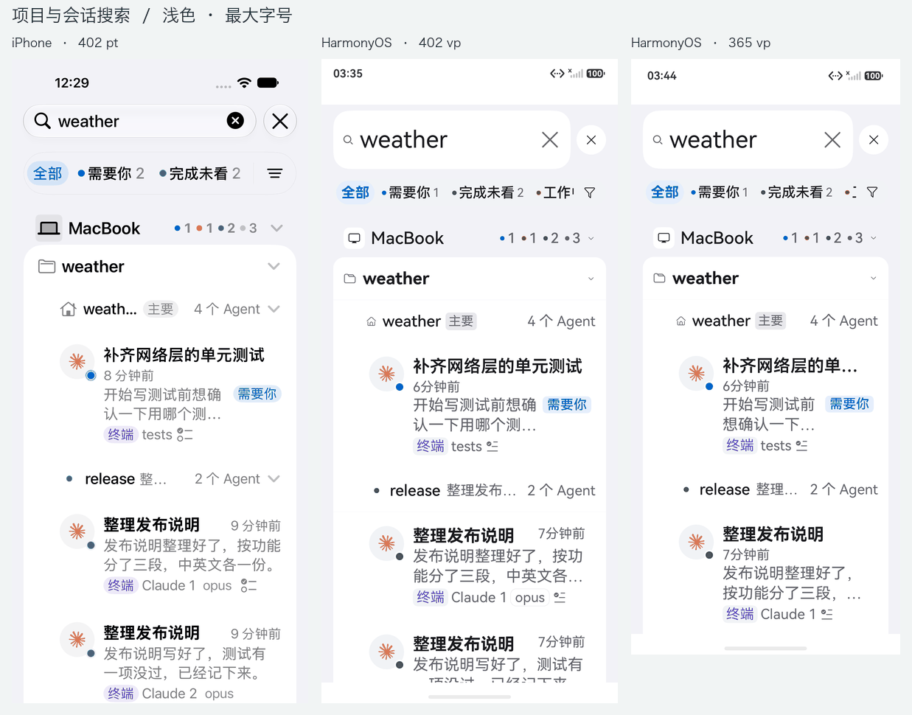

# 项目与会话搜索 · Search projects and sessions

[返回全部页面 · All pages](../README.md)

按仓库或会话关键词筛选项目，再读取匹配项。
Search for weather in the repository outline and compare its activity filters and matching rows.

Three independent native captures, left to right: iPhone 402 pt, HarmonyOS 402 vp, HarmonyOS 365 vp. The complete screen, including system bars, is visible.

[Download all original screenshots and accessibility trees for this page](../originals/project-search.zip?raw=1) · [Source and capture method](../SOURCES.md)

Original archive SHA-256: 355109865e85e8dc93bbae14c612f5d6d53e2ac35b46f3183d48cbdd3c61a595

## 浅色 · 标准字号

| Device | Pixels | Captured at | PNG digest | Hierarchy digest |
| --- | --- | --- | --- | --- |
| iPhone 402 pt | 1206 × 2622 | 2026-11-23T04:24:17.965+00:00 | 548246fd8afa0ef8 | 49bc9aca80a7eb61 |
| HarmonyOS 402 vp | 1206 × 2622 | 2026-11-23T15:35:36+08:00 | babcb0db71c9d980 | a6b9efef48af1eb6 |
| HarmonyOS 365 vp | 1280 × 2832 | 2026-11-23T15:44:20+08:00 | 3b27d45b54907eb0 | b2eeded20a1500f4 |

## 深色 · 标准字号

| Device | Pixels | Captured at | PNG digest | Hierarchy digest |
| --- | --- | --- | --- | --- |
| iPhone 402 pt | 1206 × 2622 | 2026-11-23T04:26:49.250+00:00 | a9175cbea18509b0 | 540925f8d8e3a58b |
| HarmonyOS 402 vp | 1206 × 2622 | 2026-11-23T15:35:40+08:00 | aba960623b75a511 | 8b5265d184bed1e7 |
| HarmonyOS 365 vp | 1280 × 2832 | 2026-11-23T15:44:23+08:00 | a5ad5c4bb1310005 | 85562f1aeb3c1a85 |

## 浅色 · 最大字号

| Device | Pixels | Captured at | PNG digest | Hierarchy digest |
| --- | --- | --- | --- | --- |
| iPhone 402 pt | 1206 × 2622 | 2026-11-23T04:29:19.205+00:00 | a9db613c39ea356a | 67e1abe20cb185a9 |
| HarmonyOS 402 vp | 1206 × 2622 | 2026-11-23T15:35:44+08:00 | 0aab651c5246b6bd | fb6f069c688275ed |
| HarmonyOS 365 vp | 1280 × 2832 | 2026-11-23T15:44:27+08:00 | 5a68081f256f6b1a | ddb478465ae1997a |

Full 64-character digests and ZIP entry paths are under this page in the [manifest](../manifest.json).

[← 折叠 release 标签](release-collapsed.md)
[仓库详情 →](project.md)
