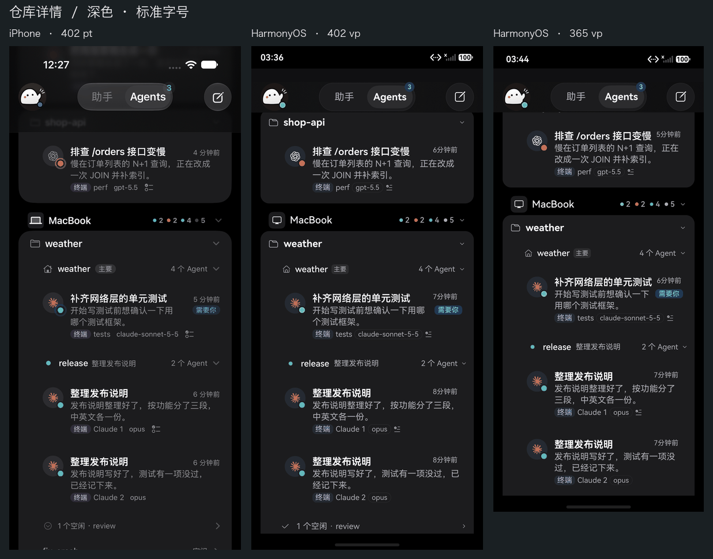

# 仓库详情 · Repository details

[返回全部页面 · All pages](../README.md)

查看 weather 仓库包含的工作树和会话。
Expand weather in place and inspect the worktrees and sessions inside this repository.

Three independent native captures, left to right: iPhone 402 pt, HarmonyOS 402 vp, HarmonyOS 365 vp. The complete screen, including system bars, is visible.

[Download all original screenshots and accessibility trees for this page](../originals/project.zip?raw=1) · [Source and capture method](../SOURCES.md)

Original archive SHA-256: c2ac9423d1802b5647ee43d929c12f9c6e88cc32390f54f4b638516850447cc2

## 浅色 · 标准字号

| Device | Pixels | Captured at | PNG digest | Hierarchy digest |
| --- | --- | --- | --- | --- |
| iPhone 402 pt | 1206 × 2622 | 2026-11-23T04:24:33.830+00:00 | 12ec58ebf9a15395 | f4728ef7cd50add4 |
| HarmonyOS 402 vp | 1206 × 2622 | 2026-11-23T15:36:22+08:00 | b230a7e455797486 | 68584f9e5fcd932e |
| HarmonyOS 365 vp | 1280 × 2832 | 2026-11-23T15:44:49+08:00 | af1de492aa09ec57 | 32a35cbbfd6a82f3 |

## 深色 · 标准字号

| Device | Pixels | Captured at | PNG digest | Hierarchy digest |
| --- | --- | --- | --- | --- |
| iPhone 402 pt | 1206 × 2622 | 2026-11-23T04:27:04.560+00:00 | f664c4cf86120bcb | 82782f6b520f8fc5 |
| HarmonyOS 402 vp | 1206 × 2622 | 2026-11-23T15:36:28+08:00 | b312ed41d0b04ae6 | 4cfdaca7cd42eeee |
| HarmonyOS 365 vp | 1280 × 2832 | 2026-11-23T15:44:55+08:00 | fdeafd1fc830b148 | b721b74456e9e857 |

## 浅色 · 最大字号

| Device | Pixels | Captured at | PNG digest | Hierarchy digest |
| --- | --- | --- | --- | --- |
| iPhone 402 pt | 1206 × 2622 | 2026-11-23T04:29:38.393+00:00 | 372f653bf252e9a9 | 55944b535da6a98c |
| HarmonyOS 402 vp | 1206 × 2622 | 2026-11-23T15:36:38+08:00 | 736661801d7866f9 | 93b8f01d57df6ad0 |
| HarmonyOS 365 vp | 1280 × 2832 | 2026-11-23T15:45:05+08:00 | 9a0f284e7342cea5 | 2ea083298b081dff |

Full 64-character digests and ZIP entry paths are under this page in the [manifest](../manifest.json).

[← 项目与会话搜索](project-search.md)
[工作树详情 →](worktree.md)
