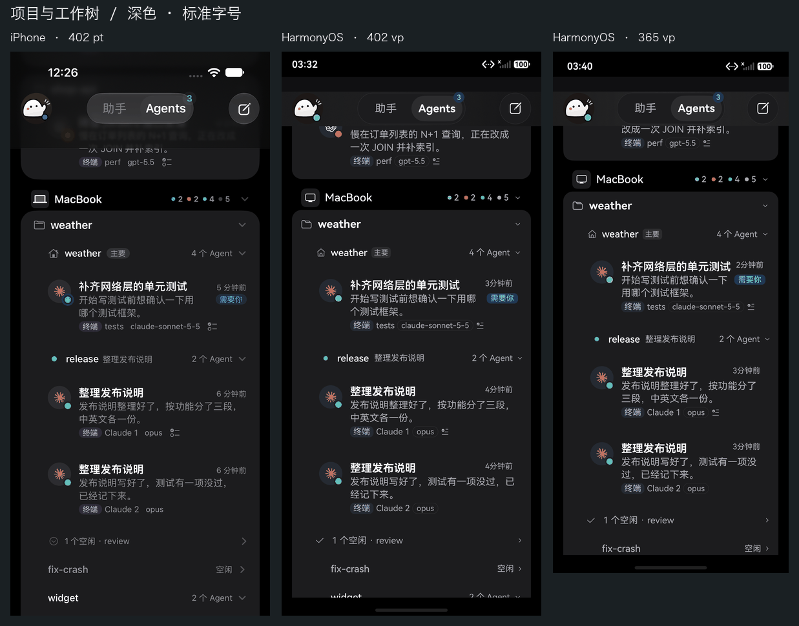

# 项目与工作树 · Project tree

[返回全部页面 · All pages](../README.md)

查看 weather 仓库、工作树和各自的 Agent。
Open the repository grouping in Agents and expand the same machine.

Three independent native captures, left to right: iPhone 402 pt, HarmonyOS 402 vp, HarmonyOS 365 vp. The complete screen, including system bars, is visible.

[Download all original screenshots and accessibility trees for this page](../originals/projects.zip?raw=1) · [Source and capture method](../SOURCES.md)

Original archive SHA-256: 41da0585d809f898f7f32836c4cc3dd940ec553e14f7a6274d879da552592cba

## 浅色 · 标准字号

| Device | Pixels | Captured at | PNG digest | Hierarchy digest |
| --- | --- | --- | --- | --- |
| iPhone 402 pt | 1206 × 2622 | 2026-11-23T04:24:00.868+00:00 | b91dd22515beb866 | 35eff61ecea8a60c |
| HarmonyOS 402 vp | 1206 × 2622 | 2026-11-23T15:32:13+08:00 | e1d235dd4ccab346 | 8f60b8fc54a39440 |
| HarmonyOS 365 vp | 1280 × 2832 | 2026-11-23T15:40:40+08:00 | 6e2005f56019f50b | 6ee2441d27fd0c3f |

## 深色 · 标准字号

| Device | Pixels | Captured at | PNG digest | Hierarchy digest |
| --- | --- | --- | --- | --- |
| iPhone 402 pt | 1206 × 2622 | 2026-11-23T04:26:31.393+00:00 | 673f134222c48eb8 | 4e70df7924a5150a |
| HarmonyOS 402 vp | 1206 × 2622 | 2026-11-23T15:32:18+08:00 | a1574f401b090e23 | 9009a27bf6873160 |
| HarmonyOS 365 vp | 1280 × 2832 | 2026-11-23T15:40:45+08:00 | 53589552af4df14e | 699b61c71b0c16fe |

## 浅色 · 最大字号

| Device | Pixels | Captured at | PNG digest | Hierarchy digest |
| --- | --- | --- | --- | --- |
| iPhone 402 pt | 1206 × 2622 | 2026-11-23T04:29:03.041+00:00 | 93f1444372e37e3c | dfdbf584bc7cc37f |
| HarmonyOS 402 vp | 1206 × 2622 | 2026-11-23T15:32:57+08:00 | fc90ece21b3af37d | 9e0f84927bbf9842 |
| HarmonyOS 365 vp | 1280 × 2832 | 2026-11-23T15:40:54+08:00 | 23e1018e970ffdcb | 24b7d7f16ab6e100 |

Full 64-character digests and ZIP entry paths are under this page in the [manifest](../manifest.json).

[折叠 release 标签 →](release-collapsed.md)
