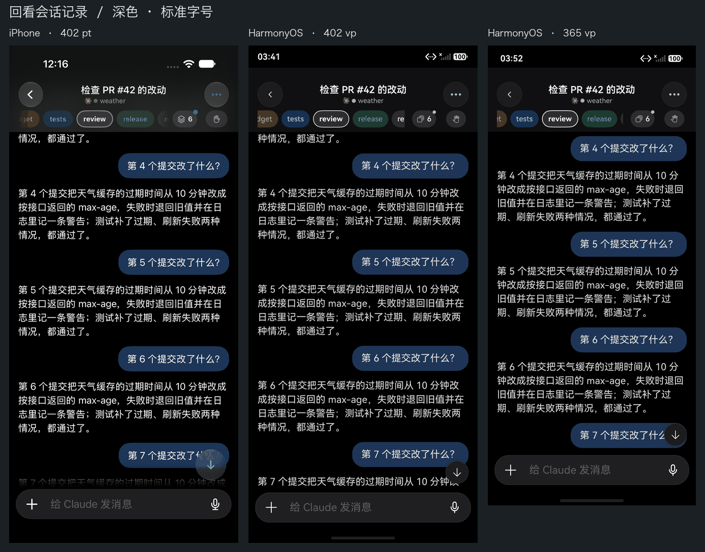

# 回看会话记录 · Read earlier messages

[返回全部页面 · All pages](../README.md)

回到较早的消息，再通过向下箭头跳至最新内容。

Three independent native captures, left to right: iPhone 402 pt, HarmonyOS 402 vp, HarmonyOS 365 vp. The complete screen, including system bars, is visible.

[Download all original screenshots and accessibility trees for this page](../originals/reading-history.zip?raw=1) · [Source and capture method](../SOURCES.md)

Original archive SHA-256: b9ec3a35b06ed870a5e341025ab31fec41f25dfce258ef02be3e4ae4847fb080

## 浅色 · 标准字号

| Device | Pixels | Captured at | PNG digest | Hierarchy digest |
| --- | --- | --- | --- | --- |
| iPhone 402 pt | 1206 × 2622 | 2026-11-23T04:14:03.061+00:00 | 16c2ee59b57698d9 | dce06e9a1f344920 |
| HarmonyOS 402 vp | 1206 × 2622 | 2026-11-23T15:41:43+08:00 | 76872e3fcf1116a4 | 79f21936b8f2228b |
| HarmonyOS 365 vp | 1280 × 2832 | 2026-11-23T15:52:42+08:00 | 7bf01dd3790bd257 | 5ae4582e1b3f628f |

## 深色 · 标准字号

| Device | Pixels | Captured at | PNG digest | Hierarchy digest |
| --- | --- | --- | --- | --- |
| iPhone 402 pt | 1206 × 2622 | 2026-11-23T04:16:23.610+00:00 | ac14fa659b4a8654 | 9d9c0f5d370eb876 |
| HarmonyOS 402 vp | 1206 × 2622 | 2026-11-23T15:41:51+08:00 | c23ad55def03ce69 | 457c1dbe8a0d6b7f |
| HarmonyOS 365 vp | 1280 × 2832 | 2026-11-23T15:52:50+08:00 | 76c5932982d91e96 | 4c9fbeae013a2f0d |

## 浅色 · 最大字号

| Device | Pixels | Captured at | PNG digest | Hierarchy digest |
| --- | --- | --- | --- | --- |
| iPhone 402 pt | 1206 × 2622 | 2026-11-23T04:19:00.451+00:00 | bce1a6c7e2c597f8 | 594b0bd8e1b0d50c |
| HarmonyOS 402 vp | 1206 × 2622 | 2026-11-23T15:43:29+08:00 | 29b25f87be443cd3 | eb623aee7dcc299d |
| HarmonyOS 365 vp | 1280 × 2832 | 2026-11-23T15:55:16+08:00 | 0b56a15d0a6ab4f8 | ed450f42939a55fd |

Full 64-character digests and ZIP entry paths are under this page in the [manifest](../manifest.json).

[← 展开会话输入框](composer.md)
[文件 →](files.md)
