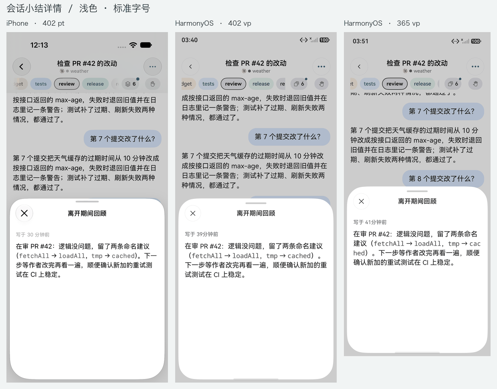
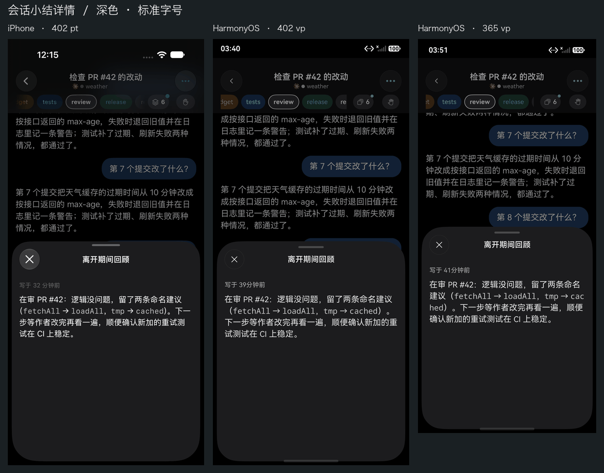
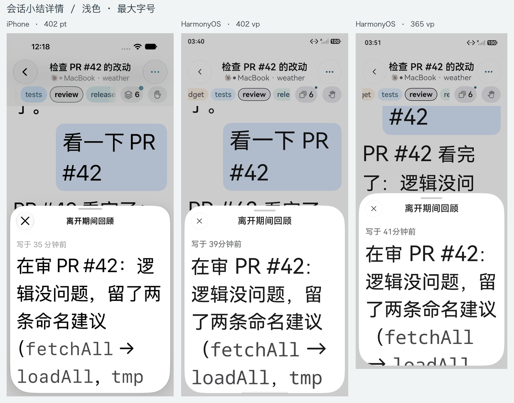

# 会话小结详情 · Conversation recap

[返回全部页面 · All pages](../README.md)

从「离开期间回顾」标记打开完整回顾。

Three independent native captures, left to right: iPhone 402 pt, HarmonyOS 402 vp, HarmonyOS 365 vp. The complete screen, including system bars, is visible.

[Download all original screenshots and accessibility trees for this page](../originals/recap-detail.zip?raw=1) · [Source and capture method](../SOURCES.md)

Original archive SHA-256: fb490bc8063a5f8bd6199e4ac266bcbb63211e12b4d50d9c4fe4442b7d00c2ae

## 浅色 · 标准字号

| Device | Pixels | Captured at | PNG digest | Hierarchy digest |
| --- | --- | --- | --- | --- |
| iPhone 402 pt | 1206 × 2622 | 2026-11-23T04:13:29.278+00:00 | 0818a8bf35a489b6 | 1dedb3e561c9487e |
| HarmonyOS 402 vp | 1206 × 2622 | 2026-11-23T15:40:30+08:00 | c7283cde00b6602a | 3ff4ebc7e281ec9c |
| HarmonyOS 365 vp | 1280 × 2832 | 2026-11-23T15:51:31+08:00 | 8d30522477feae47 | 96e89a45758e2ec5 |

## 深色 · 标准字号

| Device | Pixels | Captured at | PNG digest | Hierarchy digest |
| --- | --- | --- | --- | --- |
| iPhone 402 pt | 1206 × 2622 | 2026-11-23T04:15:49.815+00:00 | e57250d20f5422a8 | ba73e4a33e06e7cc |
| HarmonyOS 402 vp | 1206 × 2622 | 2026-11-23T15:40:33+08:00 | e153a5427a362711 | 73d2195a6ac616d6 |
| HarmonyOS 365 vp | 1280 × 2832 | 2026-11-23T15:51:34+08:00 | 106f9d4d938a72e2 | 49bdb1d9735252e8 |

## 浅色 · 最大字号

| Device | Pixels | Captured at | PNG digest | Hierarchy digest |
| --- | --- | --- | --- | --- |
| iPhone 402 pt | 1206 × 2622 | 2026-11-23T04:18:09.720+00:00 | 4581a0b4e243b55c | 44613a75935242fd |
| HarmonyOS 402 vp | 1206 × 2622 | 2026-11-23T15:40:37+08:00 | c1877ce598c8c244 | 4cb21ee88ccc3009 |
| HarmonyOS 365 vp | 1280 × 2832 | 2026-11-23T15:51:38+08:00 | e502b8ad495fd870 | 3c4ff912dc982039 |

Full 64-character digests and ZIP entry paths are under this page in the [manifest](../manifest.json).

[← Agent 会话](agent-chat.md)
[Persona 主对话 →](persona.md)
