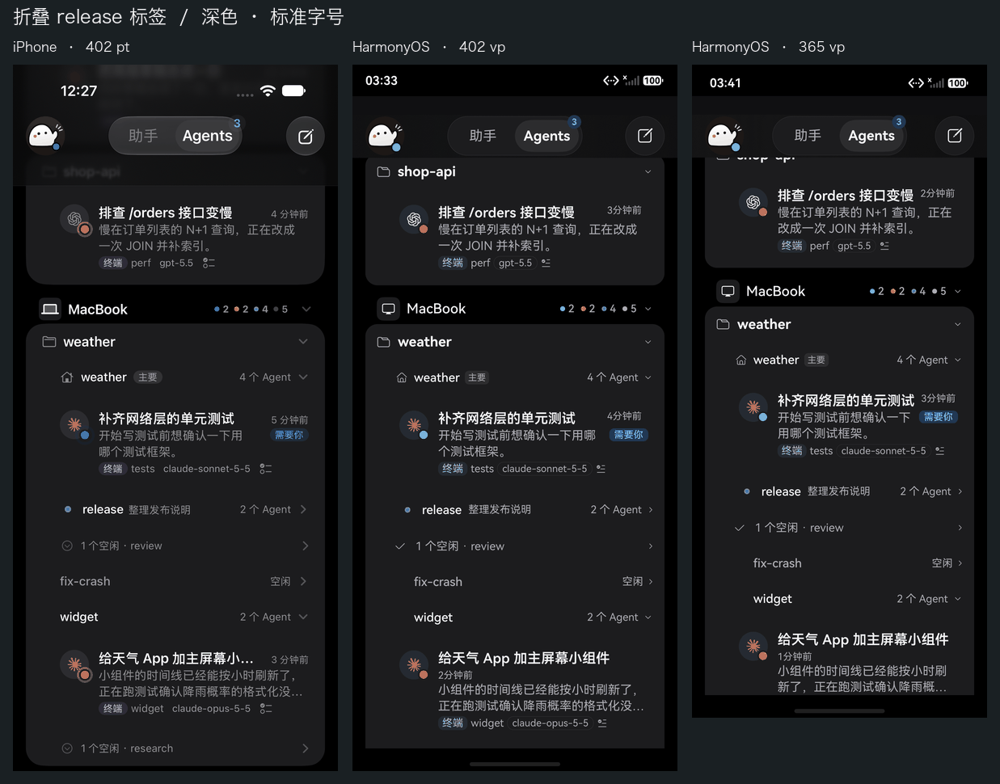

# 折叠 release 标签 · Collapse a terminal tab

[返回全部页面 · All pages](../README.md)

折叠 weather 下的 release 标签，查看分组和折叠状态。
Collapse the release terminal group in the weather project tree.

Three independent native captures, left to right: iPhone 402 pt, HarmonyOS 402 vp, HarmonyOS 365 vp. The complete screen, including system bars, is visible.

[Download all original screenshots and accessibility trees for this page](../originals/release-collapsed.zip?raw=1) · [Source and capture method](../SOURCES.md)

Original archive SHA-256: 8e78bcfe968547176a9f5ac9335e7a582003f8750f7f1261f450718bafe2014b

## 浅色 · 标准字号

| Device | Pixels | Captured at | PNG digest | Hierarchy digest |
| --- | --- | --- | --- | --- |
| iPhone 402 pt | 1206 × 2622 | 2026-11-23T04:24:38.267+00:00 | e5a61720e6da34db | db469b7c1bb2dcfa |
| HarmonyOS 402 vp | 1206 × 2622 | 2026-11-23T15:33:36+08:00 | a632981cb0d13752 | e2f532b0367ab868 |
| HarmonyOS 365 vp | 1280 × 2832 | 2026-11-23T15:41:07+08:00 | 2f4915f9801df9d0 | 021e093ba8cfb35a |

## 深色 · 标准字号

| Device | Pixels | Captured at | PNG digest | Hierarchy digest |
| --- | --- | --- | --- | --- |
| iPhone 402 pt | 1206 × 2622 | 2026-11-23T04:27:08.775+00:00 | 5b5bf8534c69ba04 | 55a3da3d8d0b8c18 |
| HarmonyOS 402 vp | 1206 × 2622 | 2026-11-23T15:33:40+08:00 | d0dc328c1f335573 | 95bfdb6bd8b563f2 |
| HarmonyOS 365 vp | 1280 × 2832 | 2026-11-23T15:41:13+08:00 | bf0db6cf4239e5e4 | 840a680746a4abb3 |

## 浅色 · 最大字号

| Device | Pixels | Captured at | PNG digest | Hierarchy digest |
| --- | --- | --- | --- | --- |
| iPhone 402 pt | 1206 × 2622 | 2026-11-23T04:29:42.336+00:00 | 32cabbbcccaa373b | 83231e69e0b77d64 |
| HarmonyOS 402 vp | 1206 × 2622 | 2026-11-23T15:33:49+08:00 | 4b9a68177beae549 | 182f19ca71c31999 |
| HarmonyOS 365 vp | 1280 × 2832 | 2026-11-23T15:41:23+08:00 | aa6251f86fb80e4c | 24b2e4fc0634ba14 |

Full 64-character digests and ZIP entry paths are under this page in the [manifest](../manifest.json).

[← 项目与工作树](projects.md)
[项目与会话搜索 →](project-search.md)
