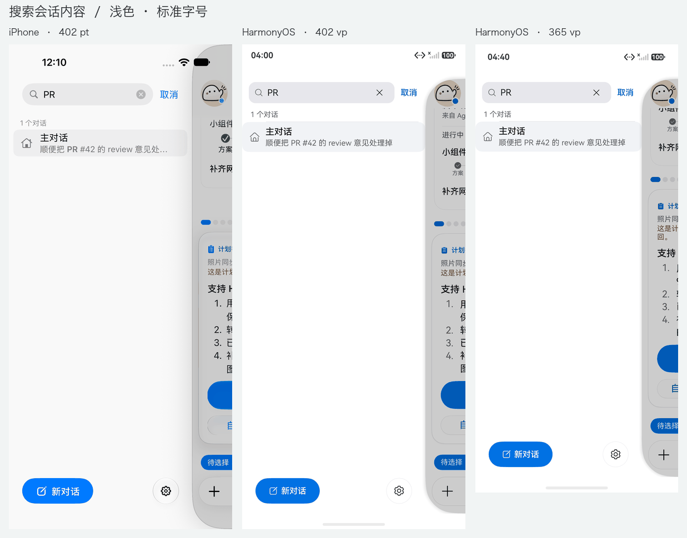
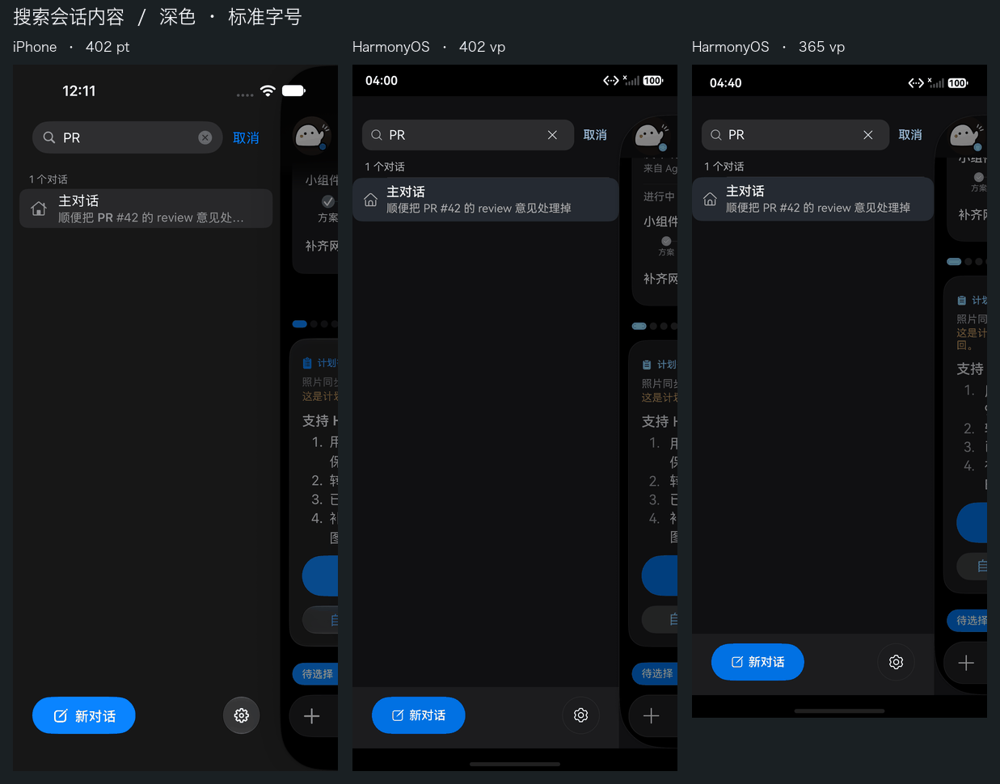
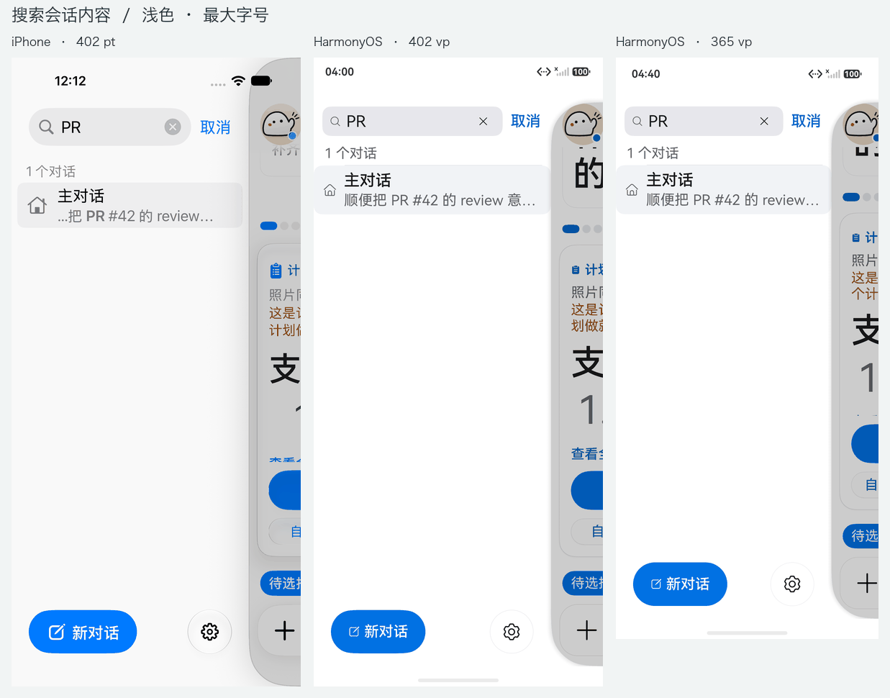

# 搜索会话内容 · Search conversations

[返回全部页面 · All pages](../README.md)

用 PR 搜索会话内容并查看匹配结果。

Three independent native captures, left to right: iPhone 402 pt, HarmonyOS 402 vp, HarmonyOS 365 vp. The complete screen, including system bars, is visible.

[Download all original screenshots and accessibility trees for this page](../originals/search.zip?raw=1) · [Source and capture method](../SOURCES.md)

Original archive SHA-256: 52626b184a6e91df68782b053fef72cdb6176c9c1b2babafc11115b774143235

## 浅色 · 标准字号

| Device | Pixels | Captured at | PNG digest | Hierarchy digest |
| --- | --- | --- | --- | --- |
| iPhone 402 pt | 1206 × 2622 | 2026-11-23T04:10:35.326+00:00 | bf84af4def600bf5 | 967b70dc96d5ab91 |
| HarmonyOS 402 vp | 1206 × 2622 | 2026-11-23T16:00:03+08:00 | 4090b4315cc7eb69 | 1d8dd017f8093ec1 |
| HarmonyOS 365 vp | 1280 × 2832 | 2026-11-23T16:40:09+08:00 | cdebfb228653be2c | 909336089d4d997b |

## 深色 · 标准字号

| Device | Pixels | Captured at | PNG digest | Hierarchy digest |
| --- | --- | --- | --- | --- |
| iPhone 402 pt | 1206 × 2622 | 2026-11-23T04:11:23.705+00:00 | bcaaa26e78173f08 | b3367303d544dfad |
| HarmonyOS 402 vp | 1206 × 2622 | 2026-11-23T16:00:06+08:00 | 709b50d043f61276 | 9421ccb692c56842 |
| HarmonyOS 365 vp | 1280 × 2832 | 2026-11-23T16:40:13+08:00 | 2750b88c85a91f79 | f974cdbd343be6ec |

## 浅色 · 最大字号

| Device | Pixels | Captured at | PNG digest | Hierarchy digest |
| --- | --- | --- | --- | --- |
| iPhone 402 pt | 1206 × 2622 | 2026-11-23T04:12:26.362+00:00 | 8d75db65eba4b1f5 | 29adf9cabcbb2219 |
| HarmonyOS 402 vp | 1206 × 2622 | 2026-11-23T16:00:11+08:00 | 3a8f26b2cd61e56d | 98ec0e6df84fa5dd |
| HarmonyOS 365 vp | 1280 × 2832 | 2026-11-23T16:40:17+08:00 | 611f258e71744a05 | 2f4094ba0eded9bc |

Full 64-character digests and ZIP entry paths are under this page in the [manifest](../manifest.json).

[← Agent 偏好](agent-preferences.md)
[收件箱 →](inbox.md)
