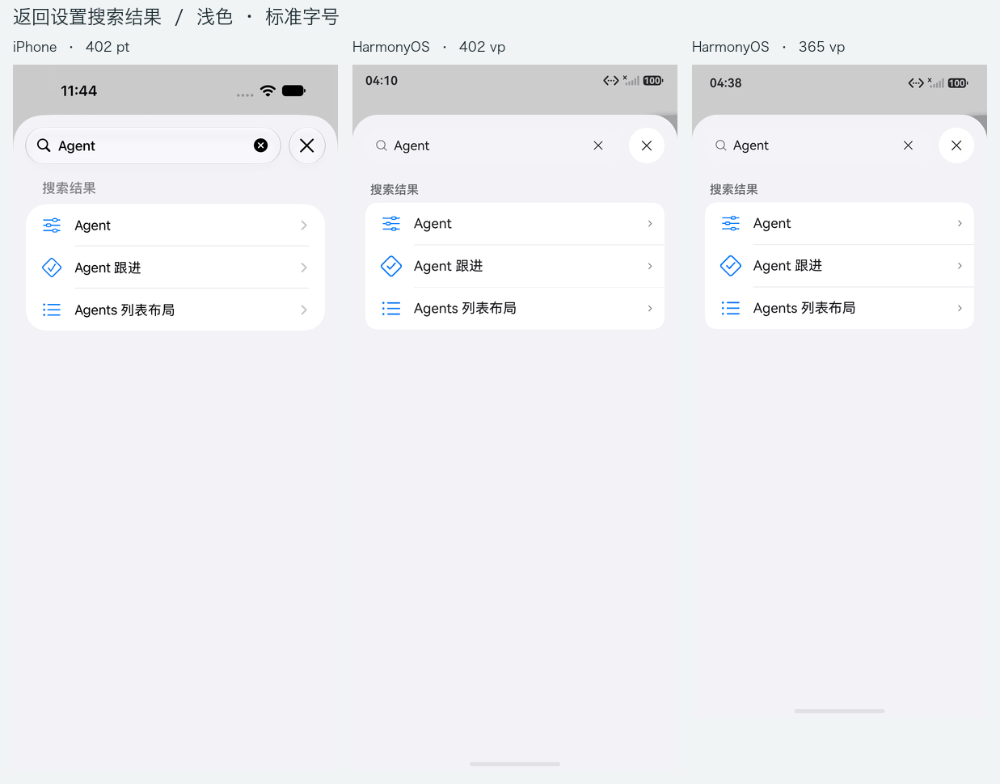
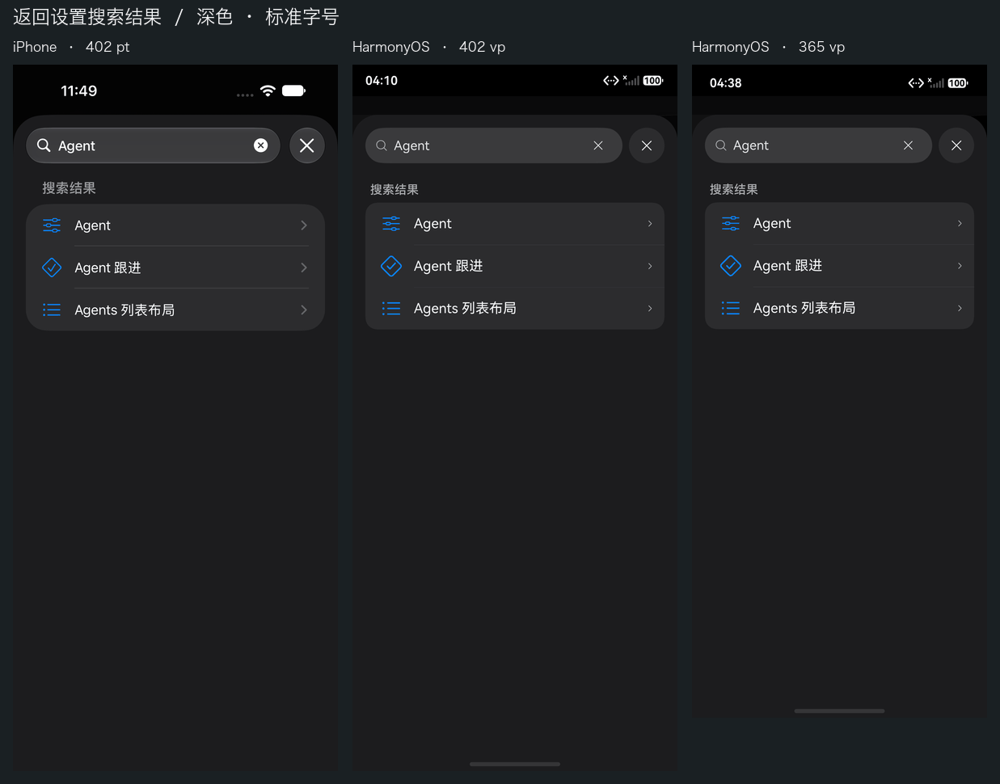
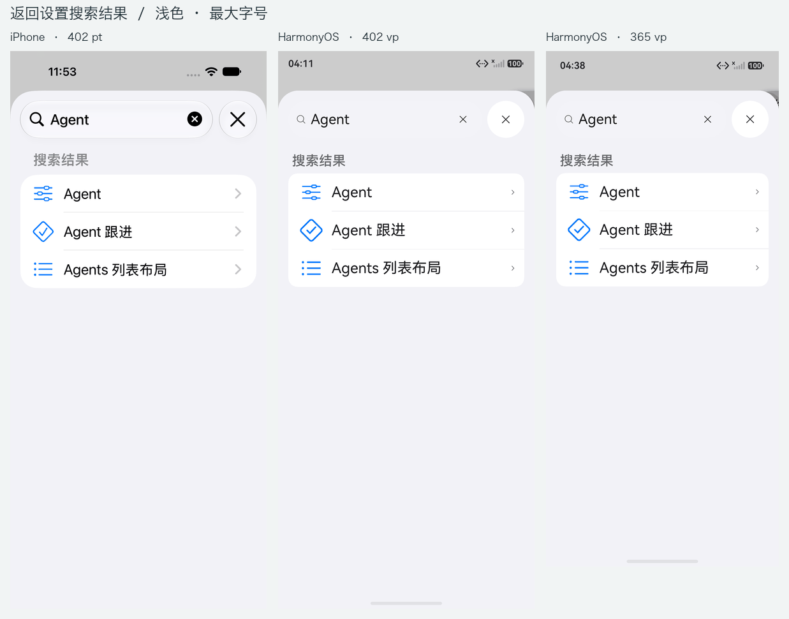

# 返回设置搜索结果 · Restore settings search

[返回全部页面 · All pages](../README.md)

搜索 Agent，打开偏好项，再返回已保留的搜索结果。

Three independent native captures, left to right: iPhone 402 pt, HarmonyOS 402 vp, HarmonyOS 365 vp. The complete screen, including system bars, is visible.

[Download all original screenshots and accessibility trees for this page](../originals/settings-search-restored.zip?raw=1) · [Source and capture method](../SOURCES.md)

Original archive SHA-256: 4206a8429f6e8a7913886d34f55a0738e158ccaaaaf3f61971aa1e822317f592

## 浅色 · 标准字号

| Device | Pixels | Captured at | PNG digest | Hierarchy digest |
| --- | --- | --- | --- | --- |
| iPhone 402 pt | 1206 × 2622 | 2026-11-23T03:44:53.728+00:00 | d853e80eb78937ca | 3be965d8934b6ddb |
| HarmonyOS 402 vp | 1206 × 2622 | 2026-11-23T16:10:51+08:00 | 0cdec1fd0f9588cd | c3eaa8bb993c8a6a |
| HarmonyOS 365 vp | 1280 × 2832 | 2026-11-23T16:38:05+08:00 | 123a607c6495f400 | 69b071166e876c45 |

## 深色 · 标准字号

| Device | Pixels | Captured at | PNG digest | Hierarchy digest |
| --- | --- | --- | --- | --- |
| iPhone 402 pt | 1206 × 2622 | 2026-11-23T03:49:33.573+00:00 | e4cd8533d731e787 | b5480d5899d8f3fc |
| HarmonyOS 402 vp | 1206 × 2622 | 2026-11-23T16:10:55+08:00 | 8f986093de277ac5 | d66a5d77d63982a8 |
| HarmonyOS 365 vp | 1280 × 2832 | 2026-11-23T16:38:09+08:00 | b478f9a0a072a884 | afaec5d6e195e2b3 |

## 浅色 · 最大字号

| Device | Pixels | Captured at | PNG digest | Hierarchy digest |
| --- | --- | --- | --- | --- |
| iPhone 402 pt | 1206 × 2622 | 2026-11-23T03:53:51.705+00:00 | c5dad4e6267b3bc7 | 3a905c33127ac86a |
| HarmonyOS 402 vp | 1206 × 2622 | 2026-11-23T16:11:00+08:00 | 081a4d0cfded2667 | 1a614c5f53c30e72 |
| HarmonyOS 365 vp | 1280 × 2832 | 2026-11-23T16:38:13+08:00 | ef31abfadae961da | 5115ff7e719f86f9 |

Full 64-character digests and ZIP entry paths are under this page in the [manifest](../manifest.json).

[← 设置](settings.md)
[语言 →](language.md)
