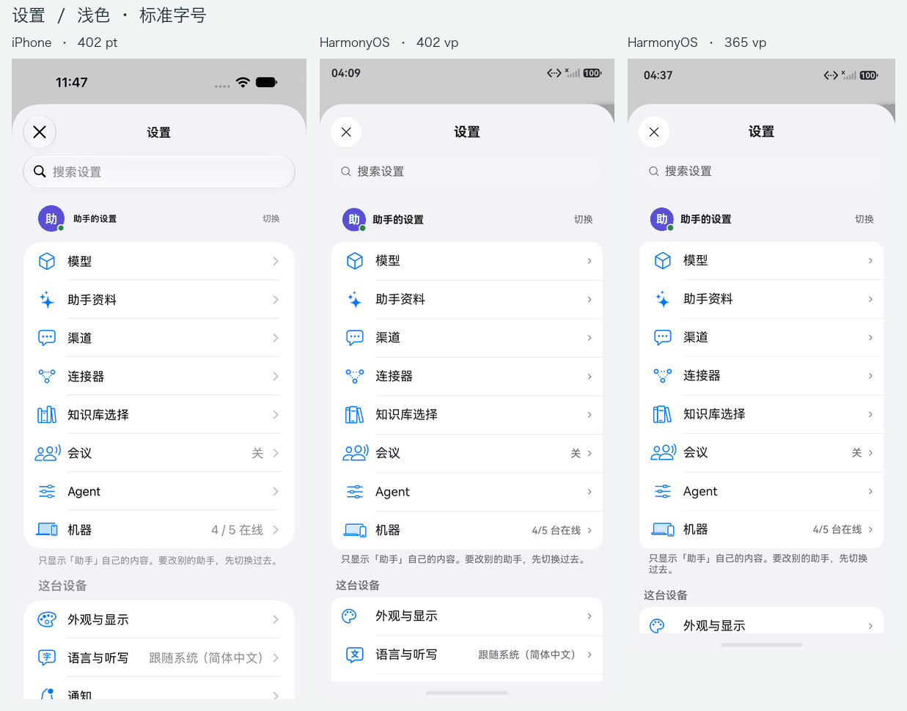
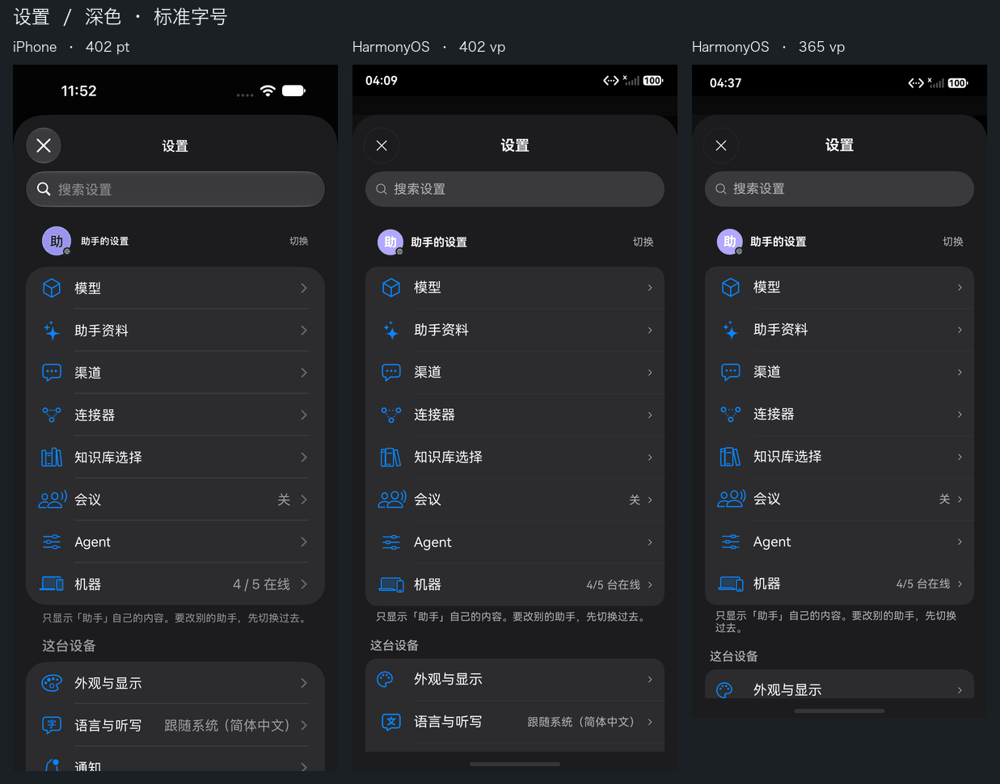
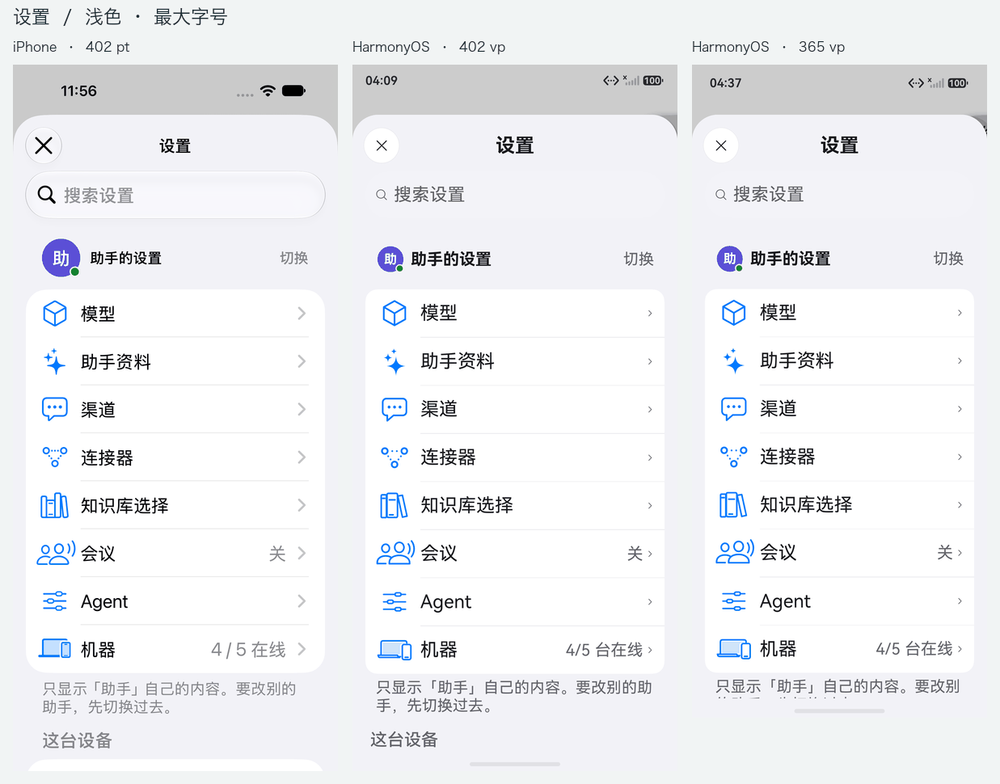

# 设置 · Settings

[返回全部页面 · All pages](../README.md)

查看设置分组和搜索入口。

Three independent native captures, left to right: iPhone 402 pt, HarmonyOS 402 vp, HarmonyOS 365 vp. The complete screen, including system bars, is visible.

[Download all original screenshots and accessibility trees for this page](../originals/settings.zip?raw=1) · [Source and capture method](../SOURCES.md)

Original archive SHA-256: 09f6ff122086ec6028ed4a52ae59f3ed36b3fe7b3f902d9dd55eca95809d19c0

## 浅色 · 标准字号

| Device | Pixels | Captured at | PNG digest | Hierarchy digest |
| --- | --- | --- | --- | --- |
| iPhone 402 pt | 1206 × 2622 | 2026-11-23T03:47:57.604+00:00 | a79919c776499bc2 | 32d281f5e21742c1 |
| HarmonyOS 402 vp | 1206 × 2622 | 2026-11-23T16:09:31+08:00 | 9c87a7026bd6cfbe | e18f00bb3c5d7332 |
| HarmonyOS 365 vp | 1280 × 2832 | 2026-11-23T16:37:05+08:00 | 54547347c6b4e7b5 | ef5e64eef0417320 |

## 深色 · 标准字号

| Device | Pixels | Captured at | PNG digest | Hierarchy digest |
| --- | --- | --- | --- | --- |
| iPhone 402 pt | 1206 × 2622 | 2026-11-23T03:52:22.371+00:00 | 340c8f68165e561f | 126794ad58d3660f |
| HarmonyOS 402 vp | 1206 × 2622 | 2026-11-23T16:09:36+08:00 | f01c393906c60e81 | 25c9d515481b160a |
| HarmonyOS 365 vp | 1280 × 2832 | 2026-11-23T16:37:09+08:00 | 81076c7f7fd2c4d9 | 3c3b67a73e27a485 |

## 浅色 · 最大字号

| Device | Pixels | Captured at | PNG digest | Hierarchy digest |
| --- | --- | --- | --- | --- |
| iPhone 402 pt | 1206 × 2622 | 2026-11-23T03:56:20.853+00:00 | 44c74c48000f397c | c57f449f18925583 |
| HarmonyOS 402 vp | 1206 × 2622 | 2026-11-23T16:09:41+08:00 | 93869e3b4b755ad1 | da87c53d1ae34d26 |
| HarmonyOS 365 vp | 1280 × 2832 | 2026-11-23T16:37:13+08:00 | 519f83586811f000 | 7234031feefd9396 |

Full 64-character digests and ZIP entry paths are under this page in the [manifest](../manifest.json).

[← 切换助手](assistant-menu.md)
[返回设置搜索结果 →](settings-search-restored.md)
