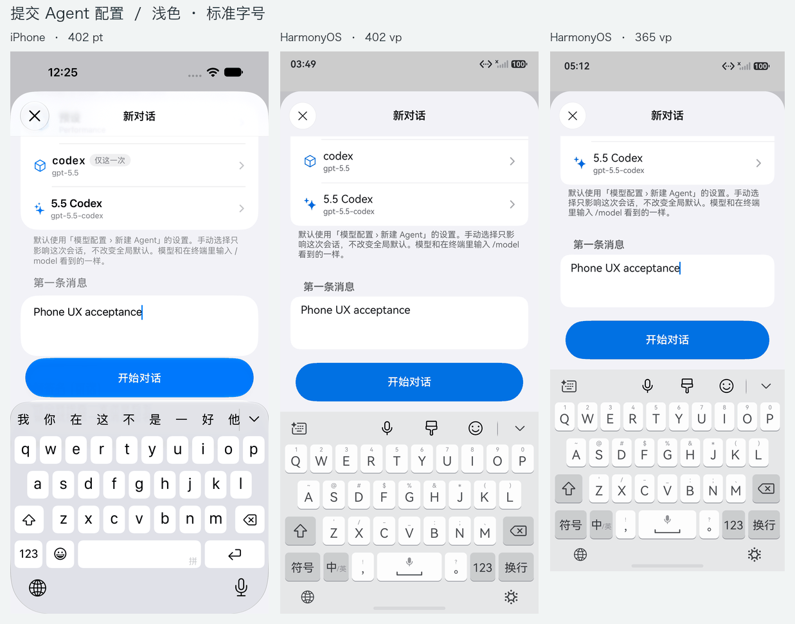
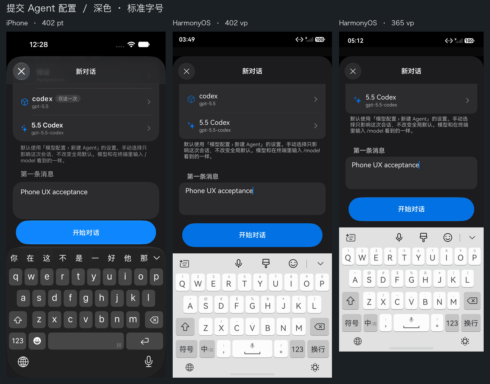
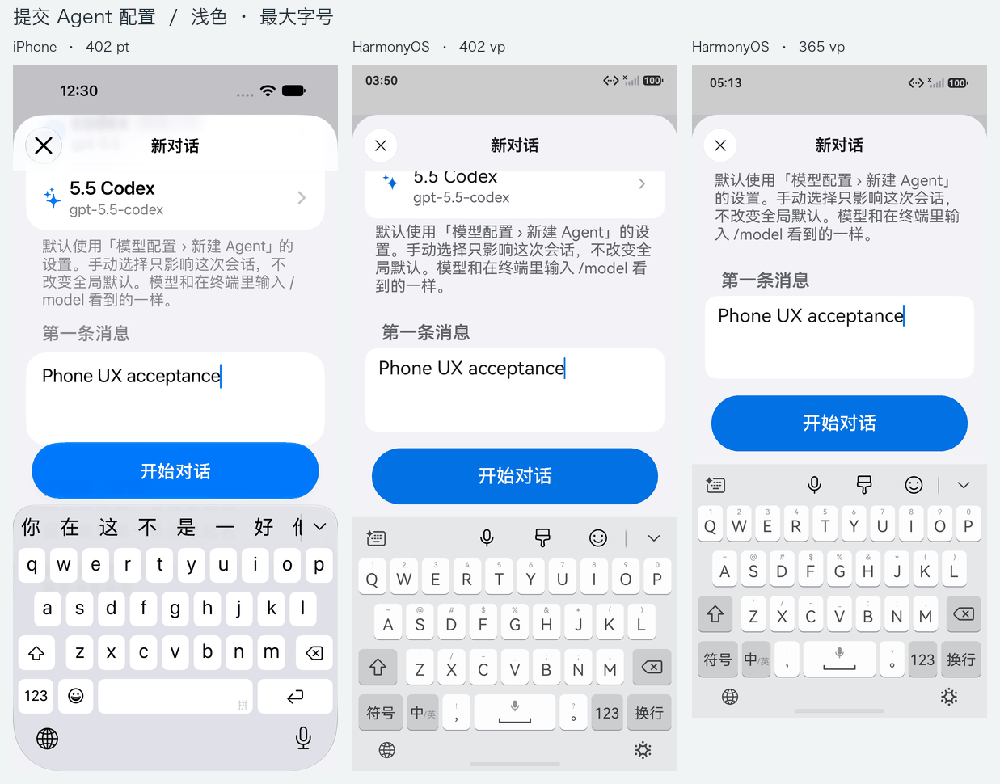

# 提交 Agent 配置 · Agent ready to start

[返回全部页面 · All pages](../README.md)

核对工作目录、启动器、模型和首条提示。
Enter the first message and inspect the start action above the keyboard.

Three independent native captures, left to right: iPhone 402 pt, HarmonyOS 402 vp, HarmonyOS 365 vp. The complete screen, including system bars, is visible.

[Download all original screenshots and accessibility trees for this page](../originals/start-ready.zip?raw=1) · [Source and capture method](../SOURCES.md)

Original archive SHA-256: 75e1185268b2eb34534a8aac516716bdc8c31da7d4a082c6877ce99e9ad5f8a1

## 浅色 · 标准字号

| Device | Pixels | Captured at | PNG digest | Hierarchy digest |
| --- | --- | --- | --- | --- |
| iPhone 402 pt | 1206 × 2622 | 2026-11-23T04:25:43.929+00:00 | 9be87f920140e8b2 | 3ee0478c9f3f2108 |
| HarmonyOS 402 vp | 1206 × 2622 | 2026-11-23T15:49:37+08:00 | c010ba02e60a89d5 | 58e706c977d46062 |
| HarmonyOS 365 vp | 1280 × 2832 | 2026-11-23T17:12:21+08:00 | 4dcced44c1d3d1d7 | 566c006651bdd48a |

## 深色 · 标准字号

| Device | Pixels | Captured at | PNG digest | Hierarchy digest |
| --- | --- | --- | --- | --- |
| iPhone 402 pt | 1206 × 2622 | 2026-11-23T04:28:13.527+00:00 | b228105aed296f26 | 358daa9ee1893251 |
| HarmonyOS 402 vp | 1206 × 2622 | 2026-11-23T15:49:52+08:00 | bf386d971894908a | 78ac8a824c1c57c2 |
| HarmonyOS 365 vp | 1280 × 2832 | 2026-11-23T17:12:43+08:00 | d71ae3f7fdb164d4 | 35e8af6c7c7fa790 |

## 浅色 · 最大字号

| Device | Pixels | Captured at | PNG digest | Hierarchy digest |
| --- | --- | --- | --- | --- |
| iPhone 402 pt | 1206 × 2622 | 2026-11-23T04:30:49.063+00:00 | 164f8412556f2ed6 | 78bd7075e1ac9fbc |
| HarmonyOS 402 vp | 1206 × 2622 | 2026-11-23T15:50:07+08:00 | 34d93669fd472efb | a9cebfb7dc0ef12c |
| HarmonyOS 365 vp | 1280 × 2832 | 2026-11-23T17:13:01+08:00 | fdb947f3141ec288 | 8138eacac6657a8a |

Full 64-character digests and ZIP entry paths are under this page in the [manifest](../manifest.json).

[← 选择模型](models.md)
[Agents 列表 →](agents.md)
