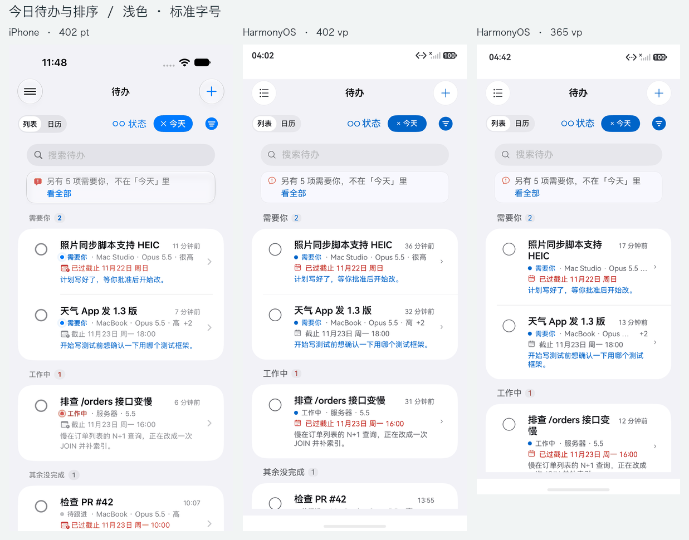
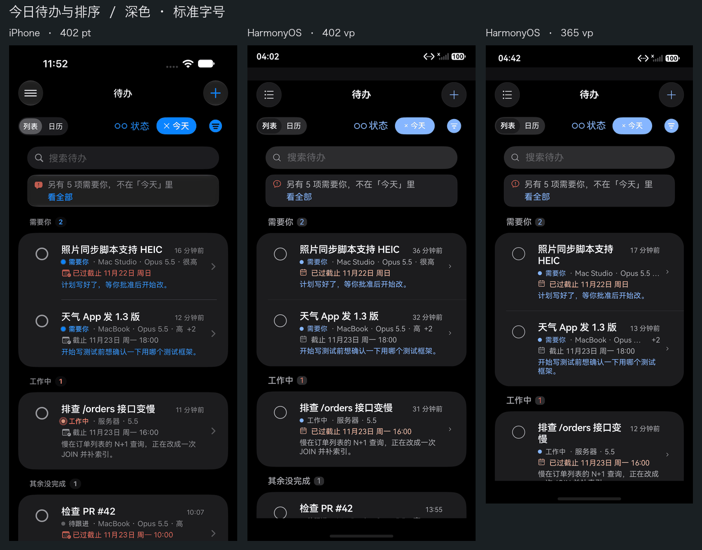
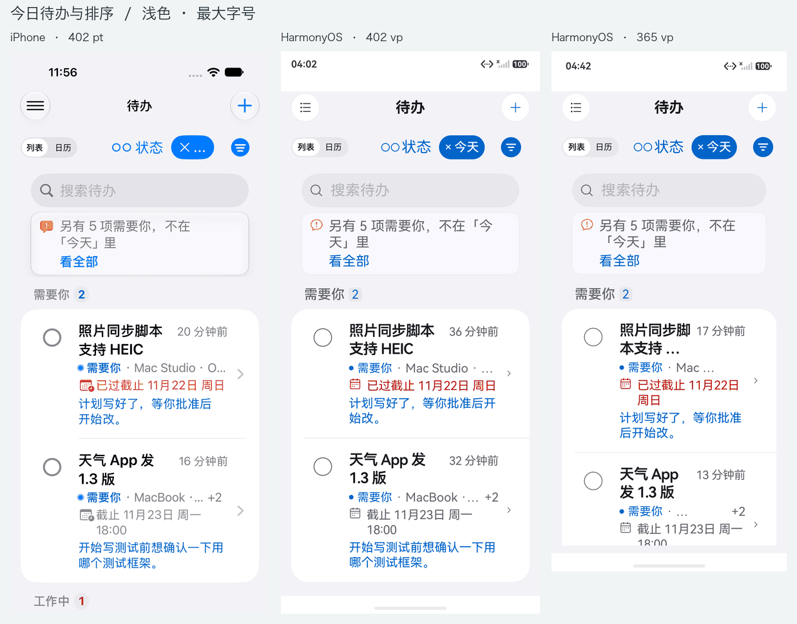

# 今日待办与排序 · Due today and priority

[返回全部页面 · All pages](../README.md)

筛选今天的待办，并查看优先级排序。

Three independent native captures, left to right: iPhone 402 pt, HarmonyOS 402 vp, HarmonyOS 365 vp. The complete screen, including system bars, is visible.

[Download all original screenshots and accessibility trees for this page](../originals/todo-due.zip?raw=1) · [Source and capture method](../SOURCES.md)

Original archive SHA-256: ee9ca2d61ab7dd1668a50adbaed17b8fb31db1c092fbf832620a580a109ba37f

## 浅色 · 标准字号

| Device | Pixels | Captured at | PNG digest | Hierarchy digest |
| --- | --- | --- | --- | --- |
| iPhone 402 pt | 1206 × 2622 | 2026-11-23T03:48:30.700+00:00 | e69b918c362bf4a1 | 2504de11a87447dc |
| HarmonyOS 402 vp | 1206 × 2622 | 2026-11-23T16:02:01+08:00 | 933ddd25322aacef | 6757d1dc84adfb0c |
| HarmonyOS 365 vp | 1280 × 2832 | 2026-11-23T16:42:43+08:00 | d5ab82fcbffcac33 | c8af35971b471e55 |

## 深色 · 标准字号

| Device | Pixels | Captured at | PNG digest | Hierarchy digest |
| --- | --- | --- | --- | --- |
| iPhone 402 pt | 1206 × 2622 | 2026-11-23T03:52:55.127+00:00 | 20cdc518accff096 | 0c403aa7036c0d00 |
| HarmonyOS 402 vp | 1206 × 2622 | 2026-11-23T16:02:04+08:00 | 37fd183914254edc | be90122642b50a42 |
| HarmonyOS 365 vp | 1280 × 2832 | 2026-11-23T16:42:46+08:00 | c09e5bfc37704aee | efe44e9baaa18f73 |

## 浅色 · 最大字号

| Device | Pixels | Captured at | PNG digest | Hierarchy digest |
| --- | --- | --- | --- | --- |
| iPhone 402 pt | 1206 × 2622 | 2026-11-23T03:56:51.192+00:00 | f846715fc69ed3ba | 8e5365798700d2e1 |
| HarmonyOS 402 vp | 1206 × 2622 | 2026-11-23T16:02:09+08:00 | 5fb35c8fd3db2cd1 | 6372bce70494f769 |
| HarmonyOS 365 vp | 1280 × 2832 | 2026-11-23T16:42:50+08:00 | 62c1e919586f4f3c | ee6601e84b988b77 |

Full 64-character digests and ZIP entry paths are under this page in the [manifest](../manifest.json).

[← 待办](todo.md)
[知识库 →](knowledge.md)
