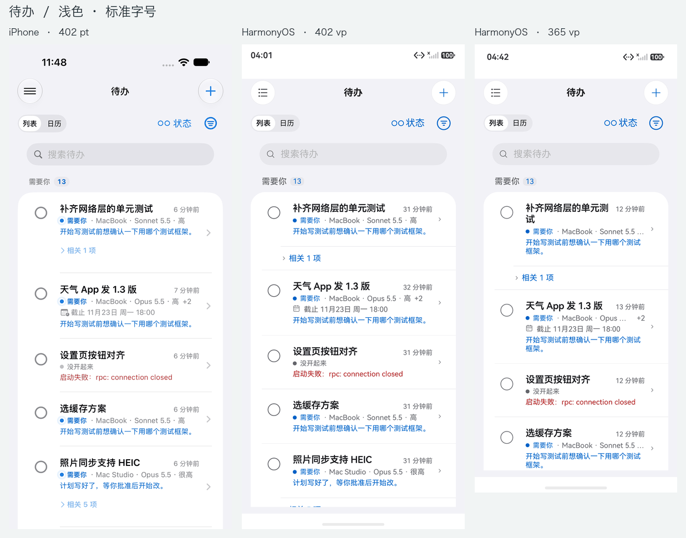
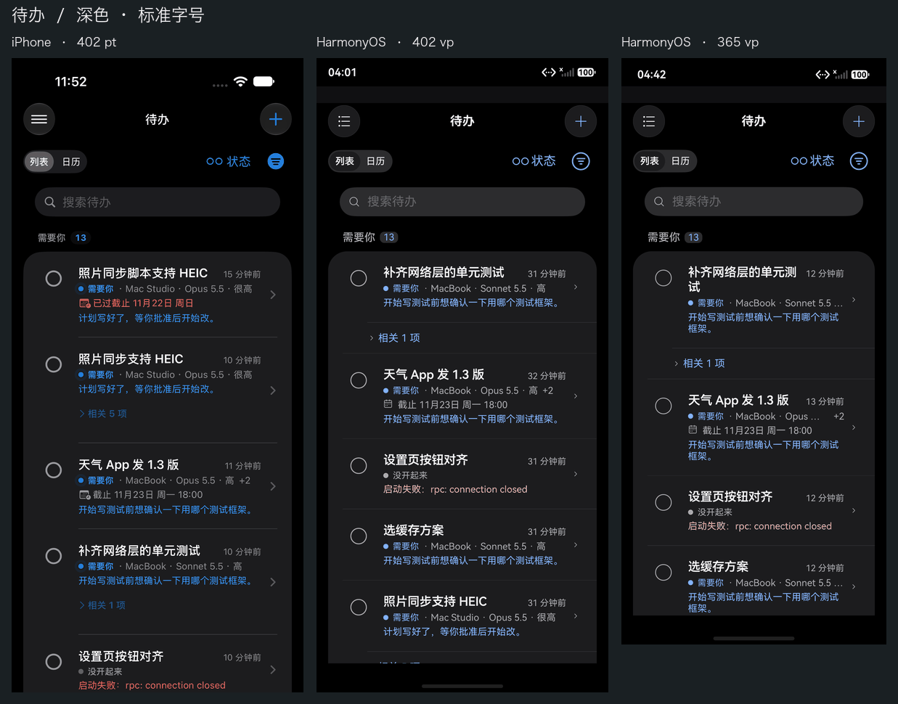
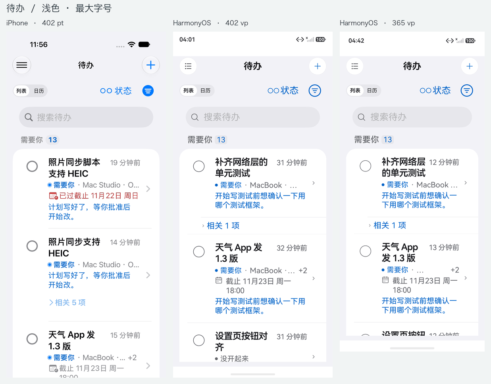

# 待办 · To-dos

[返回全部页面 · All pages](../README.md)

浏览待办清单及其状态。

Three independent native captures, left to right: iPhone 402 pt, HarmonyOS 402 vp, HarmonyOS 365 vp. The complete screen, including system bars, is visible.

[Download all original screenshots and accessibility trees for this page](../originals/todo.zip?raw=1) · [Source and capture method](../SOURCES.md)

Original archive SHA-256: 96a0600b85d51f6989ac6abe4409cddbf2f3b53b9b9486874160630bde50150b

## 浅色 · 标准字号

| Device | Pixels | Captured at | PNG digest | Hierarchy digest |
| --- | --- | --- | --- | --- |
| iPhone 402 pt | 1206 × 2622 | 2026-11-23T03:48:09.679+00:00 | a91075fa4744fb6f | 1a1cb449dc8caed7 |
| HarmonyOS 402 vp | 1206 × 2622 | 2026-11-23T16:01:43+08:00 | 95f91d9188a0d5ed | 44f579927293d526 |
| HarmonyOS 365 vp | 1280 × 2832 | 2026-11-23T16:42:24+08:00 | 5141d4abd8f18668 | 335588e444fa09d6 |

## 深色 · 标准字号

| Device | Pixels | Captured at | PNG digest | Hierarchy digest |
| --- | --- | --- | --- | --- |
| iPhone 402 pt | 1206 × 2622 | 2026-11-23T03:52:34.656+00:00 | ff2e471ab74bfe0c | ddbf78a503eb3412 |
| HarmonyOS 402 vp | 1206 × 2622 | 2026-11-23T16:01:46+08:00 | 9877942795ee7c1c | bc59afb8ec623cf9 |
| HarmonyOS 365 vp | 1280 × 2832 | 2026-11-23T16:42:27+08:00 | ecfa87acddcbfb0a | 11ea10a7936e6888 |

## 浅色 · 最大字号

| Device | Pixels | Captured at | PNG digest | Hierarchy digest |
| --- | --- | --- | --- | --- |
| iPhone 402 pt | 1206 × 2622 | 2026-11-23T03:56:32.261+00:00 | 135f563a75d26d06 | cefab0542d1192e4 |
| HarmonyOS 402 vp | 1206 × 2622 | 2026-11-23T16:01:50+08:00 | 4b208c86956d69d4 | d45eedcdcd5e14ff |
| HarmonyOS 365 vp | 1280 × 2832 | 2026-11-23T16:42:32+08:00 | 8a8bb014e0e6e4d8 | bc1b68c70504f388 |

Full 64-character digests and ZIP entry paths are under this page in the [manifest](../manifest.json).

[← 收件箱](inbox.md)
[今日待办与排序 →](todo-due.md)
