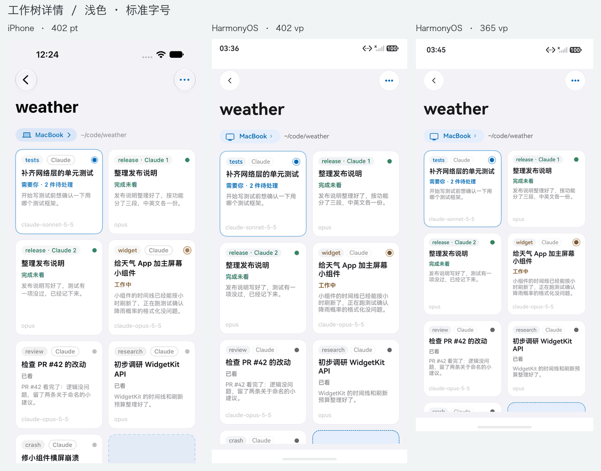
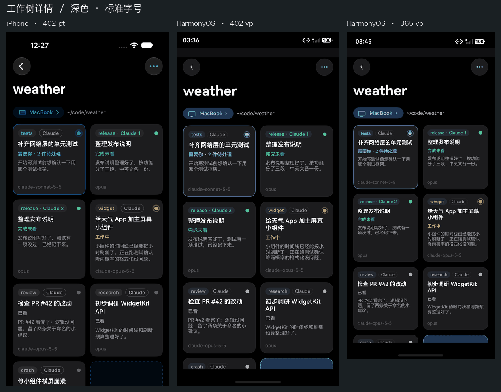
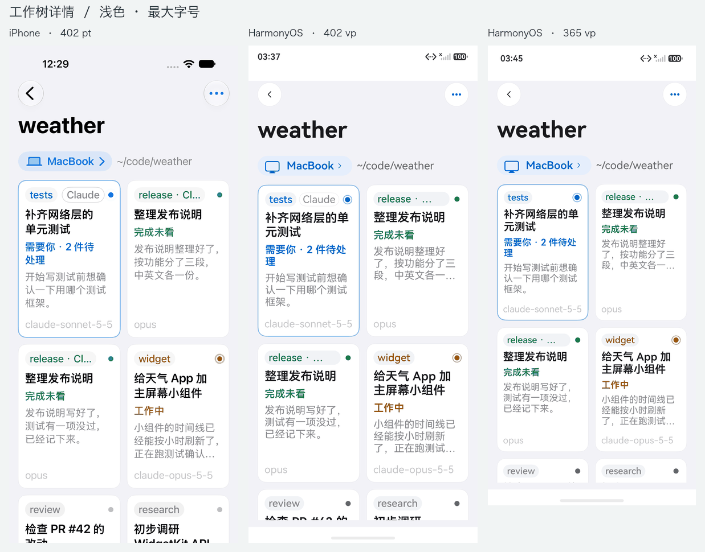

# 工作树详情 · Worktree details

[返回全部页面 · All pages](../README.md)

在选中的开发目录下查看会话和所属机器。
Open the weather terminal space and browse its agents across Git checkouts.

Three independent native captures, left to right: iPhone 402 pt, HarmonyOS 402 vp, HarmonyOS 365 vp. The complete screen, including system bars, is visible.

[Download all original screenshots and accessibility trees for this page](../originals/worktree.zip?raw=1) · [Source and capture method](../SOURCES.md)

Original archive SHA-256: 9e78a49863bde0cde85c65b999603fe9b8402fa0fb7bc19c33f55b2ddc62bb52

## 浅色 · 标准字号

| Device | Pixels | Captured at | PNG digest | Hierarchy digest |
| --- | --- | --- | --- | --- |
| iPhone 402 pt | 1206 × 2622 | 2026-11-23T04:24:53.269+00:00 | e0b93c023b1bc6bb | 76c8727f315ea3a2 |
| HarmonyOS 402 vp | 1206 × 2622 | 2026-11-23T15:36:53+08:00 | 80437b18e488ce9e | 7b5a4b0cb430f4d7 |
| HarmonyOS 365 vp | 1280 × 2832 | 2026-11-23T15:45:21+08:00 | e29f347031a9d130 | 83c47cd4bd79bca9 |

## 深色 · 标准字号

| Device | Pixels | Captured at | PNG digest | Hierarchy digest |
| --- | --- | --- | --- | --- |
| iPhone 402 pt | 1206 × 2622 | 2026-11-23T04:27:23.515+00:00 | a09e75e7afc4ba63 | a1bf277ccdeeee0f |
| HarmonyOS 402 vp | 1206 × 2622 | 2026-11-23T15:36:57+08:00 | c1861a55fd6c8dba | a1661944ad0503a1 |
| HarmonyOS 365 vp | 1280 × 2832 | 2026-11-23T15:45:25+08:00 | de263e82e879ffbe | 06f0fe802b1a550f |

## 浅色 · 最大字号

| Device | Pixels | Captured at | PNG digest | Hierarchy digest |
| --- | --- | --- | --- | --- |
| iPhone 402 pt | 1206 × 2622 | 2026-11-23T04:29:56.882+00:00 | a6aaa7c831462e37 | 2640722dffa2bac1 |
| HarmonyOS 402 vp | 1206 × 2622 | 2026-11-23T15:37:01+08:00 | 39faadda5023b578 | 35eb6e58f99471f7 |
| HarmonyOS 365 vp | 1280 × 2832 | 2026-11-23T15:45:29+08:00 | 8267204288ad5184 | d2dff7c15e2c8256 |

Full 64-character digests and ZIP entry paths are under this page in the [manifest](../manifest.json).

[← 仓库详情](project.md)
[新建 Agent →](new-agent.md)
