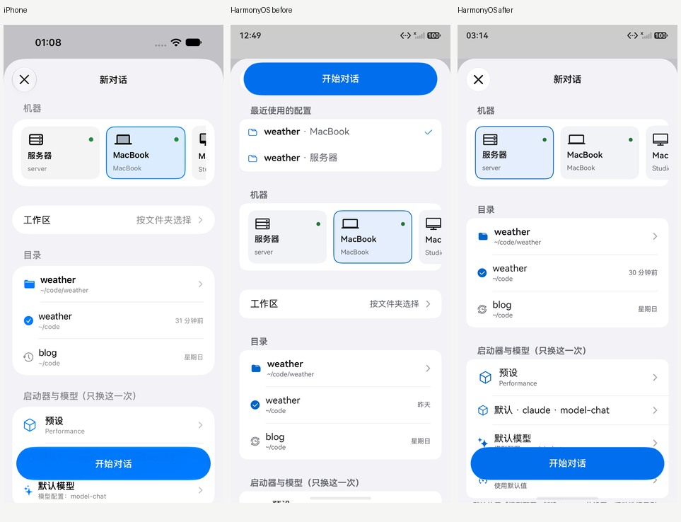
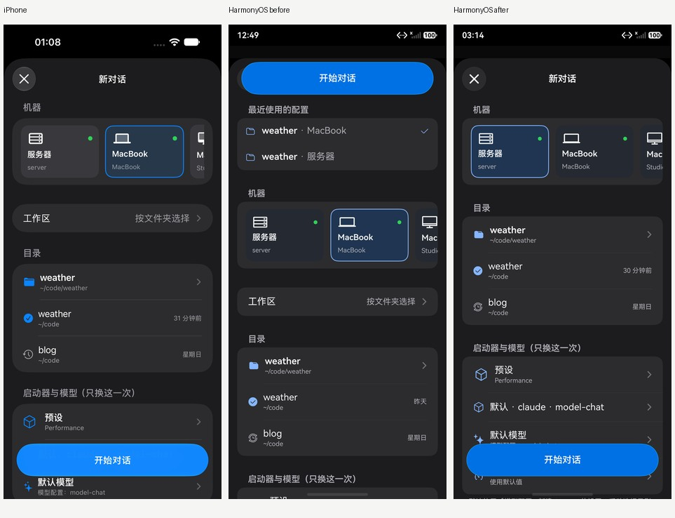
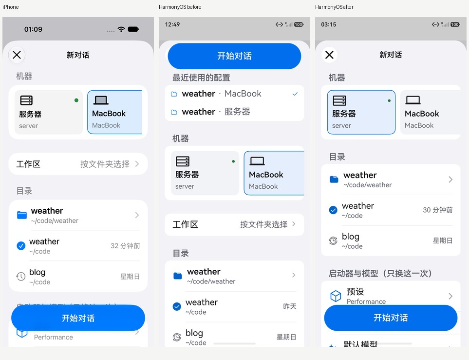

# New Agent form and cancellation

The iPhone reference is `23b51faebb29`. The first HarmonyOS build is `32e57f59b50f`, and the corrected build is `91433cdf9df4`. All native screenshots are 1206 × 2622 pixels at 402 logical points or vp. The forms use disposable test data.

The earlier HarmonyOS form drew its Start button across Close. The native accessibility bounds also placed the center of Close inside Start. On the corrected build, tapping Close returned to the Agent list in all three appearances. The isolated Hub received zero session-creation requests during those three taps.

## Light

[iPhone original](light-iphone.png) · [HarmonyOS before](light-before.png) · [HarmonyOS after](light-after.png)

## Dark

[iPhone original](dark-iphone.png) · [HarmonyOS before](dark-before.png) · [HarmonyOS after](dark-after.png)

## Largest text

[iPhone original](large-iphone.png) · [HarmonyOS before](large-before.png) · [HarmonyOS after](large-after.png)

The [native measurement record](manifest.json) includes the measured rectangles, physical tap points and original-image digests.
