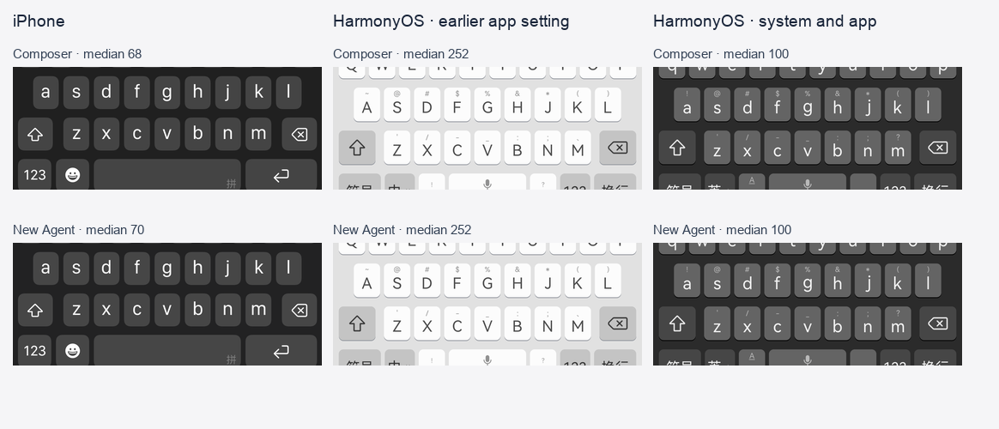
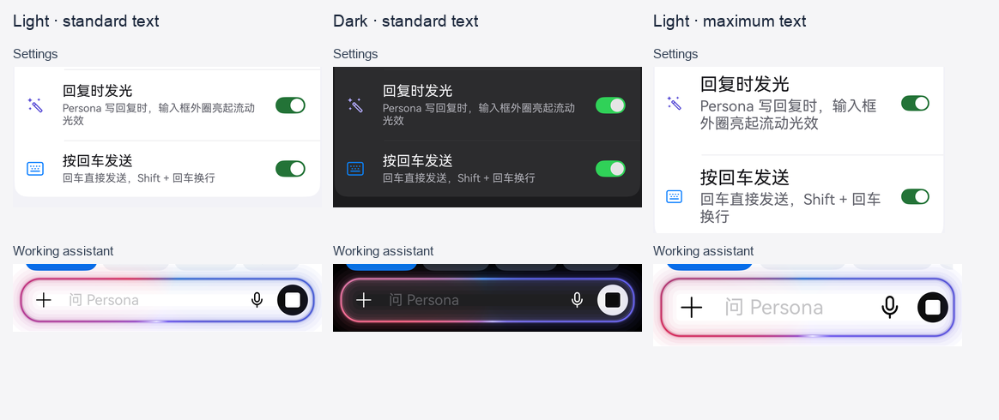
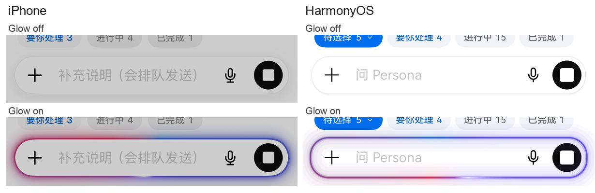

# Native keyboard and reply appearance

The three captures use the iPhone source `c2d44cc1` and HarmonyOS source `a3202069` on 402-point / 402-vp phones. Each image excerpt comes from a 1206 × 2622 native screenshot. The earlier HarmonyOS capture used `7ef860f4` and set the application appearance. Its system setting was unrecorded. An independent HarmonyOS SDK reader checked the system appearance before and after each new capture.

| Appearance | iPhone chat / New Agent | Earlier HarmonyOS | HarmonyOS with verified system mode |
| --- | ---: | ---: | ---: |
| [Light](keyboard-light.png) | 255 / 255 | 253 / 253 | 253 / 255 |
| [Dark](keyboard-dark.png) | 68 / 70 | 252 / 252 | 100 / 100 |
| [Largest text](keyboard-large.png) | 255 / 255 | 253 / 253 | 253 / 253 |

Each number is the median RGB mean in the same native keyboard region, on a 0–255 scale. In verified system dark mode the remaining difference is 32 levels for the composer and 30 for New Agent. The six HarmonyOS input scenes posted zero messages and started zero Agents.

## Reply glow and Return

Both options start off. Enabling them survives a cold restart. A working Persona assistant rendered the reply rim in all three appearances. An idle assistant and a working ordinary Agent remained unlit. The four measured rim edges differed by 0.5–1.0 physical pixel. Two captured animation frames changed 85,942 pixels on iPhone and 7,303 on HarmonyOS under the same comparison threshold.

Tapping the native software Return key sent one message to each intended synthetic recipient. A pending Pinyin candidate stayed unsent. Selecting the candidate and pressing Return delivered once. Direct English Return sent once. Shift-Return, Option-Return and the expanded editor retained a line break. An unfocused composer stayed unsent. Hardware-style events were injected into the native emulator. A physical keyboard was unavailable.

The isolated component test held the glow steady when supplied the Reduce Motion signal. The HVD transition-animation switch did not change the platform signal. The system rendered secure screenshot content as opaque black, so the optional Persona screenshot-branding switch stays hidden on this renderer.

[Native source and image checksums](manifest.json) · [File checksums](SHA256SUMS)
