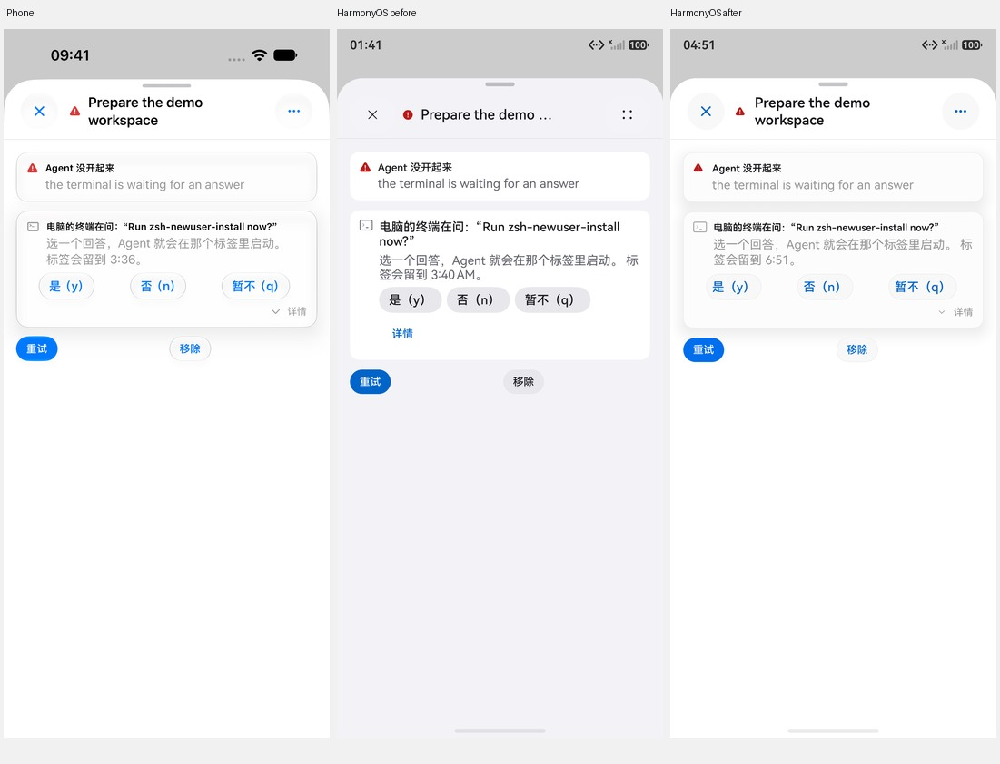
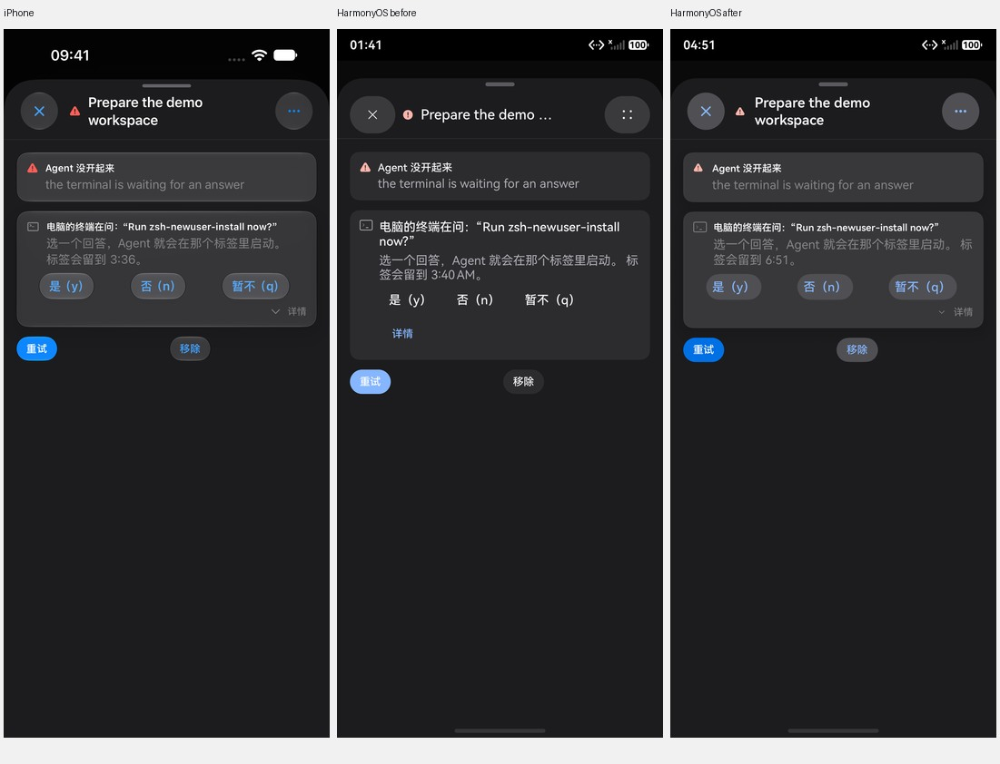
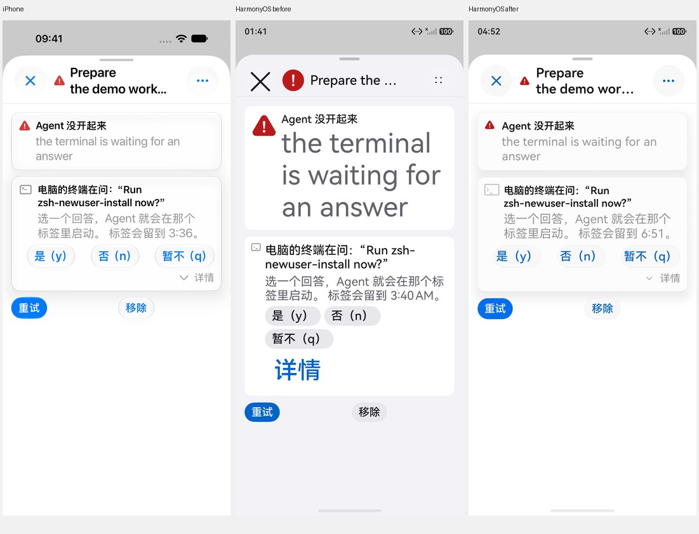

# Starting a task that asks a terminal question

**At the largest text size, iPhone displays “the demo work…” and HarmonyOS displays “the demo wor…”.** Both native accessibility trees retain the full title “Prepare the demo workspace”. The available title widths are 176.9 pt and 177 vp. Measurements with the two system fonts reproduced the one-letter difference. The full title fits in two lines at standard light and dark sizes. [Headline images and measurement notes](HEADLINE.md) · [Per-image metrics and full hashes](title-font-metrics.json)

Open the task from the Assistant board, read the startup question, choose one of the displayed answers, then return from the newly started Agent to the original conversation. Both native apps performed that sequence against the same official synthetic Hub fixture. The Hub received precisely one answer from each app.

The iPhone reference is `23b51faebb29`. The earlier HarmonyOS build is `4f0d1afb6ee2`, and the updated HarmonyOS build is `e55ccf7e3919`. All original screenshots are 1206 × 2622 pixels. The displayed deadline is calculated at the time of each independent run.

## Light

[iPhone original](light-iphone.png) · [HarmonyOS before original](light-before.png) · [HarmonyOS after original](light-after.png)

## Dark

[iPhone original](dark-iphone.png) · [HarmonyOS before original](dark-before.png) · [HarmonyOS after original](dark-after.png)

## Largest text

[iPhone original](large-iphone.png) · [HarmonyOS before original](large-before.png) · [HarmonyOS after original](large-after.png)

The [measurement record](manifest.json) identifies the original images, their accessibility-tree digests, the action sent to the Hub and the native element rectangles.
