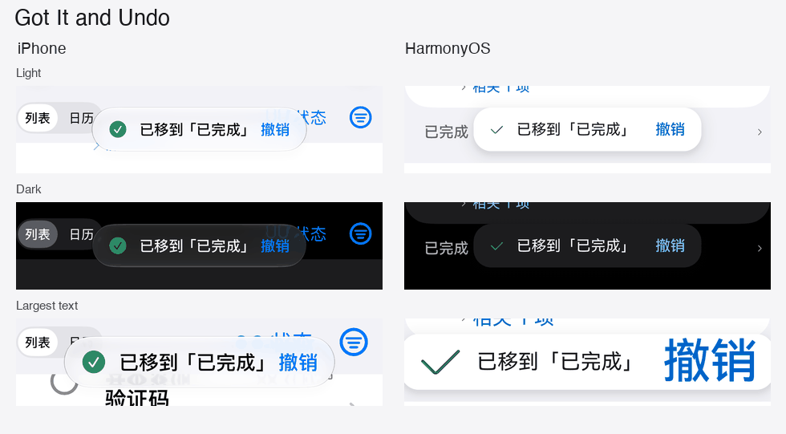

# Got It and Undo in the native to-do list

The iPhone application at `c2d44cc1406c` and the HarmonyOS application at `42e99af326fc` each filed the synthetic “博客迁移到 Astro” task and undid the action in three appearances. Both used the same isolated service. Each pair produced one `PUT` and one `DELETE` to the task’s seen endpoint, for twelve writes in total.

| Appearance | Native moment | iPhone screenshot | HarmonyOS screenshot | Application control excerpts |
| --- | --- | --- | --- | --- |
| Light | Before Got It | [iPhone](originals/iphone/light/list.png) | [HarmonyOS](originals/harmonyos/light/list.png) | [iOS](accessibility/iphone/light/list.json) · [HarmonyOS](accessibility/harmonyos/light/list.json) |
| Light | Undo available | [iPhone](originals/iphone/light/filed.png) | [HarmonyOS](originals/harmonyos/light/filed.png) | [iOS](accessibility/iphone/light/filed.json) · [HarmonyOS](accessibility/harmonyos/light/filed.json) |
| Light | After Undo | [iPhone](originals/iphone/light/undo.png) | [HarmonyOS](originals/harmonyos/light/undo.png) | [iOS](accessibility/iphone/light/undo.json) · [HarmonyOS](accessibility/harmonyos/light/undo.json) |
| Dark | Before Got It | [iPhone](originals/iphone/dark/list.png) | [HarmonyOS](originals/harmonyos/dark/list.png) | [iOS](accessibility/iphone/dark/list.json) · [HarmonyOS](accessibility/harmonyos/dark/list.json) |
| Dark | Undo available | [iPhone](originals/iphone/dark/filed.png) | [HarmonyOS](originals/harmonyos/dark/filed.png) | [iOS](accessibility/iphone/dark/filed.json) · [HarmonyOS](accessibility/harmonyos/dark/filed.json) |
| Dark | After Undo | [iPhone](originals/iphone/dark/undo.png) | [HarmonyOS](originals/harmonyos/dark/undo.png) | [iOS](accessibility/iphone/dark/undo.json) · [HarmonyOS](accessibility/harmonyos/dark/undo.json) |
| Large | Before Got It | [iPhone](originals/iphone/large/list.png) | [HarmonyOS](originals/harmonyos/large/list.png) | [iOS](accessibility/iphone/large/list.json) · [HarmonyOS](accessibility/harmonyos/large/list.json) |
| Large | Undo available | [iPhone](originals/iphone/large/filed.png) | [HarmonyOS](originals/harmonyos/large/filed.png) | [iOS](accessibility/iphone/large/filed.json) · [HarmonyOS](accessibility/harmonyos/large/filed.json) |
| Large | After Undo | [iPhone](originals/iphone/large/undo.png) | [HarmonyOS](originals/harmonyos/large/undo.png) | [iOS](accessibility/iphone/large/undo.json) · [HarmonyOS](accessibility/harmonyos/large/undo.json) |

All eighteen screenshots retain their original bytes at 1206 × 2622 pixels. The controls are excerpts from the native accessibility trees. Each excerpt and screenshot has its own digest. [Capture manifest](manifest.json) · [All file digests](SHA256SUMS)

## Visible differences in this revision

The iPhone status for the blog task reads “完成未看”. This HarmonyOS revision shows “检查中”. Both lists promote the related `todo_blog` row after filing `todo_task_blog`. The HarmonyOS control tree still gives that replacement row’s button the previous task ID. The iPhone control tree gives it `todo_blog`. The largest-text iPhone capture also clips part of the capsule at the bottom of the screen. The actions and the resulting writes are recorded for all three appearances.
